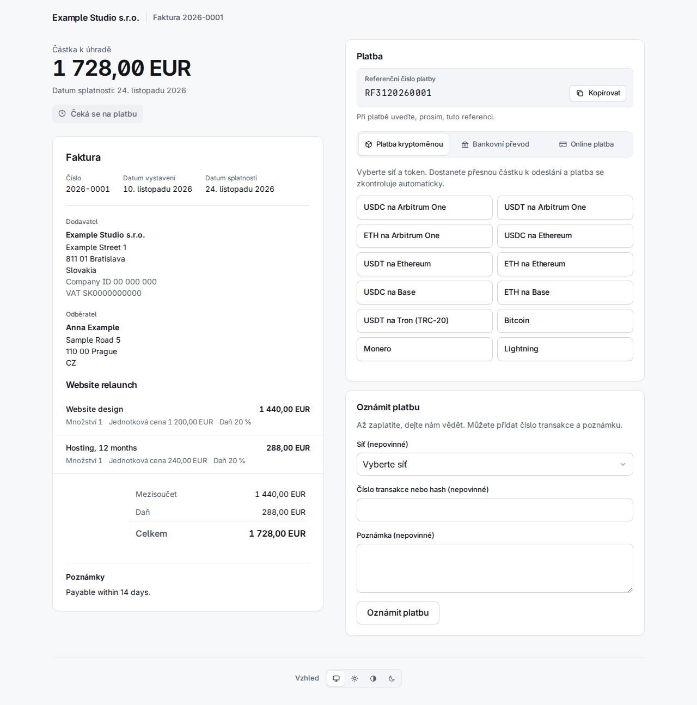

# 4. Faktury

**Invoices** v pruhu vlevo je vypisuje od nejnovějších, s filtrem podle stavu a organizace a hledáním podle čísla nebo externí reference.

Faktura má jeden z těchto stavů:

| Stav | Význam |
|---|---|
| `draft` | Neodeslaná. Nemá číslo a lze ji upravit nebo smazat. |
| `sent` | Očíslovaná a s odkazy; čeká na peníze. |
| `overdue` | Odeslaná a splatnost uplynula (stav mění worker). |
| `declared` | Klient stiskl „Oznámit platbu". To je tvrzení, ne peníze. |
| `partially_paid` | Potvrzené platby pokrývají část částky. |
| `paid` | Potvrzené platby pokrývají celou částku. |
| `overpaid` | Potvrzené platby přesahují částku. |
| `void` | Stornovaná; už ji nelze zaplatit. |

Počítají se jen **potvrzené** platby. Odeslanou fakturu už nelze upravit: její obsah se zmrazí v okamžiku odeslání včetně dodavatele, odběratele a platebních údajů, takže pozdější změna kontaktu nebo účtu nikdy nezmění fakturu, kterou už klient má.

## Vytvoření faktury

**New invoice** se ptá, kdo, co a jak se má platit. Nic se neodešle, dokud nestisknete Send na konceptu.

- **Requesting organization** a **Type**: *Invoice* dostane číslo z číslování organizace; *Payment request* (žádost o platbu) nemá číslo a není právním dokladem faktury.
- **Contact e-mail**: existující kontakt se najde podle něj, jinak se z polí níže vytvoří nový. Na **US tax resident** (yes, no nebo unknown) odpovězte vědomě; „Choose…" se nepřijme. Odpověď yes pošle fakturu vystavovateli pro USA (kapitola 2): stránka pak hlásí „Issued by …".
- **Currency**, **Issue date**, **Due in (days)** (prázdné: splatné při přijetí), **Title** a **Notes** (tisknou se na faktuře).
- **Lines**: název, volitelný popis, množství, jednotková cena v hlavních jednotkách (`12.50`), daň % a sleva %. Prázdné řádky se ignorují.
- **Payment methods**: zaškrtnutá je každá aktivní metoda vystavovatele, která se hodí k měně: jeho bankovní účty v této měně, jeho fiat odkazy, které ji přijímají, a všechny jeho platební kanály (kurzová nabídka přepočte, takže funguje jakákoli měna). Co nechcete nabízet, odškrtněte.

**Create draft** jej uloží. Stránka konceptu ukazuje položky a součty, má **Edit this draft** a **Delete draft** a políčko, které jej odešle.

## Odeslání

**Send** fakturu očísluje, zmrazí a vytvoří dva **odkazy s oprávněním** (capability links): jeden k zobrazení (`/i/…`) a jeden k zaplacení (`/p/…`). Jsou to tajemství: ukládají se jen jako hashe a zobrazí se pouze jednou.

- Se zaškrtnutým **E-mail the client when sent** se e-mail s fakturou zařadí do odchozí pošty (odešle jej worker, v jazyce kontaktu, s PDF v příloze) a nese oba odkazy. Má-li kontakt aktivní šifrovací klíč, e-mail se na něj zašifruje.
- **Bez** zaškrtnutí se nic neodešle a odkazy předáte sami. Abyste je viděli, otevřete fakturu, **More actions > Reissue the client links** (níže): stránka ukáže dva odkazy jednou.

## Co vidí klient

**Stránka faktury** `/i/…` ukazuje doklad, PDF ke stažení a **Dostávat šifrované e-maily** (kapitola 3). **Platební stránka** `/p/…` ukazuje splatnou částku a způsoby platby. Je v jazyce kontaktu nebo prohlížeče.

Platební okno má až tři záložky, **krypto první**:

- **Platba kryptoměnou**: klient vybere síť a token, např. „USDC on Arbitrum One".
- **Bankovní převod**: bankovní účet v měně faktury (příjemce, číslo účtu, banka, částka, každé s tlačítkem kopírování), **referenční číslo platby** (reference ISO 11649, např. `RF3120260001`) a vaše pokyny v jazyce klienta. U EUR na IBAN země SEPA přibudou tři QR kódy (PAY by square, QR Platba a EPC QR), u CZK na český IBAN kód QR Platba: klient jeden naskenuje v bankovní aplikaci a účet, zbývající částka i reference se vyplní samy. Stejné kódy jsou vytištěny i na PDF faktuře.
- **Online platba**: fiat odkazy (Revolut, PayPal apod.).

Pokryto je všech devět jazyků: táž stránka česky, slovensky, německy, španělsky, francouzsky, polsky, korejsky a rusky je na konci této kapitoly.

### Kurzové nabídky a směnné kurzy

Klient v kryptoměně neplatí „částku faktury": platí **kurzovou nabídku** (quote).

- Výběrem sítě a tokenu se zafixuje směnný kurz a zobrazí se **přesná částka** k odeslání, adresa, QR kód a odkaz „Open in wallet". Částka se zaokrouhluje **nahoru**, nikdy na méně.
- Nabídka platí asi **30 minut**; stránka odpočítává a **Získat novou částku** vydá další.
- Na sdílené adrese nese částka pár jednotek „prachu", **jedinečných pro každou nabídku**. Tak se platba páruje s fakturou, proto musí klient poslat přesně tuto částku v tomto tokenu v této síti.
- Kurzy pocházejí ze dvou zdrojů, které se křížově kontrolují (Kraken a Coinbase); liší-li se o víc než 1 %, nabídka se nevytvoří. Krok z EUR na jiné fiat měny používá kurzy ECB přes Frankfurter; zastaralý nebo náhle skočivší kurz odmítne nabídky v dané měně a zobrazí se v Needs a person v části *Exchange rates refused*, kde člověk může přijmout skok, který je skutečný.
- Stránka se aktualizuje sama, když se převod zaznamená. Worker sleduje blockchain; platby přes Lightning a BTCPay se čtou z jejich brány.

Pole **Oznámit platbu** umožňuje klientovi nahlásit platbu (síť, hash transakce a poznámku, vše volitelné). Faktura se stane `declared` a objeví se v Needs a person; zadaný hash se vyhledá na blockchainu. Prohlášení je tvrzení, ne peníze: samo nic nevyrovná. E-mail přijde zaměstnancům jen tehdy, když je třeba jednat: hned, když tvrzení může ověřit jen člověk (bez hashe nebo na síti, kterou systém nečte), nebo když peníze z uvedené transakce patří jiné faktuře, a po půl hodině, když se hash nenašel. Hash, jehož peníze patří této faktuře, e-mail nepošle: platba se vyrovná sama, nebo jde ke kontrole, o které přijde vlastní e-mail.

## Ruční zaznamenání platby

Bankovní převod nebo online platba dorazí tam, kam Sealbill nevidí. Když peníze uvidíte **vy**, otevřete fakturu a stiskněte **Record payment**: částka, způsob (*Bank transfer*, *Payment link* nebo *Recorded by hand*) a poznámka. Platba je okamžitě potvrzena a započítána. Může to udělat jen člověk; žádný API token ne.

Nesprávně zaznamenaná nebo vrácená platba se zruší tlačítkem **Reverse** na jejím řádku, které vyžaduje důvod.

## Částečné platby a přeplatky

**Částečná.** Pokrývají-li potvrzené platby jen část částky, faktura se stane `partially_paid`. Klient dostane e-mail, který říká, co dorazilo a co zbývá zaplatit, a platební stránka nabízí nabídky na **zbytek**. Částečně zaplacenou fakturu nelze stornovat.

**Přeplatek.** Faktura může být přeplacena dvěma způsoby a oba skončí před člověkem (kapitola 6):

- *Zaznamenalo se víc peněz, než je částka* (bankovní převod nebo platba, kterou jste zaznamenali ručně): faktura je `overpaid` a je ve frontě **Overpaid invoices**. Rozdíl vraťte mimo systém, nebo stiskněte **Keep the overpayment** a napište proč. Faktura zůstane `overpaid`, což vyjadřuje stav peněz; rozhodnutí, částka, kterou pokrývá, a vaše poznámka jdou do audit logu a položka opustí frontu, dokud nepřijdou další peníze.

  

- *Krypto platba nad kurzovou nabídku*: faktura je zaplacena a platba dostane **refund due**, zobrazený ve frontě **Refunds due** s částkou a adresou, ze které přišla. Až ji pošlete zpět nebo rozhodnete, že ne, stiskněte **Refunded** s poznámkou. Platba daleko nad nabídkou (nad *Overpayment ceiling* organizace) se neuhradí vůbec: čeká v **Payments to review**.

  

## Storno

**More actions** (tři tečky) má **Void invoice** s povinným důvodem. Stornovanou fakturu už nelze zaplatit: její otevřené nabídky a otevřená prohlášení se zavřou a stránka klienta hlásí, že je stornovaná. Odmítne se, dokud se platba potvrzuje, a když už byly potvrzeny peníze (nejprve platbu zrušte); fakturu `paid`, `partially_paid` nebo `overpaid` stornovat nelze. Peníze, které později přesto přijdou na stornovanou fakturu, se neztratí: skončí v **Payments to review** s důvodem „The invoice was already closed when the payment arrived."

## Nové odkazy

Klient ztratil e-mail nebo jste odeslali bez e-mailu a odkazy potřebujete: **More actions > Reissue the client links**.

Opětovné vydání **nahradí oba odkazy**: staré přestanou fungovat, i ty, které už jsou v klientově schránce, a e-maily ještě neodeslané se starými odkazy se zruší. Zaškrtnutím **E-mail the new links to the client** zařadíte e-mail; jinak stránka ukáže dva nové odkazy **jednou** a napíše „Nothing was e-mailed: pass these on yourself." Koncept ani stornovaná faktura nové odkazy mít nemohou. Událost webhooku `invoice.links_reissued` oznámí integraci, která uložila staré odkazy, že jsou mrtvé.

## Připomínka po 30 dnech

Pokud systém odeslal e-mail s fakturou a faktura je 30 dní po odeslání stále nezaplacená (`sent`, `overdue` nebo `partially_paid`), worker pošle **jednu** připomínku, jednou. Připomínka **nahradí oba odkazy**, jako výše.

- Počet dní nastavuje `INVOICE_REMINDER_DAYS`; `0` připomínku vypne.
- Přeskočí se u faktury odeslané bez e-mailu, u faktury odeslané přes API s `client_letters: false`, u každé objednávky z platebního odkazu, u faktury `declared`, u faktury s otevřenou nabídkou nebo zaznamenanou či posuzovanou platbou, u amerického daňového rezidenta u vystavovatele mimo USA (taková faktura je ve frontě „wrong issuer") a u kontaktu, jehož šifrovací klíč selhal. Přeskočená faktura se posoudí znovu při dalším běhu.
- Úloha běží při startu workeru a pak každých 24 hodin, takže worker, který byl vypnutý, dožene vše, co splňuje podmínky, ať je faktura jakkoli stará. Je-li při startu trezor zapečetěný, neudělá nic a zkusí to za 24 hodin.

## Táž stránka v devíti jazycích

Každý jazyk ukazuje stránku faktury a platební stránku ukázkové faktury. Vlastní text faktury (položky, poznámky) je v jazyce, v jakém jste jej napsali; rámec okolo je přeložen.

| | Stránka faktury | Platební stránka |
|---|---|---|
| English | [obrázek](../img/portal-invoice-en.png) | [obrázek](../img/portal-pay-en.png) |
| Slovenčina | [obrázek](../img/portal-invoice-sk.png) | [obrázek](../img/portal-pay-sk.png) |
| Čeština | [obrázek](../img/portal-invoice-cs.png) | [obrázek](../img/portal-pay-cs.png) |
| Deutsch | [obrázek](../img/portal-invoice-de.png) | [obrázek](../img/portal-pay-de.png) |
| Español | [obrázek](../img/portal-invoice-es.png) | [obrázek](../img/portal-pay-es.png) |
| Français | [obrázek](../img/portal-invoice-fr.png) | [obrázek](../img/portal-pay-fr.png) |
| Polski | [obrázek](../img/portal-invoice-pl.png) | [obrázek](../img/portal-pay-pl.png) |
| 한국어 | [obrázek](../img/portal-invoice-ko.png) | [obrázek](../img/portal-pay-ko.png) |
| Русский | [obrázek](../img/portal-invoice-ru.png) | [obrázek](../img/portal-pay-ru.png) |

Faktury v jiných stavech vypadají pro klienta takto:

