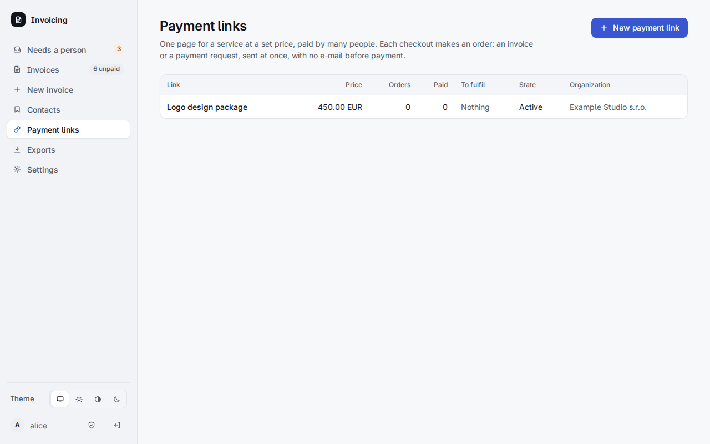
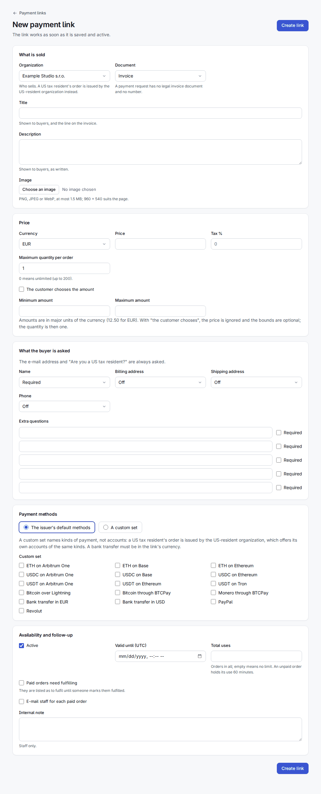
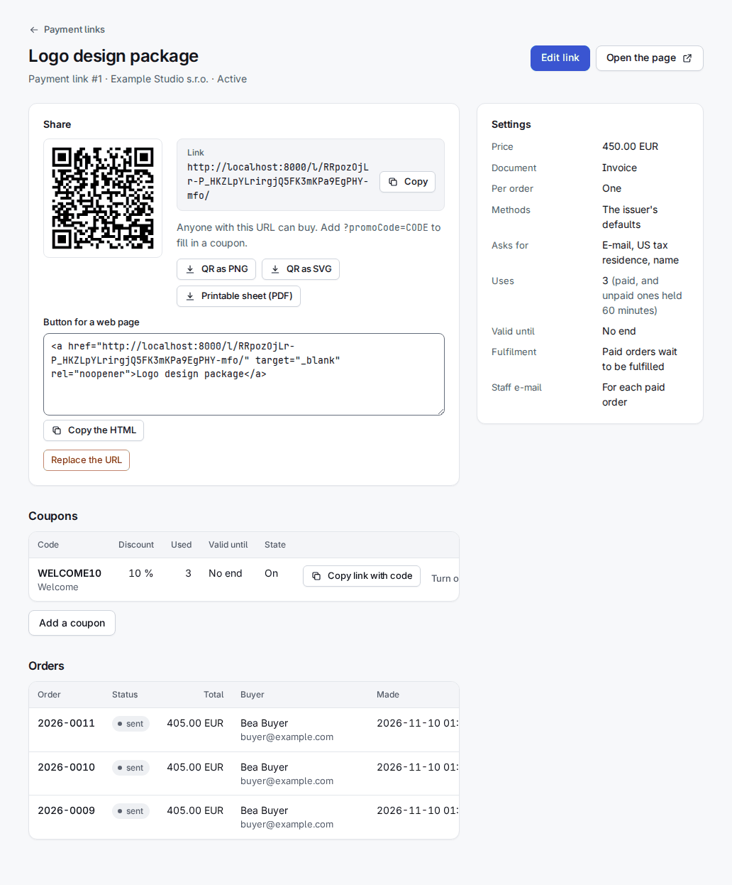
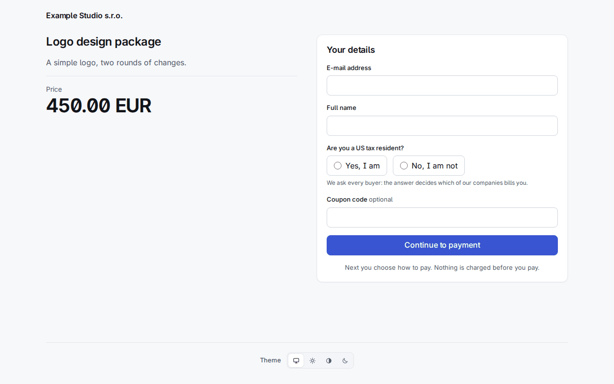
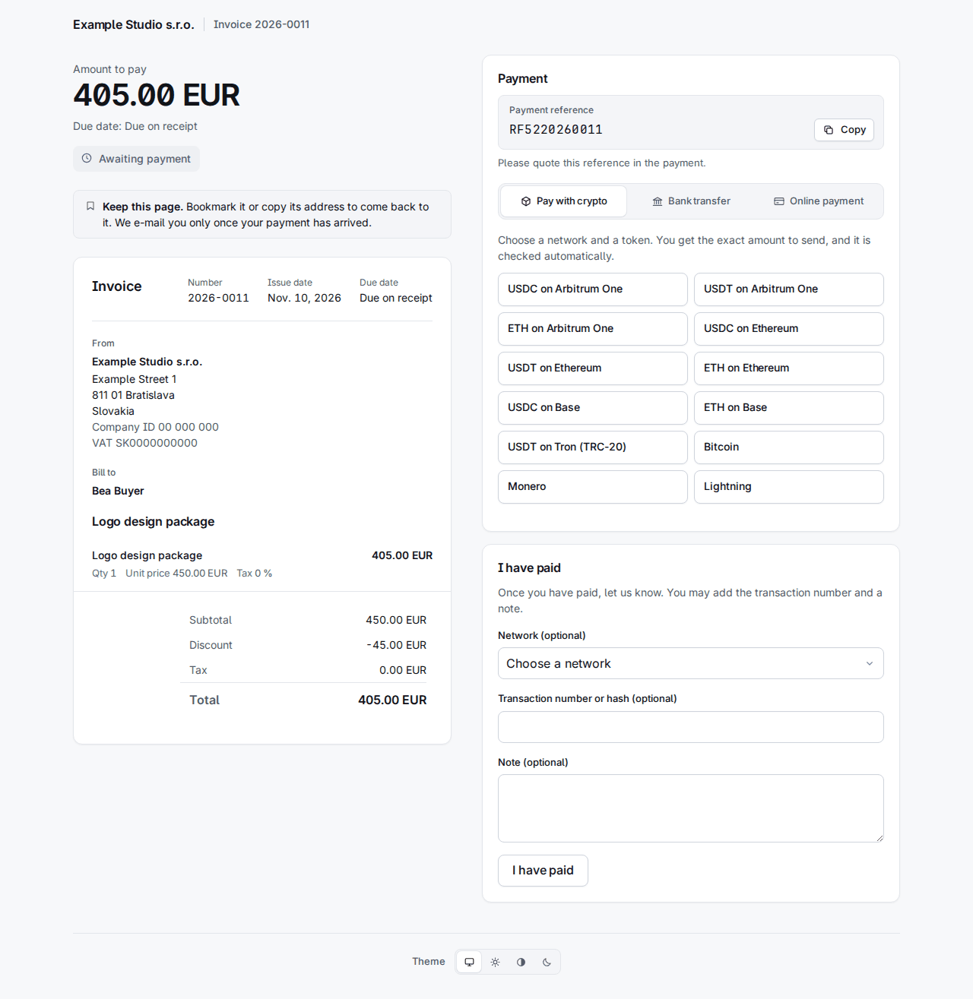
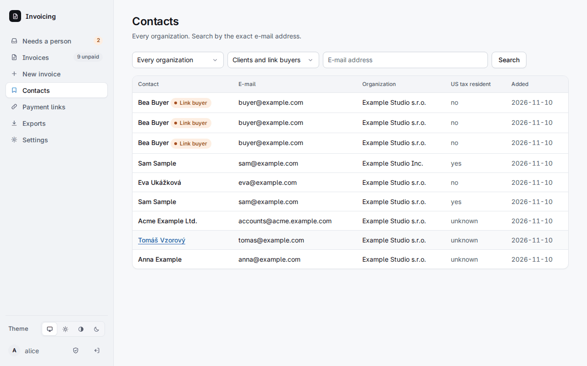

# 5. Platební odkazy

**Platební odkaz** je jedna stránka `/l/<token>/` pro službu za pevnou cenu (nebo za částku, kterou si kupující zvolí), kterou platí mnoho lidí: tlačítko v obchodě, QR kód na plakátu, odkaz v newsletteru. Otevřete **Payment links** v pruhu vlevo.

(Nejsou to *fiat odkazy* organizace z kapitoly 2, které jen ukazují na Revolut, PayPal a podobné.)

## Vytvoření odkazu

**New payment link** se ptá na:

- **What is sold**: organizaci, která prodává, doklad (*Invoice* nebo *Payment request*), název a popis zobrazené kupujícím a volitelný obrázek (PNG, JPEG nebo WebP do 1,5 MB, překódovaný; 960 × 540 sedí stránce).
- **Price**: měnu, cenu a daň %, **Maximum quantity per order** (0 znamená neomezeně, nejvýše 200), nebo zaškrtněte **The customer chooses the amount** s volitelným minimem a maximem.
- **What the buyer is asked**: e-mailová adresa a „Are you a US tax resident?" se ptají **vždy**; jméno, fakturační adresa, doručovací adresa a telefon mohou být off, optional nebo required; až pět vlastních otázek.
- **Payment methods**: výchozí metody vystavovatele nebo **vlastní množina**, např. „USDC on Arbitrum One", „Bank transfer in EUR" nebo „Bitcoin over Lightning". Vlastní množina pojmenovává druhy platby, ne účty, takže vystavovatel pro USA nabízí vlastní účty stejných druhů.
- **Availability**: active, *Valid until*, *Total uses*, **Paid orders need fulfilling** a **E-mail staff for each paid order** a interní poznámka, kterou vidí jen zaměstnanci.

Odkaz funguje hned, jakmile je uložen a aktivní.

## Sdílení

Stránka odkazu ukazuje URL s tlačítkem **Copy**, **QR kód** (PNG nebo SVG), **tisknutelný list** (PDF), HTML **tlačítka pro webovou stránku** a **Replace the URL**, které dá novou adresu a starou okamžitě zastaví. Koupit může každý, kdo má URL; připojením `?promoCode=CODE` se vyplní kupón.

**Kupóny**: kód, procentuální sleva z řádku (před daní, nikdy ne objednávka zdarma), volitelně počet použití a datum konce. **Copy link with code** dá URL, která jej vyplní.

## Co vidí kupující

Kupující napíše e-mailovou adresu, jméno pokud se ptá, odpoví na otázku o USA a pokračuje k platbě. Stránka, na kterou se dostane, je běžná **platební stránka** z kapitoly 4.

- Každý checkout vytvoří **objednávku**: fakturu nebo žádost o platbu s jednou položkou, očíslovanou a hned odeslanou, se zmrazeným snímkem. **Před platbou se neodesílá žádný e-mail**; platební stránka říká, abyste si ji uschovali. První e-mail je potvrzení platby nebo e-mail o částečné platbě a nese odkazy objednávky.
- **Američtí daňoví rezidenti.** Odpověď, kterou kupující napsal, rozhoduje, která organizace objednávku vystaví: yes vystavovateli pro USA, no organizaci odkazu. To, co kontakt ukládá, nikdy nerozhoduje, takže veřejný odkaz neprozradí nic uloženého. Zadaná odpověď, které uložený příznak odporuje, se stane položkou v Needs a person a u „no" proti uloženému „yes" se objednávka nenabídne k vyřízení, dokud člověk neověří kupujícího.
- **Veřejný formulář nikdy neukáže ani nezmění kontakt.** Adresa, která odpovídá klientovi v evidenci, přiřadí objednávku tomuto klientovi. Jinak se z napsaných údajů vytvoří *link buyer*. Link buyers jsou v Contacts s filtrem, nenajde je žádné vyhledávání a nic je znovu nepoužije; člověk z nich po ověření může udělat klienta v evidenci na jeho stránce.

  

## Objednávky, použití a limity

- Checkout **drží** jedno použití odkazu (a kupónu) 60 minut; platba z něj udělá použití. Platba, která přijde po vypršení držení, si zachová cenu; pokud tím odkaz nebo kupón s limitem překročí limit, zaměstnanci dostanou jednu položku v Needs a person.
- **Nezaplacené objednávky se po 7 dnech stornují.** Peníze, které přijdou později, jdou k posouzení, jako u každé stornované faktury.
- **Vyřízení.** Je-li zapnuto *Paid orders need fulfilling*, zaplacené objednávky jsou na stránce odkazu vedeny jako k vyřízení, dokud někdo nestiskne **Mark fulfilled**.
- **Limity**: 5 pokusů o checkout za 10 minut na adresu a 50 dokončených checkoutů za hodinu na odkaz. Odkaz nemůže vložit do rámu žádná stránka.
- Vytvoření nebo úprava odkazu přes API je `invoices:write`; URL odkazu se vydává při vytvoření, při rotaci a když jeden odkaz čte token, který má i `invoices:write` (samotný `read` dostane null).
