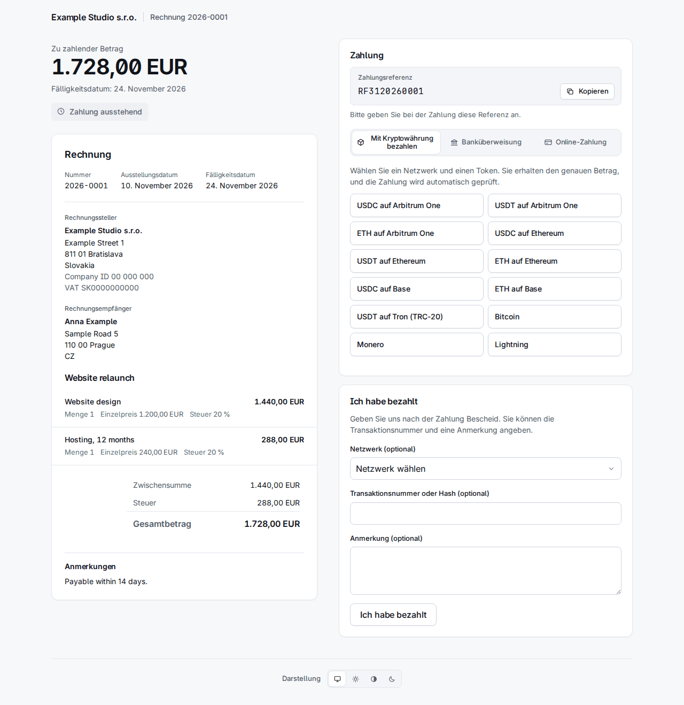

# 4. Rechnungen

**Invoices** in der Leiste listet sie mit der neuesten zuerst auf, mit einem Filter je Status und je Organisation und einer Suche nach Nummer oder externer Referenz.

Eine Rechnung hat einen dieser Status:

| Status | Bedeutung |
|---|---|
| `draft` | Nicht gesendet. Sie hat keine Nummer und lässt sich noch bearbeiten oder löschen. |
| `sent` | Nummeriert und mit ihren Links; wartet auf Geld. |
| `overdue` | Gesendet, und das Fälligkeitsdatum ist verstrichen (der Worker setzt das). |
| `declared` | Der Kunde hat „Ich habe bezahlt" gedrückt. Das ist eine Behauptung, kein Geld. |
| `partially_paid` | Bestätigte Zahlungen decken einen Teil der Summe. |
| `paid` | Bestätigte Zahlungen decken die Summe. |
| `overpaid` | Bestätigte Zahlungen übersteigen die Summe. |
| `void` | Storniert; sie kann nicht mehr bezahlt werden. |

Es zählen nur **bestätigte** Zahlungen. Eine gesendete Rechnung lässt sich nicht mehr bearbeiten: Was sie sagt, wird im Moment des Sendens eingefroren, einschließlich Rechnungssteller, Rechnungsempfänger und Zahlungsangaben, sodass eine spätere Änderung an einem Kontakt oder Konto nie eine Rechnung verändert, die der Kunde schon in Händen hat.

## Eine Rechnung erstellen

**New invoice** fragt, wer, was und wie bezahlt werden soll. Nichts wird gesendet, bevor Sie auf dem Entwurf Send drücken.

- **Requesting organization** und **Type**: Eine *Invoice* bekommt eine Nummer aus der Nummerierung der Organisation; eine *Payment request* (Zahlungsaufforderung) hat keine Nummer und ist kein Rechnungsdokument im rechtlichen Sinn.
- **Contact e-mail**: Ein bestehender Kontakt wird darüber gefunden, sonst wird aus den Feldern darunter ein neuer angelegt. Beantworten Sie **US tax resident** (yes, no oder unknown) bewusst; „Choose…" wird nicht akzeptiert. Ein yes schickt die Rechnung an den US-Issuer (Kapitel 2): Die Seite sagt dann „Issued by …".
- **Currency**, **Issue date**, **Due in (days)** (leer: bei Erhalt fällig), **Title** und **Notes** (auf der Rechnung gedruckt).
- **Lines**: Name, optionale Beschreibung, Menge, Einzelpreis in Hauptwährungseinheiten (`12.50`), Steuer % und Rabatt %. Leere Zeilen werden ignoriert.
- **Payment methods**: Jede aktive Methode des Issuers, die zur Währung passt, ist angehakt: seine Bankkonten in dieser Währung, seine Fiat-Links, die sie annehmen, und alle seine Rail-Konten (ein Kursangebot rechnet um, jede Währung funktioniert also). Haken Sie ab, was Sie nicht anbieten wollen.

**Create draft** speichert sie. Die Entwurfsseite zeigt die Positionen und Summen, hat **Edit this draft** und **Delete draft** und das Feld, das sie sendet.

## Senden

**Send** nummeriert die Rechnung, friert sie ein und erzeugt zwei **Berechtigungs-Links** (capability links): einen zum Ansehen (`/i/…`) und einen zum Bezahlen (`/p/…`). Sie sind Geheimnisse: Sie werden nur als Hashes gespeichert und nur einmal angezeigt.

- Bei angehaktem **E-mail the client when sent** wird der Rechnungsbrief in den Postausgang gestellt (der Worker sendet ihn, in der Sprache des Kontakts, mit dem PDF im Anhang) und enthält beide Links. Hat der Kontakt einen aktiven Verschlüsselungsschlüssel, wird der Brief daran verschlüsselt.
- **Ohne** Haken wird nichts gesendet, und Sie geben die Links selbst weiter. Um sie zu sehen, öffnen Sie die Rechnung, **More actions > Reissue the client links** (unten): Die Seite zeigt die beiden Links einmal.

## Was der Kunde sieht

Die **Rechnungsseite** `/i/…` zeigt das Dokument, ein PDF zum Herunterladen und **Verschlüsselte E-Mails erhalten** (Kapitel 3). Die **Zahlungsseite** `/p/…` zeigt den fälligen Betrag und die Zahlungswege. Sie ist in der Sprache des Kontakts oder des Browsers.

Der Zahlungsbereich hat bis zu drei Reiter, **Krypto zuerst**:

- **Mit Kryptowährung bezahlen**: Der Kunde wählt ein Netzwerk und einen Token, zum Beispiel „USDC on Arbitrum One".
- **Banküberweisung**: das Bankkonto der Rechnungswährung (Begünstigter, Kontonummer, Bank, Betrag, jeweils mit Kopierschaltfläche), die **Zahlungsreferenz** (eine ISO-11649-Referenz wie `RF3120260001`) und Ihre Hinweise in der Sprache des Kunden. Bei EUR an die IBAN eines SEPA-Landes kommen vier QR-Codes hinzu (PAY by square, payme, QR Platba und EPC-QR), bei CZK an eine tschechische IBAN der QR-Platba-Code: Der Kunde scannt einen davon in seiner Banking-App, und Konto, offener Betrag und Referenz sind ausgefüllt. Auf dem Handy, wo es nichts zu scannen gibt, tippt der Kunde stattdessen auf **In der Banking-App öffnen (payme)**, und eine slowakische Banking-App öffnet sich mit ausgefüllter Überweisung. Die PDF-Rechnung druckt dieselben Codes, und ihr payme-Code ist zugleich ein Link.
- **Online-Zahlung**: die Fiat-Links (Revolut, PayPal und so weiter).

Alle neun Sprachen sind abgedeckt: Dieselbe Seite auf Slowakisch, Tschechisch, Deutsch, Spanisch, Französisch, Polnisch, Koreanisch und Russisch steht am Ende dieses Kapitels.

### Kursangebote und Wechselkurse

Ein Kunde zahlt in Krypto nicht „den Rechnungsbetrag": Er zahlt ein **Kursangebot** (quote).

- Die Wahl von Netzwerk und Token legt den Wechselkurs fest und zeigt den **genauen Betrag** zum Senden, die Adresse, einen QR-Code und einen Link „Open in wallet". Der Betrag wird **aufgerundet**, nie zu knapp.
- Das Angebot gilt etwa **30 Minuten**; die Seite zählt herunter, und **Neuen Betrag anfordern** stellt ein neues aus.
- Auf einer gemeinsam genutzten Adresse trägt der Betrag einige Einheiten „Staub", die **pro Angebot eindeutig** sind. So wird die Zahlung der Rechnung zugeordnet; der Kunde muss also genau diesen Betrag in diesem Token auf diesem Netzwerk senden.
- Die Kurse stammen aus zwei Quellen, die gegeneinander geprüft werden (Kraken und Coinbase); weichen sie um mehr als 1 % ab, wird kein Angebot erstellt. Der Schritt von EUR zu anderen Fiat-Währungen nutzt die Kurse der EZB über Frankfurter; ein veralteter oder plötzlich springender Kurs lässt Angebote in dieser Währung ablehnen und erscheint in Needs a person unter *Exchange rates refused*, wo ein Mensch einen Sprung akzeptieren kann, der echt ist.
- Die Seite aktualisiert sich selbst, wenn die Überweisung gesehen wird. Der Worker beobachtet die Chain; Lightning- und BTCPay-Zahlungen werden von ihrem Gateway gelesen.

Mit dem Feld **Ich habe bezahlt** kann ein Kunde eine Zahlung melden (Netzwerk, Transaktions-Hash und eine Notiz, alles optional). Die Rechnung wird `declared` und erscheint in Needs a person; ein angegebener Hash wird auf der Chain nachgeschlagen. Eine Erklärung ist eine Behauptung, nie Geld: Sie begleicht von sich aus nichts. Mitarbeitende bekommen nur dann eine E-Mail, wenn sie handeln müssen: sofort, wenn nur ein Mensch die Behauptung prüfen kann (kein Hash oder ein Netzwerk, das das System nicht liest) oder wenn das Geld der genannten Transaktion an eine andere Rechnung ging, und nach einer halben Stunde, wenn der Hash nicht gefunden wurde. Ein Hash, dessen Geld zu dieser Rechnung gehört, schickt keine E-Mail: Die Zahlung begleicht sich selbst oder geht in die Prüfung, zu der eine eigene E-Mail kommt.

## Eine Zahlung von Hand erfassen

Eine Banküberweisung oder Online-Zahlung kommt dort an, wo Sealbill nicht hinsieht. Sehen **Sie** das Geld, öffnen Sie die Rechnung und drücken **Record payment**: den Betrag, die Art (*Bank transfer*, *Payment link* oder *Recorded by hand*) und eine Notiz. Sie ist sofort bestätigt und wird gezählt. Das kann nur ein Mensch; kein API-Token kann es.

Eine falsch erfasste oder zurückgegebene Zahlung machen Sie mit **Reverse** in ihrer Zeile rückgängig; dafür ist ein Grund nötig.

## Teilzahlungen und Überzahlungen

**Teilzahlung.** Decken bestätigte Zahlungen nur einen Teil der Summe, wird die Rechnung `partially_paid`. Der Kunde bekommt einen Brief, der sagt, was eingegangen ist und was noch aussteht, und die Zahlungsseite bietet Angebote für den **Rest**. Eine teilweise bezahlte Rechnung kann nicht storniert werden.

**Überzahlung.** Eine Rechnung kann auf zwei Arten überzahlt werden, und beide enden vor einem Menschen (Kapitel 6):

- *Es wurde mehr Geld erfasst als die Summe* (eine Banküberweisung oder eine Zahlung, die Sie von Hand erfasst haben): Die Rechnung ist `overpaid` und steht in der Warteschlange **Overpaid invoices**. Erstatten Sie die Differenz außerhalb des Systems, oder drücken Sie **Keep the overpayment** und tippen Sie ein, warum. Die Rechnung bleibt `overpaid`, was dem Geldstand entspricht; die Entscheidung, die Summe, die sie abdeckt, und Ihre Notiz gehen ins Audit-Log, und der Eintrag verlässt die Warteschlange, bis mehr Geld eintrifft.

  

- *Eine Krypto-Zahlung über ihrem Kursangebot*: Die Rechnung ist bezahlt, und die Zahlung bekommt ein **refund due**, aufgelistet unter **Refunds due** mit dem Betrag und der Adresse, von der sie kam. Nachdem Sie ihn zurückgeschickt oder entschieden haben, es nicht zu tun, drücken Sie **Refunded** mit einer Notiz. Eine Zahlung weit über dem Angebot (über der *Overpayment ceiling* der Organisation) wird gar nicht verbucht: Sie wartet unter **Payments to review**.

  

## Stornieren

**More actions** (die drei Punkte) hat **Void invoice** mit einem Pflichtgrund. Eine stornierte Rechnung kann nicht mehr bezahlt werden: Ihre offenen Angebote und offenen Erklärungen werden geschlossen, und die Kundenseite sagt, dass sie storniert ist. Es wird abgelehnt, solange eine Zahlung bestätigt wird und sobald Geld bestätigt ist (machen Sie diese Zahlung zuerst rückgängig); eine `paid`-, `partially_paid`- oder `overpaid`-Rechnung kann nicht storniert werden. Geld, das später doch noch für eine stornierte Rechnung eintrifft, geht nicht verloren: Es landet in **Payments to review** mit dem Grund „The invoice was already closed when the payment arrived."

## Links neu ausstellen

Ein Kunde hat die E-Mail verloren, oder Sie haben ohne E-Mail gesendet und brauchen die Links: **More actions > Reissue the client links**.

Das Neuausstellen **ersetzt beide Links**: Die alten funktionieren nicht mehr, auch die schon im Postfach des Kunden, und noch nicht gesendete Briefe mit den alten Links werden abgebrochen. Haken Sie **E-mail the new links to the client** an, um einen Brief in den Postausgang zu stellen; sonst zeigt die Seite die beiden neuen Links **einmal** und sagt „Nothing was e-mailed: pass these on yourself." Ein Entwurf oder eine stornierte Rechnung kann keine neuen Links bekommen. Das Webhook-Ereignis `invoice.links_reissued` teilt einer Integration, die die alten Links gespeichert hat, mit, dass sie tot sind.

## Die Erinnerung nach 30 Tagen

Hat das System den Rechnungsbrief per E-Mail gesendet und ist die Rechnung **30 Tage** nach dem Senden noch unbezahlt (`sent`, `overdue` oder `partially_paid`), sendet der Worker **eine** Erinnerung, einmal. Die Erinnerung **ersetzt beide Links**, wie oben.

- `INVOICE_REMINDER_DAYS` legt die Zahl der Tage fest; `0` schaltet die Erinnerung ab.
- Sie wird übersprungen bei einer Rechnung, die ohne E-Mail gesendet wurde, bei einer über die API mit `client_letters: false` gesendeten, bei jeder Bestellung aus einem Zahlungslink, bei einer `declared`-Rechnung, bei einer Rechnung mit offenem Angebot oder einer erkannten oder geprüften Zahlung, bei einem US-Steuerresidenten bei einem Issuer außerhalb der USA (diese Rechnung steht in der Warteschlange „wrong issuer") und bei einem Kontakt, dessen Verschlüsselungsschlüssel ausgefallen ist. Eine übersprungene Rechnung wird beim nächsten Lauf erneut geprüft.
- Die Aufgabe läuft beim Start des Workers und dann alle 24 Stunden, ein Worker, der aus war, holt also alles nach, was die Bedingungen erfüllt, egal wie alt die Rechnung ist. Ist der Tresor beim Start versiegelt, tut sie nichts und versucht es 24 Stunden später erneut.

## Dieselbe Seite in den neun Sprachen

Jede Sprache zeigt die Rechnungsseite und die Zahlungsseite der Demo-Rechnung. Der eigene Text der Rechnung (Positionen, Notizen) steht in der Sprache, in der Sie ihn eingegeben haben; der Rahmen darum ist übersetzt.

| | Rechnungsseite | Zahlungsseite |
|---|---|---|
| English | [Bild](../img/portal-invoice-en.png) | [Bild](../img/portal-pay-en.png) |
| Slovenčina | [Bild](../img/portal-invoice-sk.png) | [Bild](../img/portal-pay-sk.png) |
| Čeština | [Bild](../img/portal-invoice-cs.png) | [Bild](../img/portal-pay-cs.png) |
| Deutsch | [Bild](../img/portal-invoice-de.png) | [Bild](../img/portal-pay-de.png) |
| Español | [Bild](../img/portal-invoice-es.png) | [Bild](../img/portal-pay-es.png) |
| Français | [Bild](../img/portal-invoice-fr.png) | [Bild](../img/portal-pay-fr.png) |
| Polski | [Bild](../img/portal-invoice-pl.png) | [Bild](../img/portal-pay-pl.png) |
| 한국어 | [Bild](../img/portal-invoice-ko.png) | [Bild](../img/portal-pay-ko.png) |
| Русский | [Bild](../img/portal-invoice-ru.png) | [Bild](../img/portal-pay-ru.png) |

Rechnungen in anderen Zuständen sehen für den Kunden so aus:

