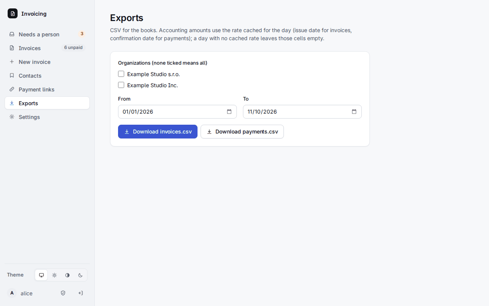

# 8. Exporte und die Buchhaltungswährung

**Exports** in der Leiste liefert zwei CSV-Dateien für die Buchhaltung.

Wählen Sie die Organisationen (keine angehakt heißt alle), ein optionales **From**- und **To**-Datum und laden Sie herunter:

- **invoices.csv**, eine Zeile pro Rechnung;
- **payments.csv**, eine Zeile pro Zahlung, mit ihrem Status.

| invoices.csv | |
|---|---|
| `organization, number, kind, status, issue_date, due_date, contact, contact_email, currency` | wer und wann |
| `subtotal, discount, tax, total, paid` | in der Rechnungswährung |
| `accounting_currency, accounting_rate, accounting_total, rate_source` | dieselbe Summe in der Buchhaltungswährung der Organisation |
| `external_reference, payment_link, migrated_from` | woher sie stammt: die Referenz Ihres Systems, ein Zahlungslink oder der Dienst, aus dem sie migriert wurde |

| payments.csv | |
|---|---|
| `organization, invoice_number, payment_id, state, rail, network, asset, amount` | was eingegangen ist und wie, im empfangenen Asset |
| `invoice_currency, amount_invoice_currency, quote_rate` | der Betrag in der Rechnungswährung und der Kurs des Angebots, zu dem bezahlt wurde |
| `accounting_currency, accounting_rate, accounting_amount` | dasselbe in der Buchhaltungswährung |
| `tx_hash, log_index, detected_at, confirmed_at, confirmed_by, review_reason` | Nachweis: die Transaktion, wann sie gesehen und bestätigt wurde, wer sie bestätigt hat |

## Die Buchhaltungswährung

Jede Organisation hat eine **Buchhaltungswährung** (Settings > Organizations; Standard ist EUR): die Währung, in der ihre Bücher geführt werden. Die Buchhaltungsspalten rechnen jeden Betrag mit **dem für den Tag zwischengespeicherten Kurs** in sie um: dem Ausstellungsdatum bei Rechnungen und dem Bestätigungsdatum bei Zahlungen. Der Worker füllt den Zwischenspeicher stündlich (`accounting_rates`). Ein Tag ohne zwischengespeicherten Kurs lässt diese Zellen **leer**; `rate_source` sagt, woher ein Kurs stammt (`identity`, wenn die Währungen gleich sind). Ein Export ruft nie einen Kursdienst auf, ist also schnell und ändert sich nicht, wenn Sie ihn erneut ausführen.

Dieselben Dateien gibt es über die API für einen Token mit `read`: `GET /api/v1/exports/invoices.csv?from=2026-01-01&to=2026-12-31` und `GET /api/v1/exports/payments.csv?…`, höchstens 400 Tage auf einmal.
