# 4. Invoices

**Invoices** in the rail lists them, newest first, with a filter per status and per organization and a search by number
or external reference.

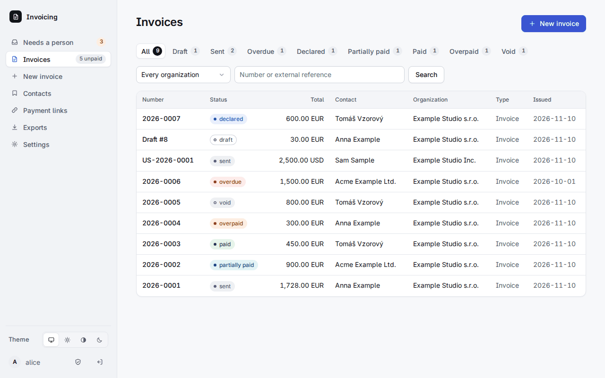

An invoice has one of these statuses:

| Status | Meaning |
|---|---|
| `draft` | Not sent. It has no number and can still be edited or deleted. |
| `sent` | Numbered and with its links; waiting for money. |
| `overdue` | Sent, and the due date has passed (the worker moves it). |
| `declared` | The client pressed "I have paid". That is a claim, not money. |
| `partially_paid` | Confirmed payments cover part of the total. |
| `paid` | Confirmed payments cover the total. |
| `overpaid` | Confirmed payments exceed the total. |
| `void` | Cancelled; it can no longer be paid. |

Only **confirmed** payments count. A sent invoice can no longer be edited: what it says is frozen at the moment it
was sent, including the seller, the buyer and the payment details, so a later change to a contact or an account never
alters an invoice already in a client's hands.

## Create an invoice

**New invoice** asks for who, what and how to be paid. Nothing is sent until you press Send on the draft.

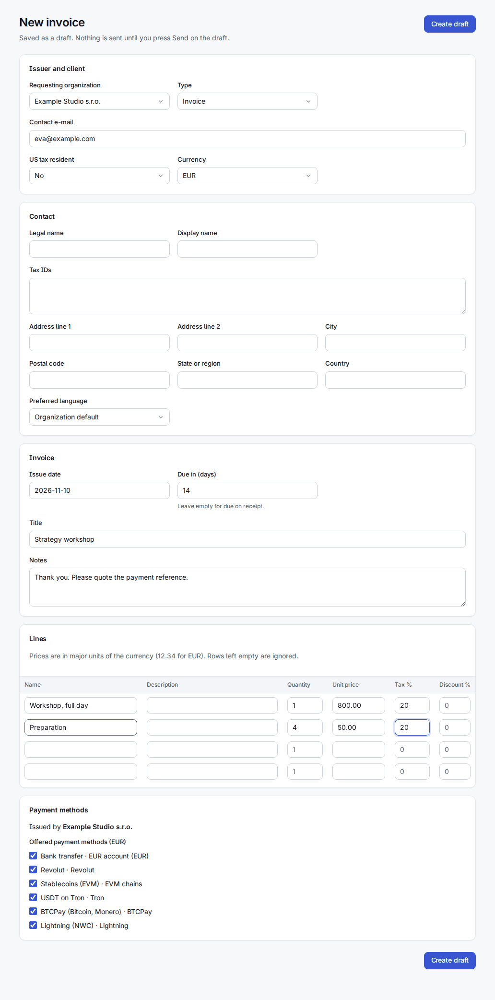

- **Requesting organization** and **Type**: an *Invoice* gets a number from the organization's numbering; a *Payment
  request* has no number and is not a legal invoice document.
- **Contact e-mail**: an existing contact is found by it, otherwise a new one is made from the fields below. Answer
  **US tax resident** (yes, no or unknown) on purpose; "Choose…" is not accepted. A yes sends the invoice to the
  US-resident issuer (chapter 2): the page then says "Issued by …".
- **Currency**, **Issue date**, **Due in (days)** (empty: due on receipt), **Title** and **Notes** (printed on the invoice).
- **Lines**: name, optional description, quantity, unit price in major units (`12.50`), tax % and discount %. Empty rows
  are ignored.
- **Payment methods**: every active method of the issuer that fits the currency is ticked: its bank accounts in that
  currency, its fiat links that accept it and all its rail accounts (a crypto quote converts, so any currency works).
  Untick what you do not want to offer.

**Create draft** saves it. The draft page shows the lines and the totals, has **Edit this draft** and **Delete draft**,
and the box that sends it.

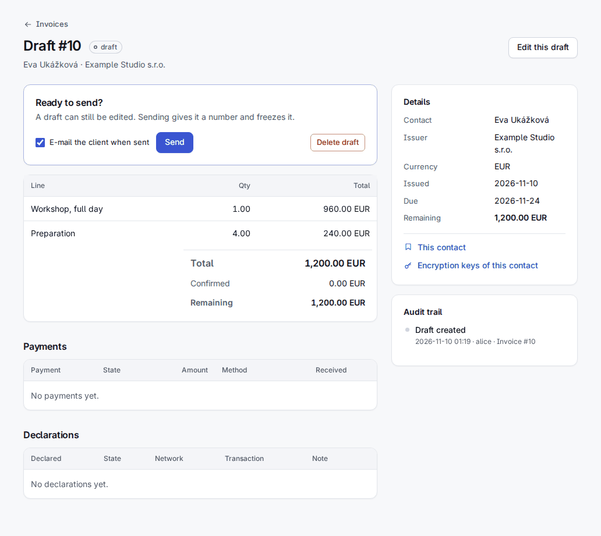

## Send

**Send** numbers the invoice, freezes it and creates two **capability links**, one to view it (`/i/…`) and one to pay it
(`/p/…`). They are secrets: they are stored only as hashes and are shown only once.

- With **E-mail the client when sent** ticked, the invoice letter is queued in the outbox (the worker sends it, in the
  contact's language, with the PDF attached) and carries both links. If the contact has an active encryption key the
  letter is encrypted to it.
- **Without** the tick nothing is mailed and you pass the links on yourself. To see them, open the invoice, **More
  actions > Reissue the client links** (below): the page shows the two links once.

## What the client sees

The **invoice page** `/i/…` shows the document, a PDF to download and **Receive encrypted e-mail** (chapter 3). The **pay
page** `/p/…` shows the amount due and the ways to pay. It is in the language of the contact, or of the browser.

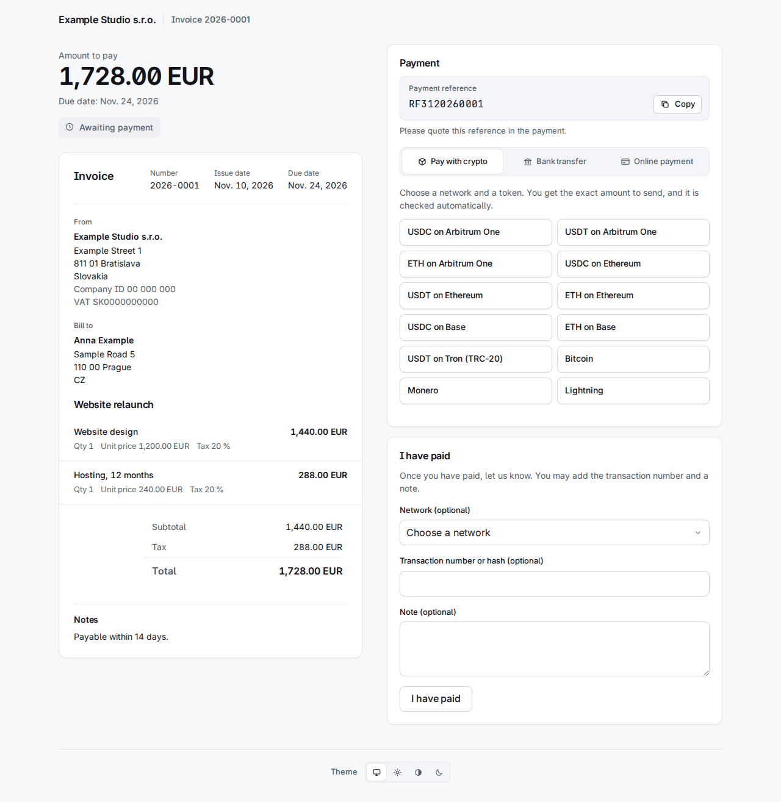

The payment box has up to three tabs, **crypto first**:

- **Pay with crypto**: the client picks a network and a token, for example "USDC on Arbitrum One".
- **Bank transfer**: the bank account of the invoice's currency (beneficiary, account number, bank, amount, each with a
  copy button), the **payment reference** (an ISO 11649 reference such as `RF3120260001`) and your instructions in the
  client's language. For EUR to the IBAN of a SEPA country three QR codes are added (PAY by square, QR Platba and EPC
  QR), for CZK to a Czech IBAN the QR Platba code: the client scans one in their banking app, and the account, the
  amount still due and the reference are filled in. The PDF invoice prints the same codes.
- **Online payment**: the fiat links (Revolut, PayPal and so on).

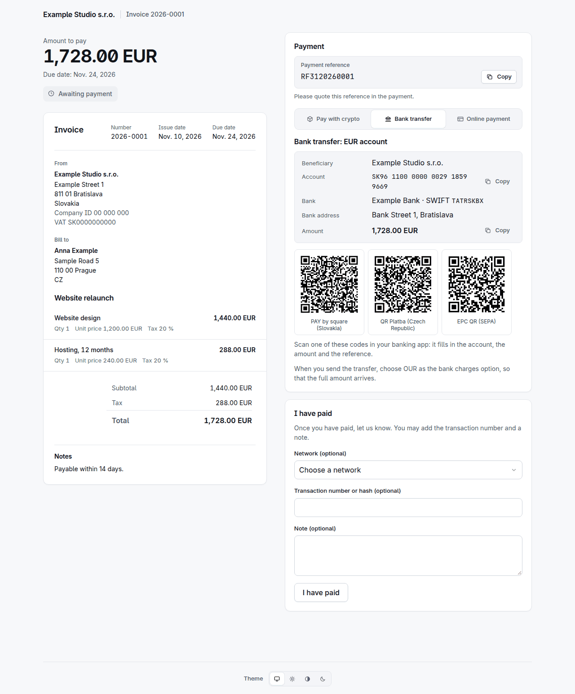

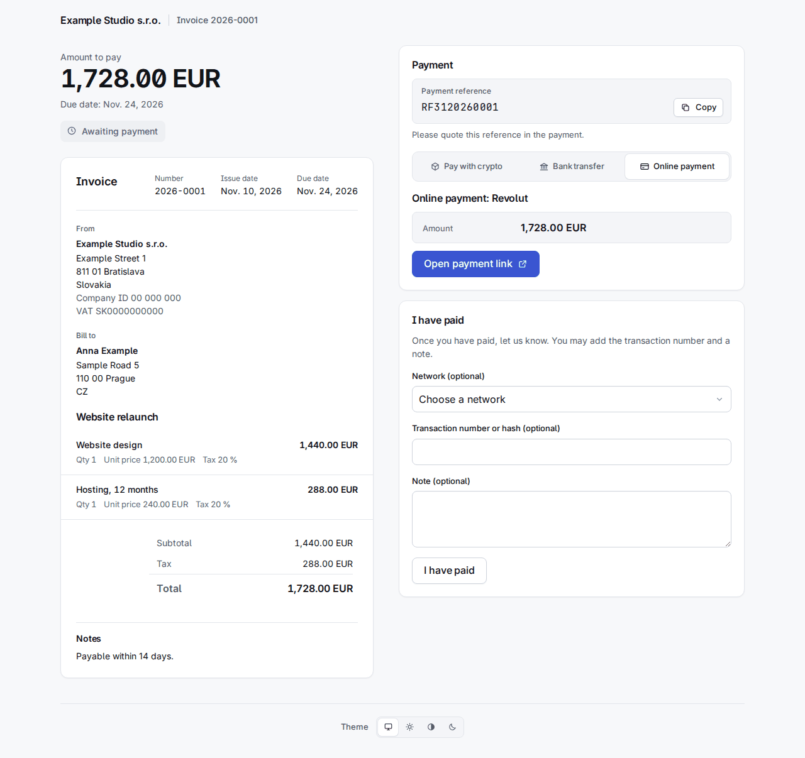

All nine languages are covered: the same page in Slovak, Czech, German, Spanish, French, Polish, Korean and Russian is
at the end of this chapter.

### Quotes and exchange rates

A client does not pay "the invoice amount" in crypto: they pay a **quote**.

- Choosing a network and a token fixes the exchange rate and shows the **exact amount** to send, the address, a QR code
  and an "Open in wallet" link. The amount is rounded **up**, never short.
- The quote is valid for about **30 minutes**; the page counts down and **Get a new amount** issues another.
- On a shared address the amount carries a few units of dust that are **unique per quote**. That is how the payment is
  matched to the invoice, so the client must send exactly that amount in that token on that network.
- Rates come from two sources that are cross-checked (Kraken and Coinbase); if they differ by more than 1 %, no quote is
  made. The step from EUR to other fiat currencies uses the ECB's rates through
  Frankfurter; a stale or suddenly jumping rate refuses quotes in that currency and appears in Needs a person under
  *Exchange rates refused*, where a person can accept a jump that is real.
- The page updates by itself when the transfer is seen. The worker watches the chain; Lightning and BTCPay payments are
  read from their gateway.

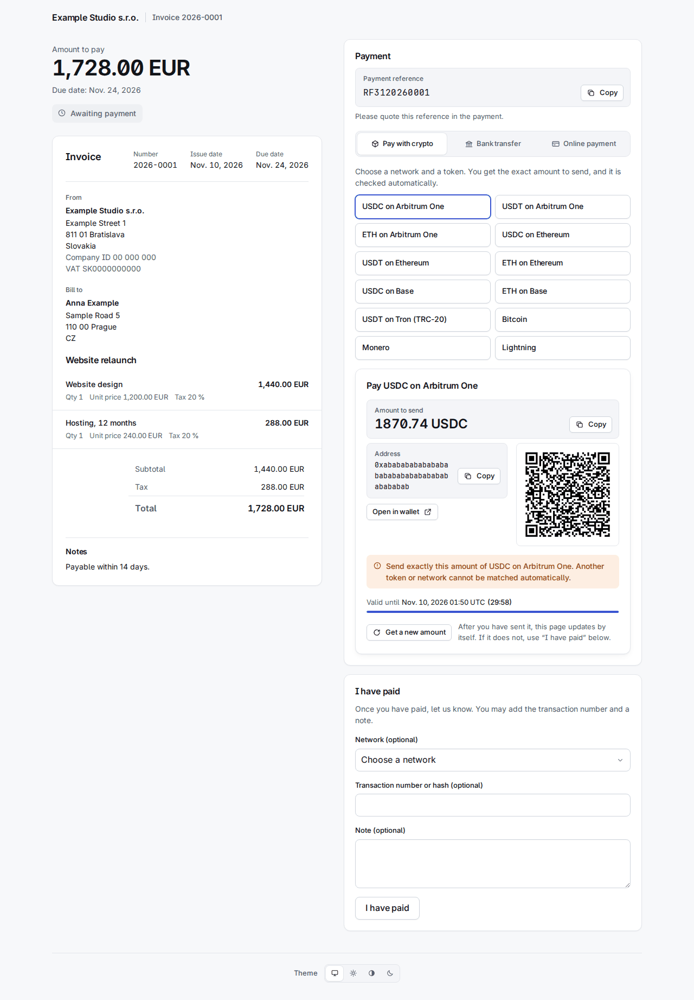

The **I have paid** box lets a client report a payment (network, transaction hash and a note, all optional). The invoice
becomes `declared` and appears in Needs a person; a hash that is given is looked up on the chain. A declaration is a
claim, never money: it settles nothing by itself. Staff are e-mailed only when they have to act: at once when nothing
but a person can check the claim (no hash, or a network the system does not read) or when the named transaction's money
went to another invoice, and after half an hour when the hash was not found. A hash whose money is this invoice's sends
no e-mail: the payment settles, or goes to review, which has a letter of its own.

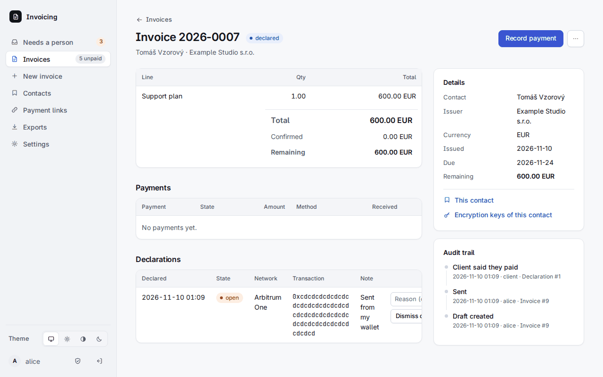

## Record a payment by hand

A bank transfer or an online payment arrives somewhere Sealbill cannot see. When **you** see the money, open the
invoice and press **Record payment**: the amount, the way (*Bank transfer*, *Payment link* or *Recorded by hand*) and a
note. It is confirmed at once and counted. Only a person can do this; no API token can.

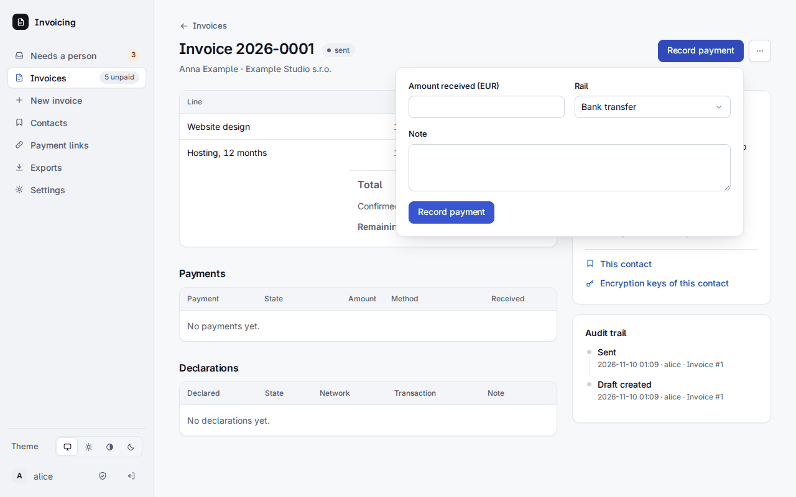

A wrongly recorded or returned payment is undone with **Reverse** on its row, which needs a reason.

## Partial payments and overpayments

**Partial.** When confirmed payments cover only part of the total the invoice becomes `partially_paid`. The client gets a
letter that says what arrived and what is still due, and the pay page offers quotes for the **remainder**. A partially
paid invoice cannot be voided.

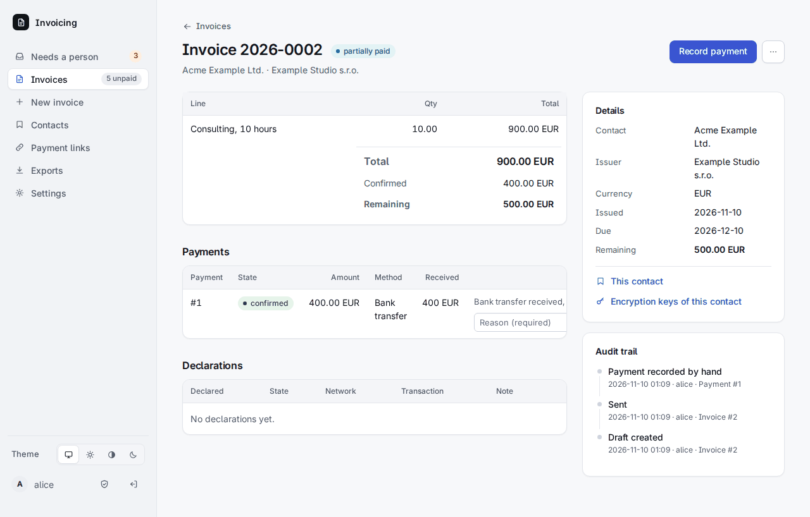

**Over.** An invoice can be overpaid in two ways, and both end up in front of a person (chapter 6):

- *More money than the total was recorded* (a bank transfer, or a payment you recorded by hand): the invoice is `overpaid` and listed under **Overpaid invoices**. Refund the difference outside the system, or press
  **Keep the overpayment** and type why. The invoice stays `overpaid`, which is what the money says; the decision, the
  sum it covers and your note go to the audit log, and the item leaves the queue until more money arrives.

  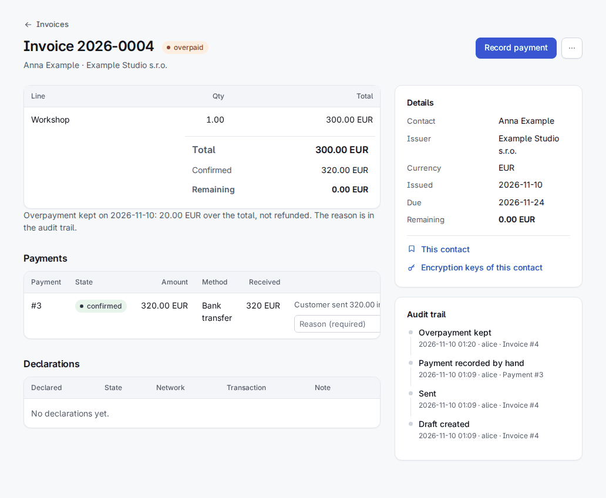

  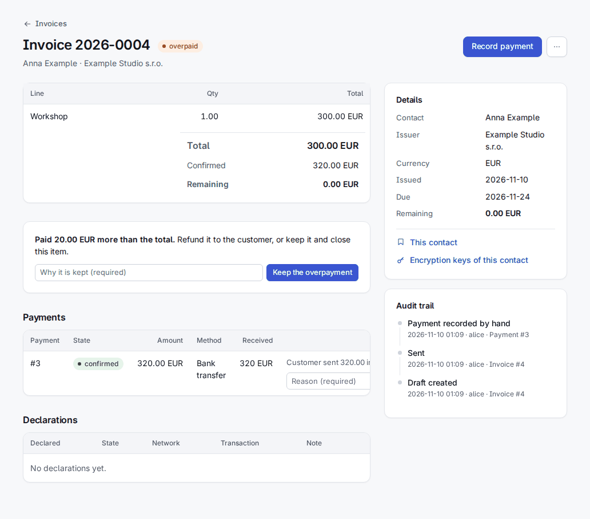

- *A crypto payment above its quote*: the invoice is paid and the payment gets a **refund due**, listed under **Refunds
  due** with the amount and the address it came from. After you have sent it back, or decided not to, press
  **Refunded** with a note. A payment far above the quote (past the *Overpayment ceiling* of the organization) is not
  settled at all: it waits under **Payments to review**.

## Void

**More actions** (the three dots) has **Void invoice** with a required reason. A void invoice can no longer be paid: its
open quotes and open declarations are closed, and the client's page says it is void. It is refused while a payment is
being confirmed and once money has been confirmed (reverse that payment first); a `paid`, `partially_paid` or
`overpaid` invoice cannot be voided. Money that still arrives later for a void invoice is not lost: it lands in
**Payments to review** with the reason "The invoice was already closed when the payment arrived."

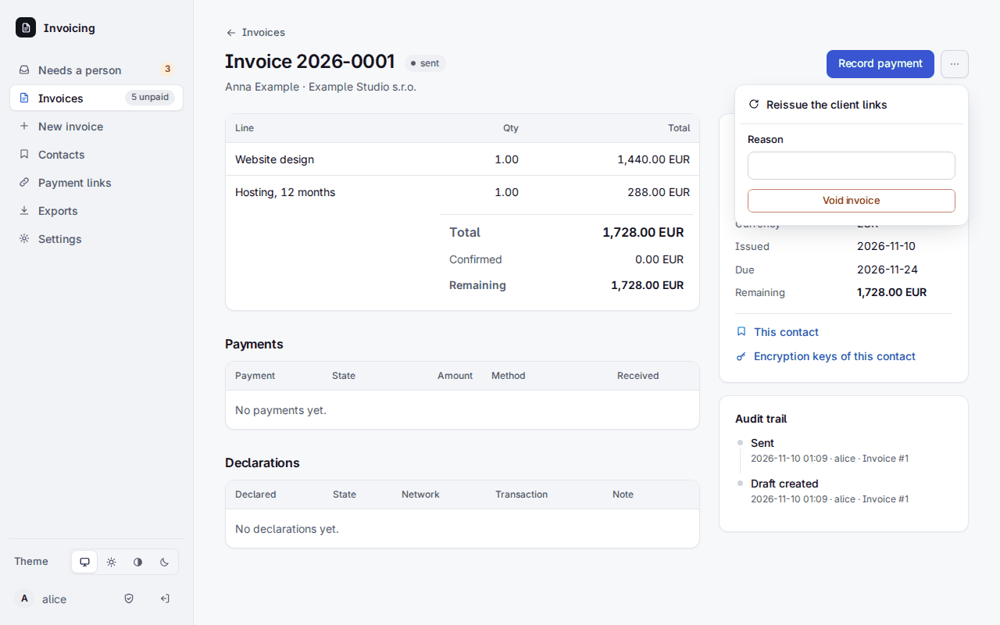

## Reissue the links

A client lost the e-mail, or you sent without e-mail and need the links: **More actions > Reissue the client links**.

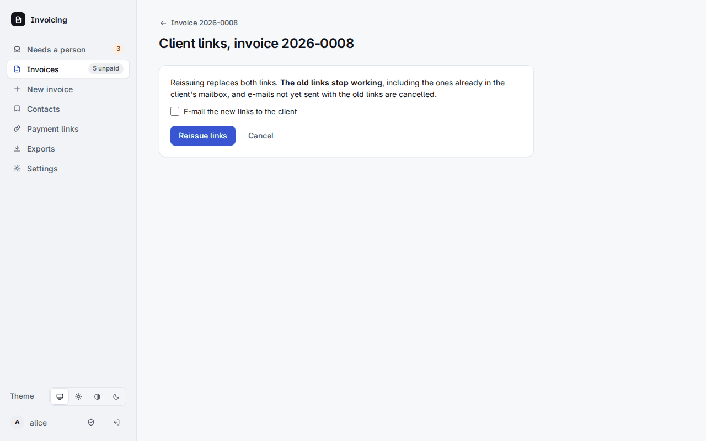

Reissuing **replaces both links**: the old ones stop working, including the ones already in the client's mailbox, and
letters not yet sent with the old links are cancelled. Tick **E-mail the new links to the client** to queue a letter;
otherwise the page shows the two new links **once** and says "Nothing was e-mailed: pass these on yourself." A draft
or a void invoice cannot have its links reissued. An `invoice.links_reissued` webhook event tells
an integration that stored the old links that they are dead.

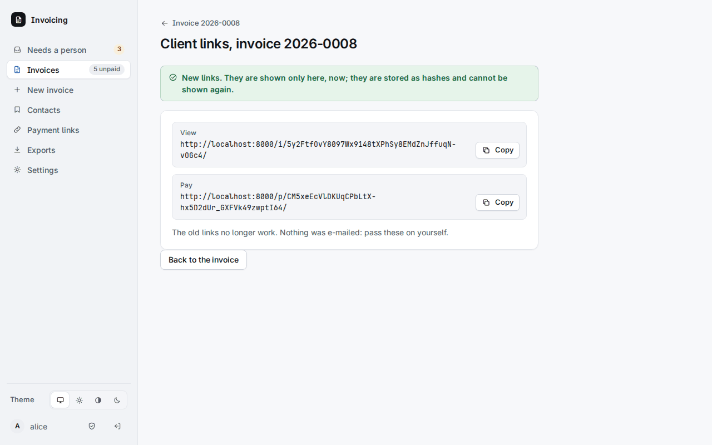

## The reminder after 30 days

If the system e-mailed the invoice letter and the invoice is still unpaid (`sent`, `overdue` or `partially_paid`)
**30 days** after it was sent, the worker sends **one** reminder, once. The reminder **replaces both links**, as above.

- `INVOICE_REMINDER_DAYS` sets the number of days; `0` turns the reminder off.
- It is skipped for an invoice that was sent without the e-mail, one sent with `client_letters: false` through the API,
  any payment-link order, a `declared` invoice, an invoice with an open quote or a payment detected or in review, a US
  tax resident on a non-US issuer (that invoice is in the "wrong issuer" queue), and a contact whose encryption key has
  failed. A skipped invoice is looked at again on the next run.
- The job runs when the worker starts and then every 24 hours, so a worker that was down catches up on everything that
  qualifies, whatever its age. With the vault sealed at the start it does nothing, and tries again 24 hours later.

## The same page in the nine languages

Each language shows the invoice page and the pay page of the demo invoice. The invoice's own text (lines, notes) is in
whatever language you typed it; the frame around it is translated.

| | Invoice page | Pay page |
|---|---|---|
| English | [image](../img/portal-invoice-en.png) | [image](../img/portal-pay-en.png) |
| Slovenčina | [image](../img/portal-invoice-sk.png) | [image](../img/portal-pay-sk.png) |
| Čeština | [image](../img/portal-invoice-cs.png) | [image](../img/portal-pay-cs.png) |
| Deutsch | [image](../img/portal-invoice-de.png) | [image](../img/portal-pay-de.png) |
| Español | [image](../img/portal-invoice-es.png) | [image](../img/portal-pay-es.png) |
| Français | [image](../img/portal-invoice-fr.png) | [image](../img/portal-pay-fr.png) |
| Polski | [image](../img/portal-invoice-pl.png) | [image](../img/portal-pay-pl.png) |
| 한국어 | [image](../img/portal-invoice-ko.png) | [image](../img/portal-pay-ko.png) |
| Русский | [image](../img/portal-invoice-ru.png) | [image](../img/portal-pay-ru.png) |

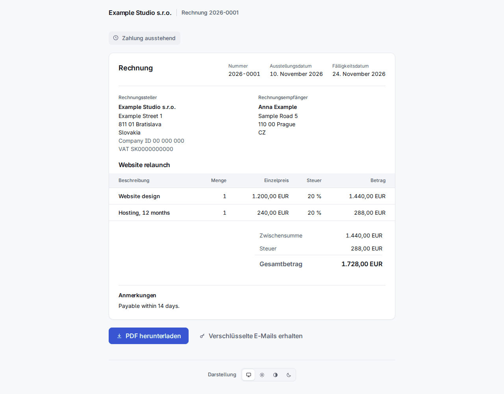

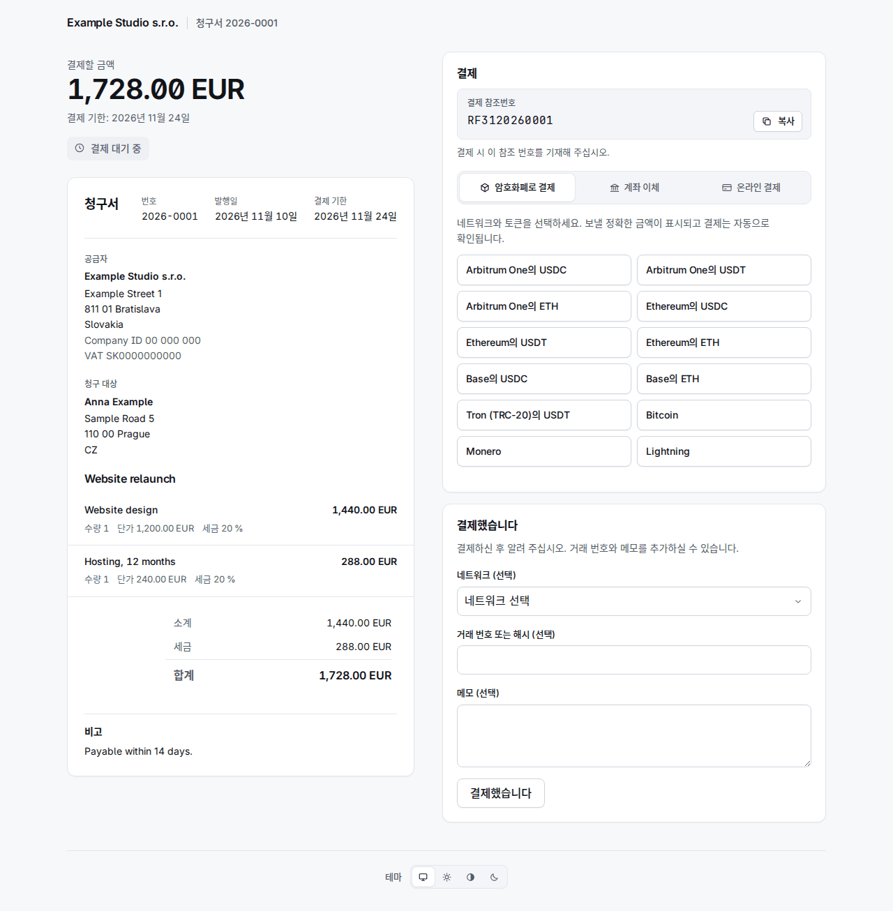

Invoices in other states look like this to the client:

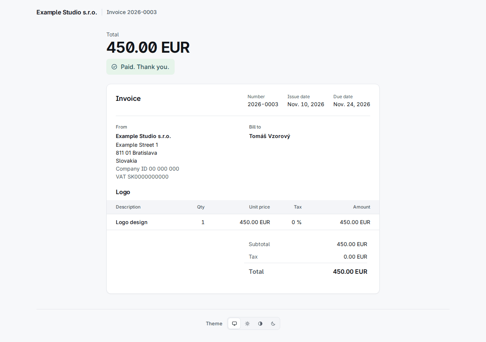

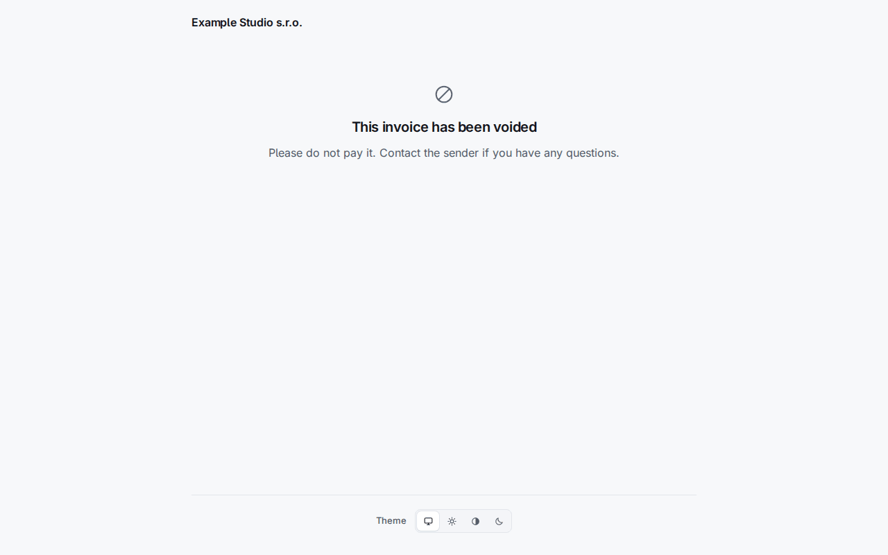
