# 2. Ajustes

**Settings** es la última entrada de la barra. Su página de inicio enumera todo lo que sigue, además del registro de auditoría, la bandeja de salida de correo (E-mail outbox) y las entregas de webhooks (el capítulo 6 las usa).

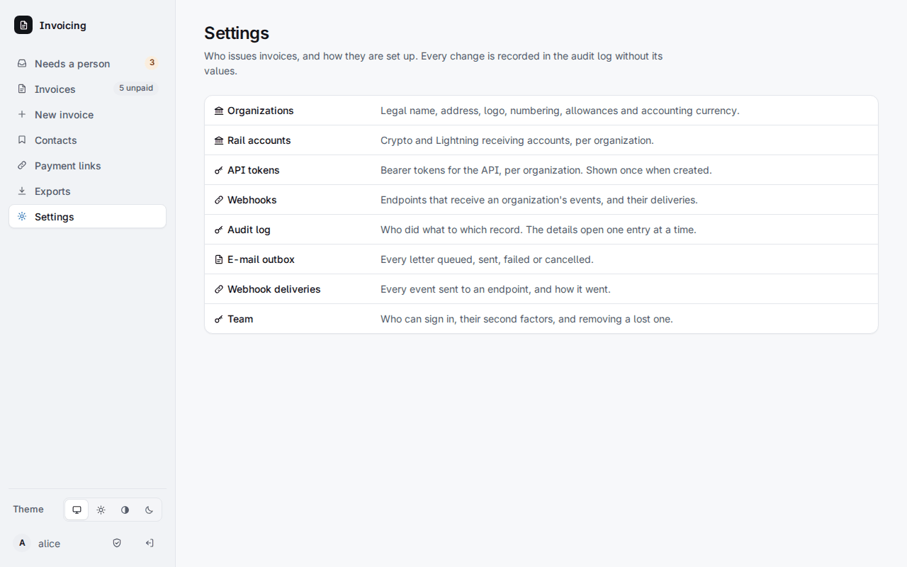

Cada cambio se anota en el **Audit log** (Settings > Audit log): quién, qué y qué registro, nunca los valores escritos.

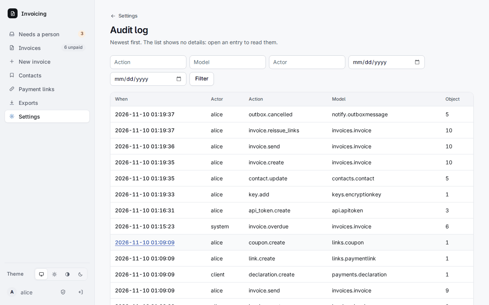

Abra una entrada para leer sus detalles. Los cambios enumerados en el capítulo 1 bajo «La reconfirmación» exigen un superusuario con un segundo factor reciente.

## Organizaciones

Una **organización** es una entidad jurídica que emite facturas: su nombre, dirección, identificadores fiscales, logotipo, la numeración de las facturas y las cuentas de pago que le pertenecen. Una segunda organización resulta útil cuando dos empresas comparten una instalación, por ejemplo una de la UE y otra de EE. UU.

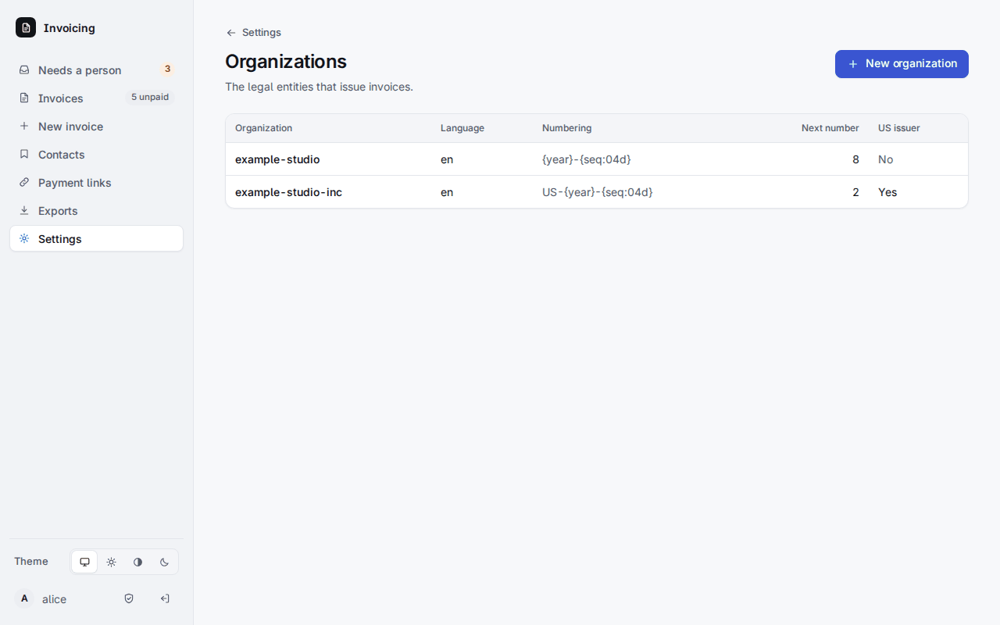

**Settings > Organizations > New organization**, o abra una para editarla:

| Campo | Qué hace |
|---|---|
| Slug | El nombre corto que se usa en la API y en los comandos (`example-studio`). |
| Legal name, Address, Tax ids | Se imprimen en el bloque «Emisor» de la factura. Los identificadores fiscales son texto libre. |
| Email from | El remitente de los correos de la organización, por ejemplo `Example Studio <billing@example.com>`. |
| Default language | El idioma de las páginas del cliente y de los correos cuando el contacto no tiene idioma preferido. |
| Footer note, Logo | Se imprimen en la factura y en el PDF. El logotipo es un PNG o JPEG de hasta 1,9 MB, guardado como PNG sin metadatos. |
| Number format | Al estilo de Python, con `{year}` y `{seq}`: `{year}-{seq:04d}` da `2026-0001`. Debe contener `{seq}`. |
| Next number | Lo fija la emisión de facturas; no se puede editar, o se repetirían números. |
| Underpayment allowance | Un pago en cripto que se quede corto como máximo en el **menor** de estos dos valores, esta proporción (puntos básicos; 50 es 0,5 %) y este importe fijo en dólares (1,00 por defecto), sigue liquidando la cotización. Absorbe la comisión de retirada de un exchange. |
| Overpayment ceiling | Un pago en cripto que supere el importe cotizado en más de esta proporción (1000 es 10 %) no se liquida, sino que se deja a una persona. |
| Accounting currency | La moneda de las columnas contables de las exportaciones (capítulo 8). |
| Hosts a Back button may lead to | Un host por línea. Una factura creada por la API puede llevar un `return_url` exactamente en estos hosts. |

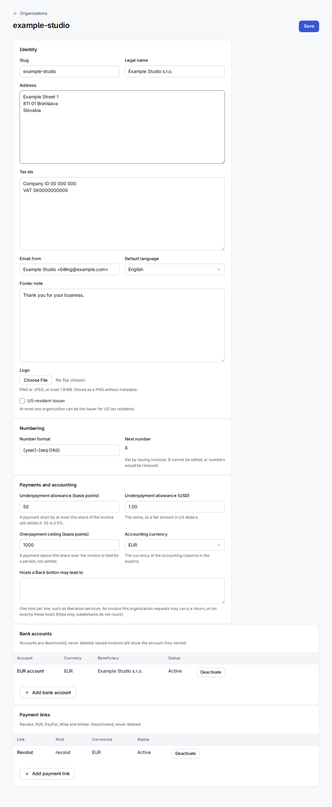

### El emisor para residentes de EE. UU.

Marque **US-resident issuer** en una organización como máximo. Es la organización que debe emitir las facturas de los clientes que son residentes fiscales de EE. UU.

- Cada contacto tiene una respuesta **US tax resident**: yes, no o unknown. El formulario de factura le obliga a elegir; un enlace de pago se lo pregunta al comprador.
- Cuando otra organización solicita una factura para un contacto que es residente fiscal de EE. UU., la factura la **emite la organización emisora**, con su numeración, sus cuentas bancarias y sus canales. El emisor guarda su propia copia del contacto; su contacto nunca se reescribe.
- Si un contacto pasa a ser residente fiscal de EE. UU. después de que otra organización emitiera una factura, esa factura aparece en la cola **US tax residents with invoices from another issuer** de Needs a person: anúlela y créela de nuevo.
- Sin ninguna organización marcada, esa factura no se puede crear.

Cambiar el indicador o los hosts de retorno es un cambio con reconfirmación. El indicador queda en el registro de auditoría y se envía por correo a los superusuarios.

## Cuentas bancarias y enlaces fiat

Al final de una organización hay dos listas. Ambas se **desactivan, nunca se borran**: una factura emitida sigue mostrando la cuenta que nombraba.

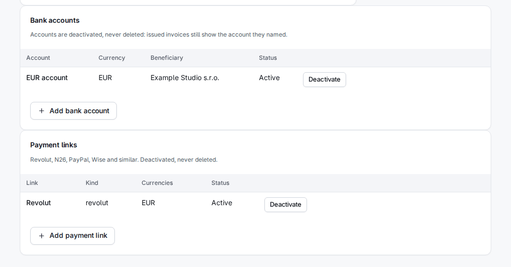

**Add bank account** pide una etiqueta, una moneda, el beneficiario, el IBAN o número de cuenta, el banco, su SWIFT/BIC y, opcionalmente, un banco intermediario. Una cuenta bancaria se ofrece en facturas **de su propia moneda**. Con un IBAN, la página de pago y la factura en PDF muestran también códigos QR bancarios: en EUR para el IBAN de un país SEPA, en CZK para una cuenta checa (capítulo 4). Las *instrucciones de pago* existen una vez por idioma: la página de pago muestra la del idioma del lector y recurre al inglés; deje un idioma vacío para omitirlo.

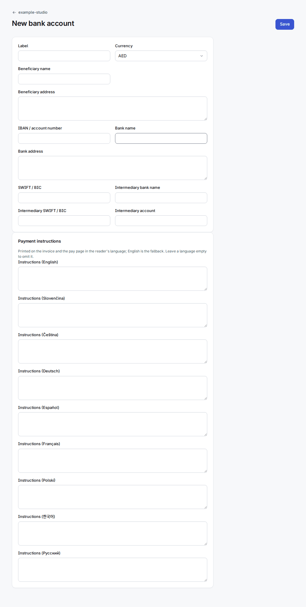

**Add payment link** (un *enlace fiat*, que no debe confundirse con las páginas compartibles del capítulo 5) es un enlace a un servicio que cobra en otro sitio: Revolut, N26, PayPal, Wise u «other». Necesita una dirección `https://` y las monedas que puede aceptar. La página de pago lo muestra en **Pago en línea**.

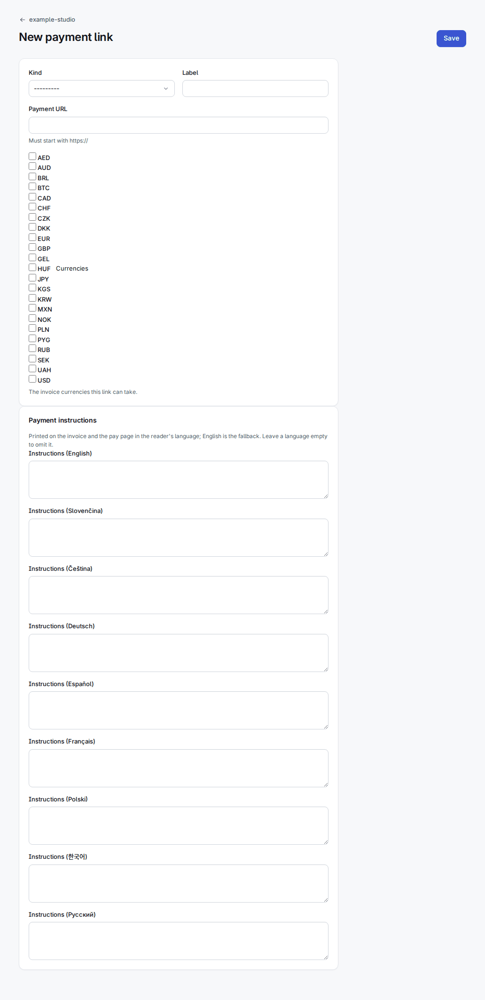

## Canales de pago (rails)

Una **rail account** es una forma de cobrar en cripto o por Lightning. Una cuenta activa se ofrece en cada factura nueva de su organización (salvo que la factura nombre sus propios métodos). Abra **Settings > Rail accounts**.

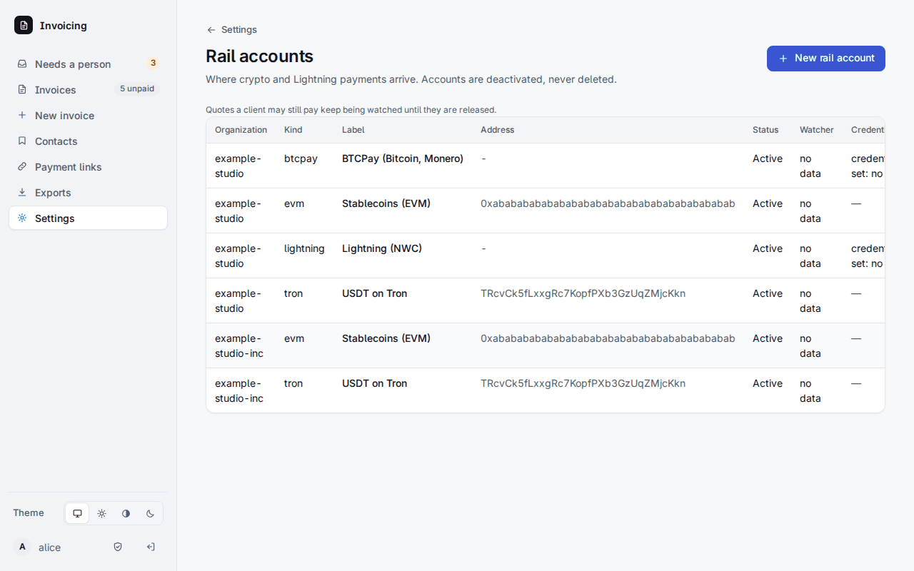

**New rail account** pregunta primero por la organización y el tipo.

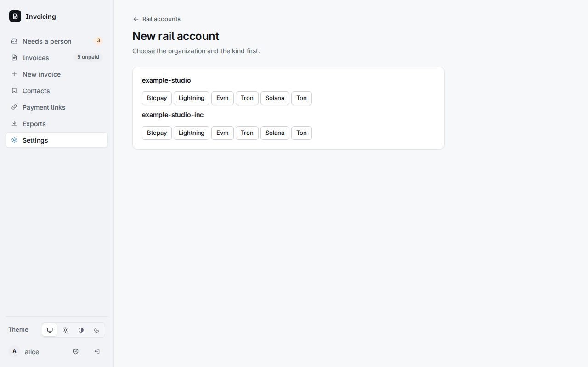

| Tipo | Qué necesita |
|---|---|
| **evm** | Una dirección; las redes que vigilar (Ethereum, Arbitrum One, Optimism, Base, Polygon PoS, BNB Smart Chain, Avalanche C-Chain) y los activos que aceptar (ETH, USDC, USDT). |
| **tron** | Una dirección; USDT. Se vigila toda la red Tron. |
| **solana** | Una dirección; USDC y USDT. |
| **ton** | Desactivado por ahora: solo se puede guardar inactivo, porque aún no se puede demostrar que un pago por TON haya llegado. |
| **btcpay** | La `URL` y el `Store ID` de BTCPay, los activos (BTC, XMR, ZEC) y una política de velocidad: `MediumSpeed` (1 confirmación, por defecto), `LowMediumSpeed` (2) o `LowSpeed` (6). `HighSpeed` se rechaza. |
| **lightning** | Un backend: `nwc` (Nostr Wallet Connect, por ejemplo Alby Hub), `lnd`, `cln` o `lnbits`; una `URL` para los tres últimos. Activo BTC. |

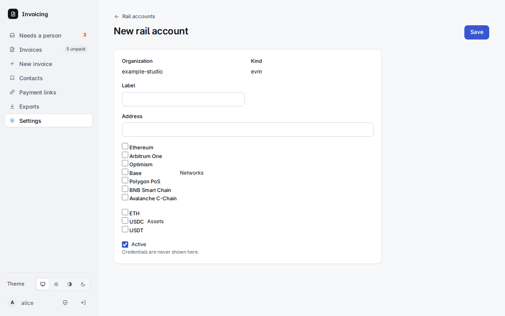

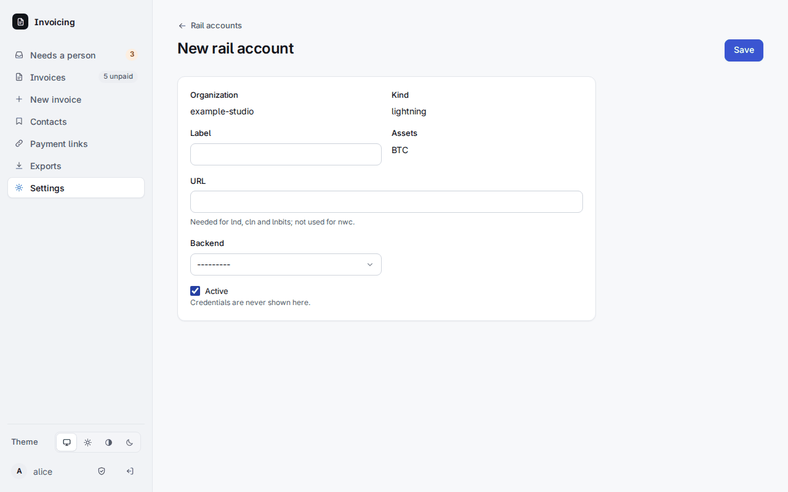

Conviene saber:

- **Use direcciones que solo use este sistema.** Un pago en cadena se asocia a su factura por su **importe**: cada cotización pide el importe base más unas unidades de «polvo», únicas entre las cotizaciones que retienen esa dirección. El dinero enviado allí por cualquier otro motivo acaba en Needs a person.
- La URL de un canal debe ser una dirección `https://` en un host que resuelva solo a direcciones públicas; se rechazan las direcciones de loopback o privadas (la única excepción es un LND o CLN en la misma máquina, en `LOCAL_LIGHTNING_PORT`).
- Mientras un cliente aún pueda pagar una cotización, no se pueden cambiar la organización, el tipo, la dirección, las redes ni los activos de la cuenta; cree una cuenta nueva. **Deactivate** deja de ofrecerla, pero las cotizaciones ya mostradas siguen vigiladas hasta que se liberan.
- La columna *Watcher* dice si el worker puede leer esa cadena o pasarela.

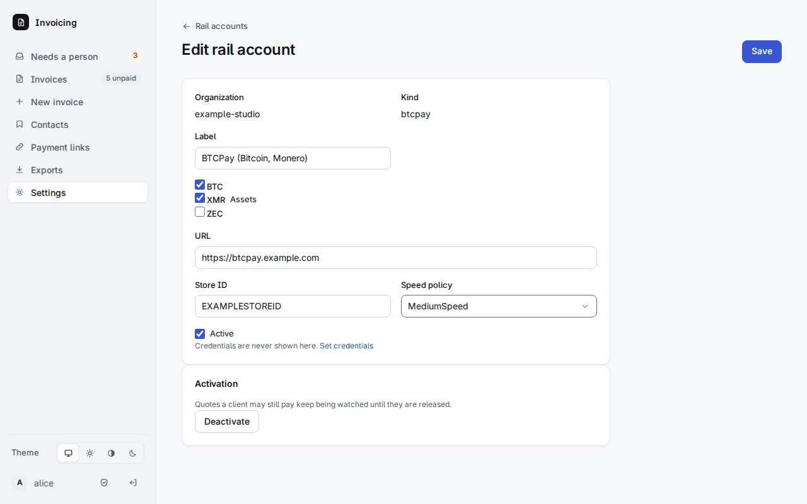

### Credenciales

Los secretos de BTCPay y Lightning se cifran con la clave de la bóveda y **no se vuelven a mostrar jamás**. Abra la cuenta y pulse **Set credentials** (la bóveda debe estar desbloqueada), o use en un shell `manage.py set_rail_credentials <id de la cuenta rail>`. Dejar un campo vacío conserva lo guardado.

El sistema **nunca gasta**, así que solo guarda una credencial de la que se puede demostrar que no puede hacerlo:

| Backend | Qué pegar |
|---|---|
| BTCPay | Una `api_key` solo con `btcpay.store.canviewinvoices` y `btcpay.store.cancreateinvoice` (se pregunta a BTCPay qué permite la clave) y el `webhook_secret`. El botón **Register the BTCPay webhook** crea el webhook en BTCPay y guarda su secreto por usted. |
| Lightning, NWC | La `nwc_url` de una conexión con `make_invoice` y `lookup_invoice` y **sin** método `pay_*`. |
| Lightning, LND | Un `macaroon` creado con `invoices:read invoices:write info:read` (el `invoice.macaroon` propio de LND se rechaza). |
| Lightning, Core Lightning | Un `rune` limitado a `invoice` y `listinvoices`. |
| Lightning, LNbits | La **Invoice/read key** de la cartera, nunca la Admin key; marque la casilla que indica que lo ha comprobado. |

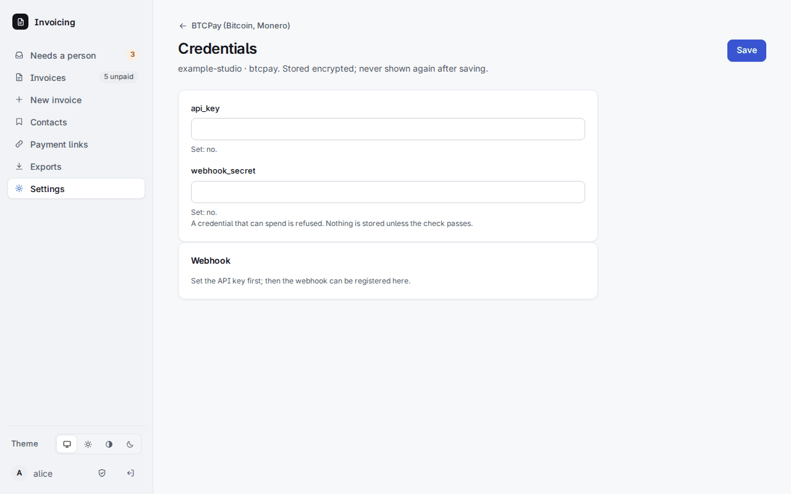

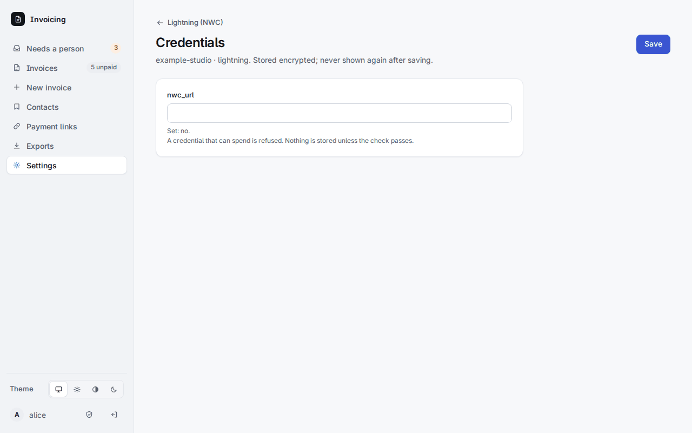

Cambiar el host de la URL de un canal borra sus credenciales guardadas y lo desactiva, de modo que una clave nunca se envía a otro servicio. El README ([Crypto rails](../../../README.md#crypto-rails)) tiene los detalles por backend, las variables de entorno para sus propios endpoints RPC y lo que los watchers no ven.

## Tokens de API y scopes

**Settings > API tokens**. Un token pertenece a **una organización** y solo ve sus datos. Se muestra **una vez**, al crearlo; si se pierde, revóquelo y cree otro. Revocar es permanente y la fila permanece.

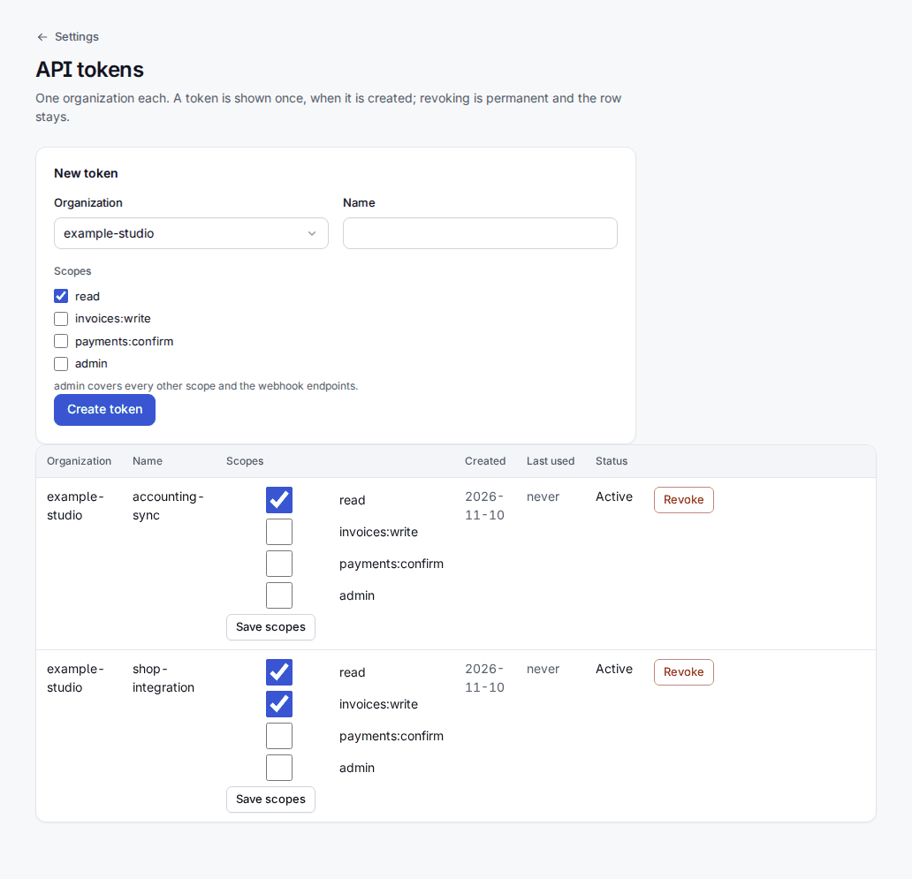

| Scope | Permite |
|---|---|
| `read` | Todo GET. |
| `invoices:write` | Crear y actualizar contactos y sus claves de cifrado; crear, enviar y anular facturas; reemitir enlaces; gestionar enlaces de pago. |
| `payments:confirm` | Confirmar, rechazar, revertir y asignar pagos, confirmar reembolsos, descartar declaraciones. **Esto mueve el estado del dinero.** No puede registrar un pago manual: solo una persona puede. |
| `admin` | Todo lo anterior y los endpoints de webhooks. |

Dé a un token el conjunto más pequeño que necesite; una integración que solo crea y envía facturas necesita `read` e `invoices:write`. Crear, cambiar scopes y revocar son cambios con reconfirmación.

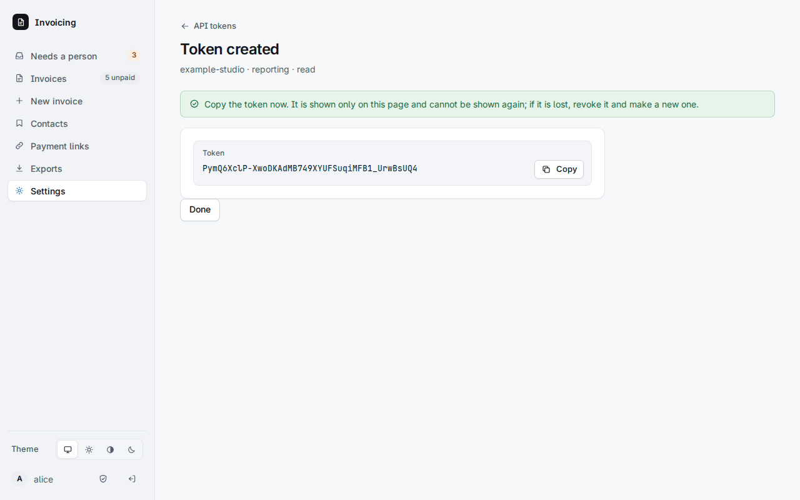

También puede emitir uno desde un shell: `manage.py create_api_token --org <slug> --name <name> --scopes read,invoices:write`.

## Webhooks

**Settings > Webhooks** registra un endpoint al que se avisa de lo que ocurre con las facturas y los pagos de una organización.

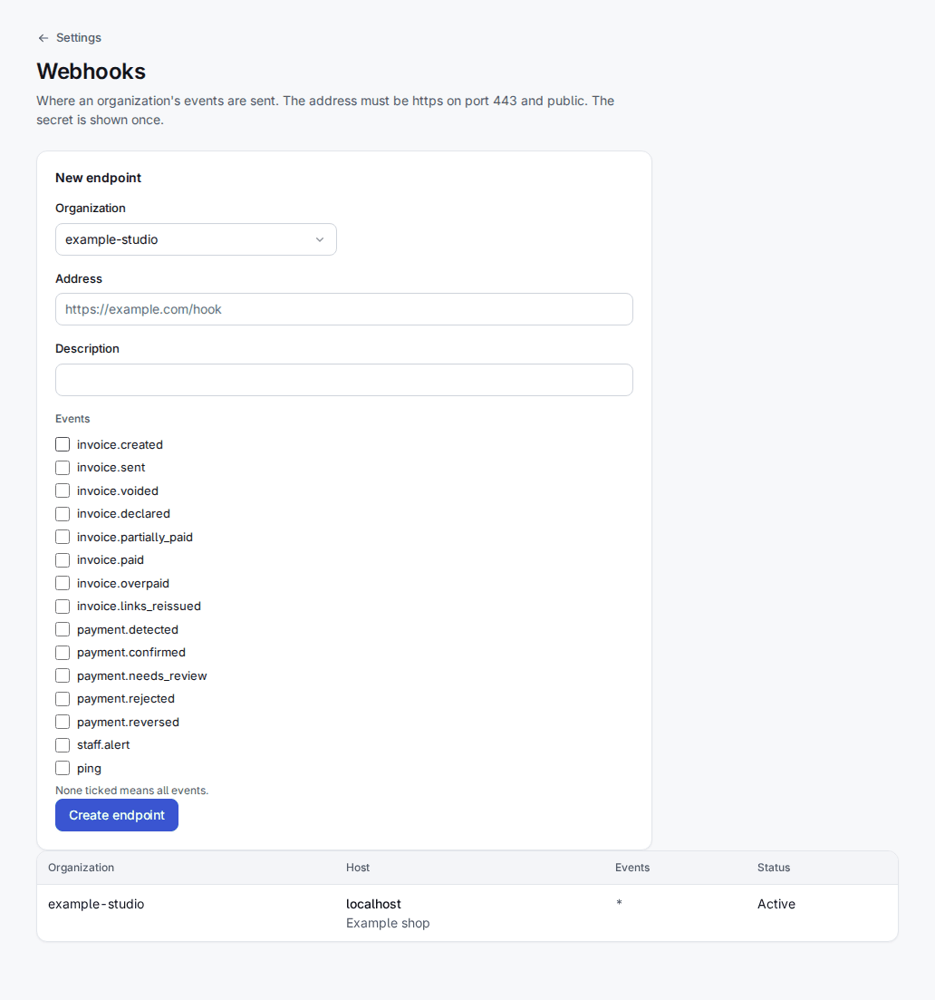

- La dirección debe ser `https://`, en el puerto 443, en un host que resuelva solo a direcciones públicas. (Un entorno de desarrollo puede relajarlo con `WEBHOOK_ALLOW_HTTP` y `WEBHOOK_ALLOW_PRIVATE`.)
- Marque los eventos que desee; no marcar ninguno significa todos: `invoice.created`, `.sent`, `.voided`, `.declared`, `.partially_paid`, `.paid`, `.overpaid`, `.links_reissued`, `payment.detected`, `.confirmed`, `.needs_review`, `.rejected`, `.reversed`, `staff.alert` y `ping`.
- El **secreto** se muestra una vez. Cada entrega es un `POST` firmado con `X-Pay-Signature: sha256=<hex>`, un HMAC-SHA256 del cuerpo en bruto con ese secreto; compruébelo antes de fiarse de la llamada. El cuerpo lleva solo identificadores y estados, nunca nombres, direcciones ni importes: lea el resto por la API.
- Una entrega se reintenta tras 2, 5, 15, 30, 60, 120, 240 y 480 minutos, y luego se marca como fallida; el personal recibe un aviso una vez y aparece en **Webhooks not delivered** de Needs a person.
- La página de un endpoint tiene **Send a ping**, las últimas entregas y **Delete**. Settings > Webhook deliveries enumera cada entrega con **Retry now**.

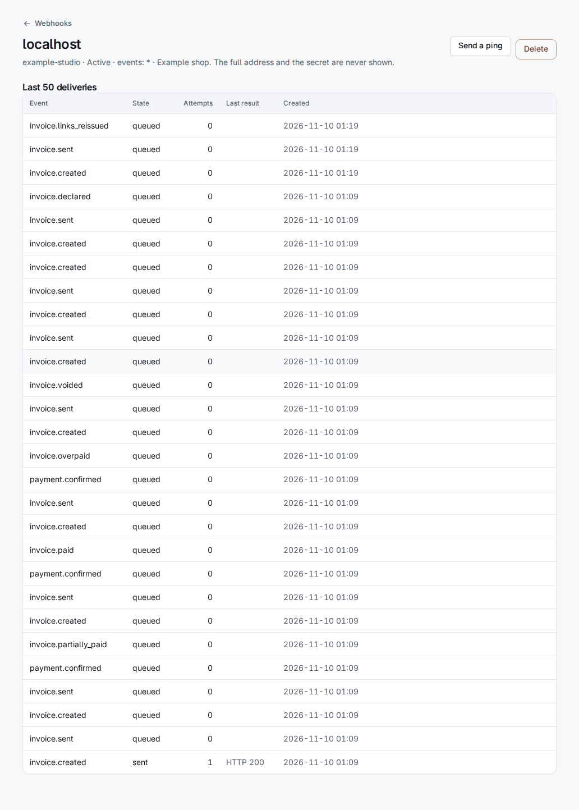

La lista completa de eventos y el código de verificación están en `/llms.txt` de su instalación (capítulo 9).

## El equipo

**Settings > Team** enumera a todos los que pueden iniciar sesión, con los nombres de sus segundos factores y el último inicio de sesión. Un superusuario puede eliminar el factor perdido de un compañero (un cambio con reconfirmación, comunicado por correo a todos los superusuarios); el compañero queda entonces bloqueado hasta que alguien registre en el servidor un autenticador nuevo. Su propio último factor no se puede eliminar.

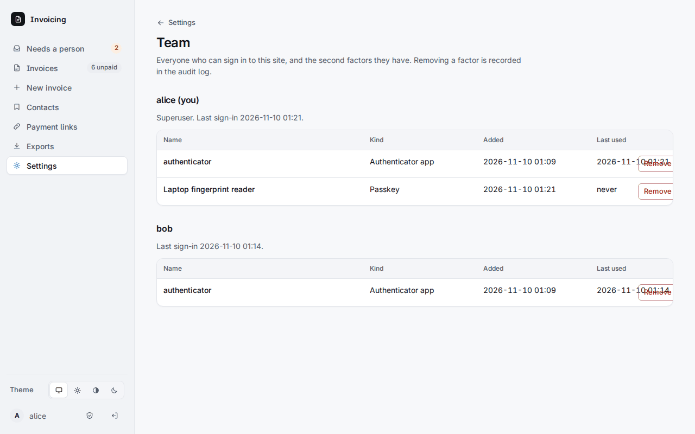
