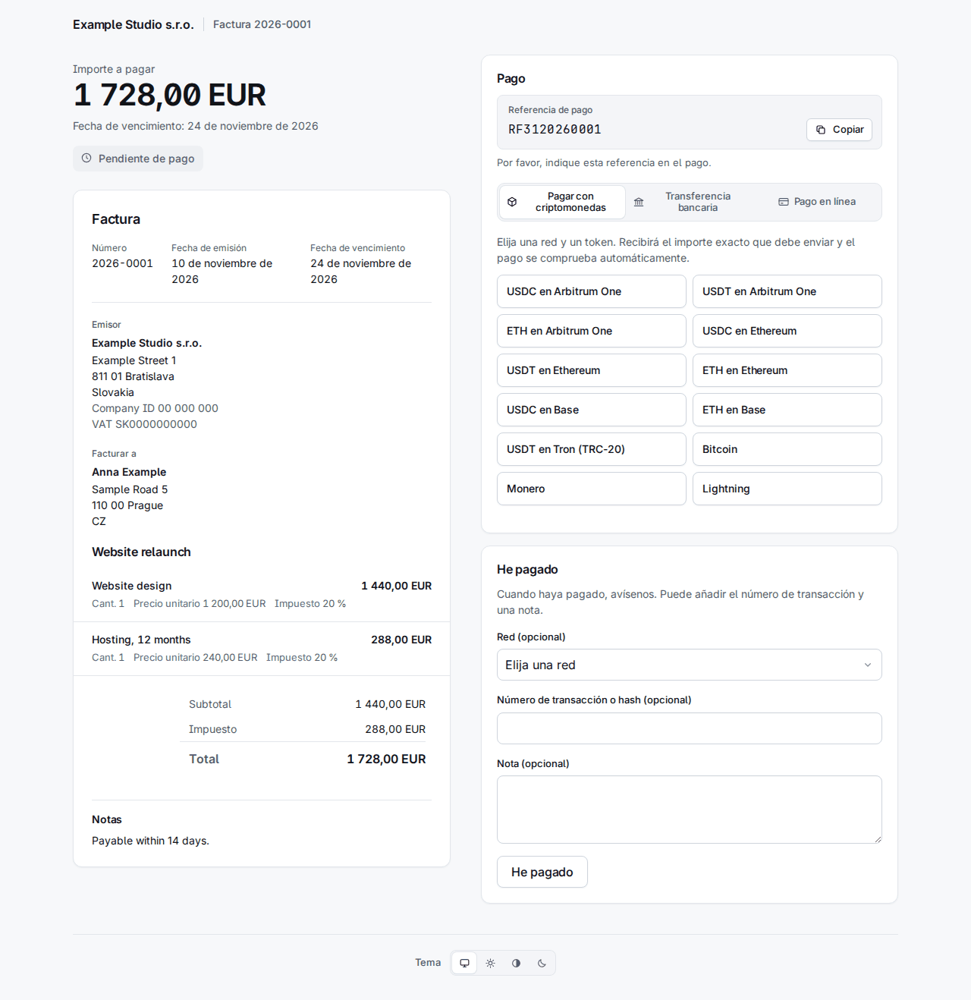

# 4. Facturas

**Invoices** en la barra las enumera, las más recientes primero, con un filtro por estado y por organización y una búsqueda por número o referencia externa.

Una factura tiene uno de estos estados:

| Estado | Significado |
|---|---|
| `draft` | No enviada. No tiene número y aún se puede editar o borrar. |
| `sent` | Numerada y con sus enlaces; esperando dinero. |
| `overdue` | Enviada, y la fecha de vencimiento ha pasado (lo cambia el worker). |
| `declared` | El cliente pulsó «He pagado». Es una afirmación, no dinero. |
| `partially_paid` | Los pagos confirmados cubren parte del total. |
| `paid` | Los pagos confirmados cubren el total. |
| `overpaid` | Los pagos confirmados superan el total. |
| `void` | Anulada; ya no se puede pagar. |

Solo cuentan los pagos **confirmados**. Una factura enviada ya no se puede editar: lo que dice se congela en el momento del envío, incluidos el emisor, el comprador y los datos de pago, de modo que un cambio posterior en un contacto o en una cuenta nunca altera una factura que el cliente ya tiene.

## Crear una factura

**New invoice** pregunta quién, qué y cómo se pagará. No se envía nada hasta que pulse Send en el borrador.

- **Requesting organization** y **Type**: una *Invoice* recibe un número de la numeración de la organización; una *Payment request* (solicitud de pago) no tiene número y no es un documento de factura legal.
- **Contact e-mail**: un contacto existente se encuentra por él; si no, se crea uno nuevo con los campos de abajo. Responda **US tax resident** (yes, no o unknown) a conciencia; «Choose…» no se acepta. Un yes envía la factura al emisor de EE. UU. (capítulo 2): la página dice entonces «Issued by …».
- **Currency**, **Issue date**, **Due in (days)** (vacío: vence a la recepción), **Title** y **Notes** (se imprimen en la factura).
- **Lines**: nombre, descripción opcional, cantidad, precio unitario en unidades principales (`12.50`), impuesto % y descuento %. Las filas vacías se ignoran.
- **Payment methods**: está marcado cada método activo del emisor que encaja con la moneda: sus cuentas bancarias en esa moneda, sus enlaces fiat que la aceptan y todas sus cuentas rail (una cotización convierte, así que sirve cualquier moneda). Desmarque lo que no quiera ofrecer.

**Create draft** la guarda. La página del borrador muestra las líneas y los totales, tiene **Edit this draft** y **Delete draft** y la casilla que la envía.

## Enviar

**Send** numera la factura, la congela y crea dos **enlaces de capacidad** (capability links): uno para verla (`/i/…`) y otro para pagarla (`/p/…`). Son secretos: se guardan solo como hashes y se muestran solo una vez.

- Con **E-mail the client when sent** marcado, la carta de la factura se pone en la bandeja de salida (la envía el worker, en el idioma del contacto, con el PDF adjunto) y lleva ambos enlaces. Si el contacto tiene una clave de cifrado activa, la carta se cifra con ella.
- **Sin** la marca no se envía nada y usted pasa los enlaces por su cuenta. Para verlos, abra la factura, **More actions > Reissue the client links** (abajo): la página muestra los dos enlaces una vez.

## Lo que ve el cliente

La **página de la factura** `/i/…` muestra el documento, un PDF para descargar y **Recibir correo cifrado** (capítulo 3). La **página de pago** `/p/…` muestra el importe a pagar y las formas de pago. Está en el idioma del contacto o del navegador.

El cuadro de pago tiene hasta tres pestañas, **cripto primero**:

- **Pagar con criptomonedas**: el cliente elige una red y un token, por ejemplo «USDC on Arbitrum One».
- **Transferencia bancaria**: la cuenta bancaria de la moneda de la factura (beneficiario, número de cuenta, banco, importe, cada uno con botón de copiar), la **referencia de pago** (una referencia ISO 11649 como `RF3120260001`) y sus instrucciones en el idioma del cliente.
- **Pago en línea**: los enlaces fiat (Revolut, PayPal y demás).

Los nueve idiomas están cubiertos: la misma página en eslovaco, checo, alemán, español, francés, polaco, coreano y ruso está al final de este capítulo.

### Cotizaciones y tipos de cambio

Un cliente no paga en cripto «el importe de la factura»: paga una **cotización** (quote).

- Elegir red y token fija el tipo de cambio y muestra el **importe exacto** que enviar, la dirección, un código QR y un enlace «Open in wallet». El importe se redondea **hacia arriba**, nunca por defecto.
- La cotización vale unos **30 minutos**; la página cuenta hacia atrás y **Obtener un nuevo importe** emite otra.
- En una dirección compartida el importe lleva unas unidades de «polvo» **únicas por cotización**. Así se asocia el pago a la factura, por lo que el cliente debe enviar exactamente ese importe en ese token y en esa red.
- Los tipos proceden de dos fuentes que se contrastan (Kraken y Coinbase); si difieren en más de un 1 %, no se emite la cotización. El paso de EUR a otras monedas fiat usa los tipos del BCE a través de Frankfurter; un tipo obsoleto o que salta de golpe hace rechazar las cotizaciones en esa moneda y aparece en Needs a person bajo *Exchange rates refused*, donde una persona puede aceptar un salto que sea real.
- La página se actualiza sola cuando se ve la transferencia. El worker vigila la cadena; los pagos de Lightning y BTCPay se leen de su pasarela.

El cuadro **He pagado** permite al cliente comunicar un pago (red, hash de la transacción y una nota, todo opcional). La factura pasa a `declared` y aparece en Needs a person; un hash indicado se busca en la cadena. Una declaración es una afirmación, nunca dinero: por sí sola no liquida nada.

## Registrar un pago a mano

Una transferencia bancaria o un pago en línea llega a un sitio que Sealbill no ve. Cuando **usted** vea el dinero, abra la factura y pulse **Record payment**: el importe, la vía (*Bank transfer*, *Payment link* o *Recorded by hand*) y una nota. Se confirma al instante y se cuenta. Solo una persona puede hacerlo; ningún token de API.

Un pago mal registrado o devuelto se deshace con **Reverse** en su fila, que exige un motivo.

## Pagos parciales y excesos

**Parcial.** Cuando los pagos confirmados cubren solo parte del total, la factura pasa a `partially_paid`. El cliente recibe una carta que dice lo que llegó y lo que aún se debe, y la página de pago ofrece cotizaciones para el **resto**. Una factura parcialmente pagada no se puede anular.

**Exceso.** Una factura puede pagarse de más de dos maneras, y ambas acaban ante una persona (capítulo 6):

- *Se registró más dinero que el total* (una transferencia bancaria o un pago que usted registró a mano): la factura queda `overpaid` y aparece en la cola **Overpaid invoices**. Devuelva la diferencia fuera del sistema, o pulse **Keep the overpayment** y escriba por qué. La factura sigue `overpaid`, que es lo que dice el dinero; la decisión, la suma que cubre y su nota van al registro de auditoría, y el elemento sale de la cola hasta que llegue más dinero.

  

- *Un pago en cripto superior a su cotización*: la factura queda pagada y el pago recibe un **refund due**, listado en **Refunds due** con el importe y la dirección de la que vino. Cuando lo haya devuelto, o decidido no hacerlo, pulse **Refunded** con una nota. Un pago muy superior a la cotización (por encima del *Overpayment ceiling* de la organización) no se liquida en absoluto: espera en **Payments to review**.

  

## Anular

**More actions** (los tres puntos) tiene **Void invoice** con un motivo obligatorio. Una factura anulada ya no se puede pagar: se cierran sus cotizaciones y declaraciones abiertas, y la página del cliente dice que está anulada. Se rechaza mientras se confirma un pago y una vez confirmado dinero (revierta antes ese pago); una factura `paid`, `partially_paid` u `overpaid` no se puede anular. El dinero que llegue después para una factura anulada no se pierde: va a **Payments to review** con el motivo «The invoice was already closed when the payment arrived.»

## Reemitir los enlaces

Un cliente perdió el correo, o usted envió sin correo y necesita los enlaces: **More actions > Reissue the client links**.

Reemitir **sustituye ambos enlaces**: los antiguos dejan de funcionar, incluidos los que ya están en el buzón del cliente, y se cancelan las cartas aún no enviadas con los enlaces antiguos. Marque **E-mail the new links to the client** para poner una carta en cola; si no, la página muestra los dos enlaces nuevos **una vez** y dice «Nothing was e-mailed: pass these on yourself.» Un borrador o una factura anulada no pueden tener enlaces nuevos. El evento de webhook `invoice.links_reissued` avisa a una integración que guardó los enlaces antiguos de que están muertos.

## El recordatorio a los 30 días

Si el sistema envió por correo la carta de la factura y la factura sigue sin pagar (`sent`, `overdue` o `partially_paid`) **30 días** después del envío, el worker envía **un** recordatorio, una sola vez. El recordatorio **sustituye ambos enlaces**, como arriba.

- `INVOICE_REMINDER_DAYS` fija el número de días; `0` desactiva el recordatorio.
- Se omite en una factura enviada sin correo, en una enviada por la API con `client_letters: false`, en cualquier pedido de un enlace de pago, en una factura `declared`, en una factura con una cotización abierta o un pago detectado o en revisión, en un residente fiscal de EE. UU. con un emisor que no sea el de EE. UU. (esa factura está en la cola «wrong issuer») y en un contacto cuya clave de cifrado ha fallado. Una factura omitida se vuelve a examinar en la siguiente ejecución.
- La tarea se ejecuta al arrancar el worker y luego cada 24 horas, así que un worker que estuvo parado recupera todo lo que cumple las condiciones, sea cual sea la antigüedad de la factura. Si la bóveda está sellada al arrancar, no hace nada y lo intenta de nuevo 24 horas después.

## La misma página en los nueve idiomas

Cada idioma muestra la página de la factura y la página de pago de la factura de demostración. El texto propio de la factura (líneas, notas) está en el idioma en que usted lo escribió; el marco que lo rodea está traducido.

| | Página de la factura | Página de pago |
|---|---|---|
| English | [imagen](../img/portal-invoice-en.png) | [imagen](../img/portal-pay-en.png) |
| Slovenčina | [imagen](../img/portal-invoice-sk.png) | [imagen](../img/portal-pay-sk.png) |
| Čeština | [imagen](../img/portal-invoice-cs.png) | [imagen](../img/portal-pay-cs.png) |
| Deutsch | [imagen](../img/portal-invoice-de.png) | [imagen](../img/portal-pay-de.png) |
| Español | [imagen](../img/portal-invoice-es.png) | [imagen](../img/portal-pay-es.png) |
| Français | [imagen](../img/portal-invoice-fr.png) | [imagen](../img/portal-pay-fr.png) |
| Polski | [imagen](../img/portal-invoice-pl.png) | [imagen](../img/portal-pay-pl.png) |
| 한국어 | [imagen](../img/portal-invoice-ko.png) | [imagen](../img/portal-pay-ko.png) |
| Русский | [imagen](../img/portal-invoice-ru.png) | [imagen](../img/portal-pay-ru.png) |

Las facturas en otros estados tienen este aspecto para el cliente:

