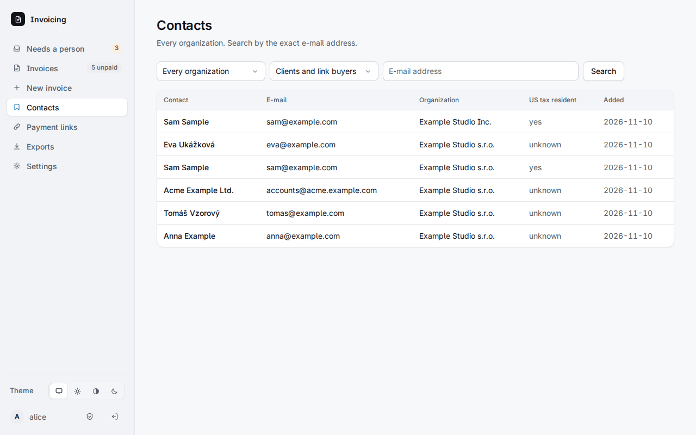
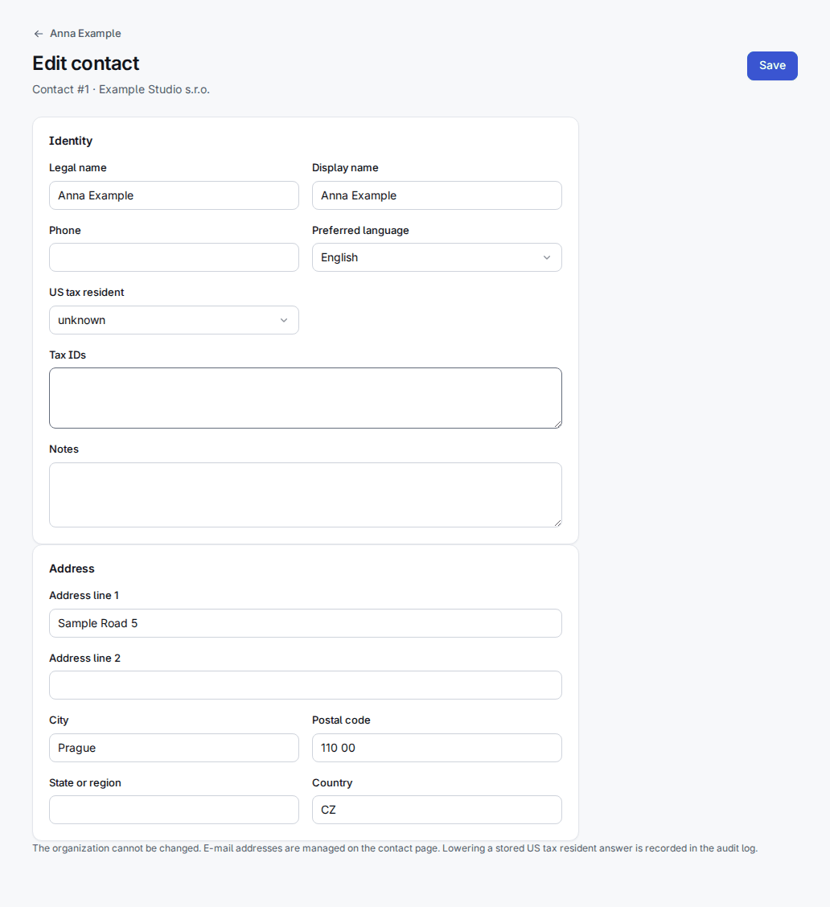
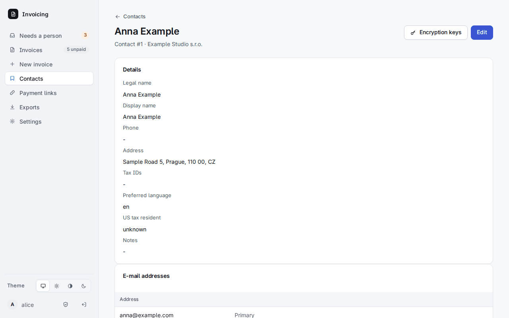
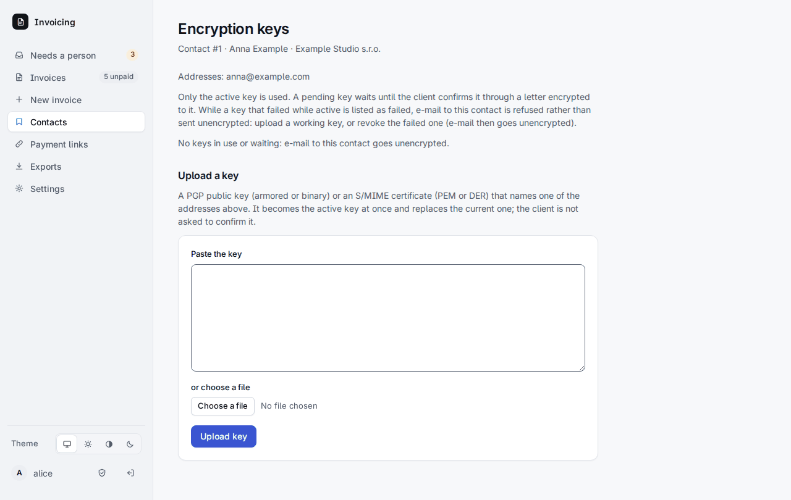
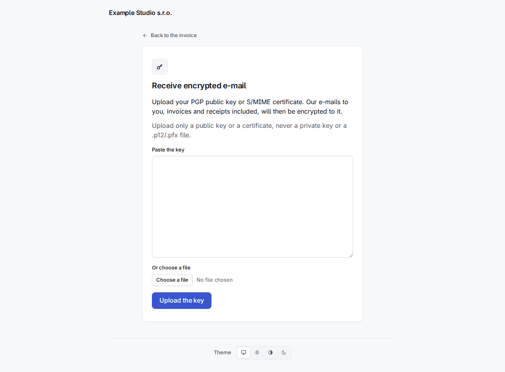
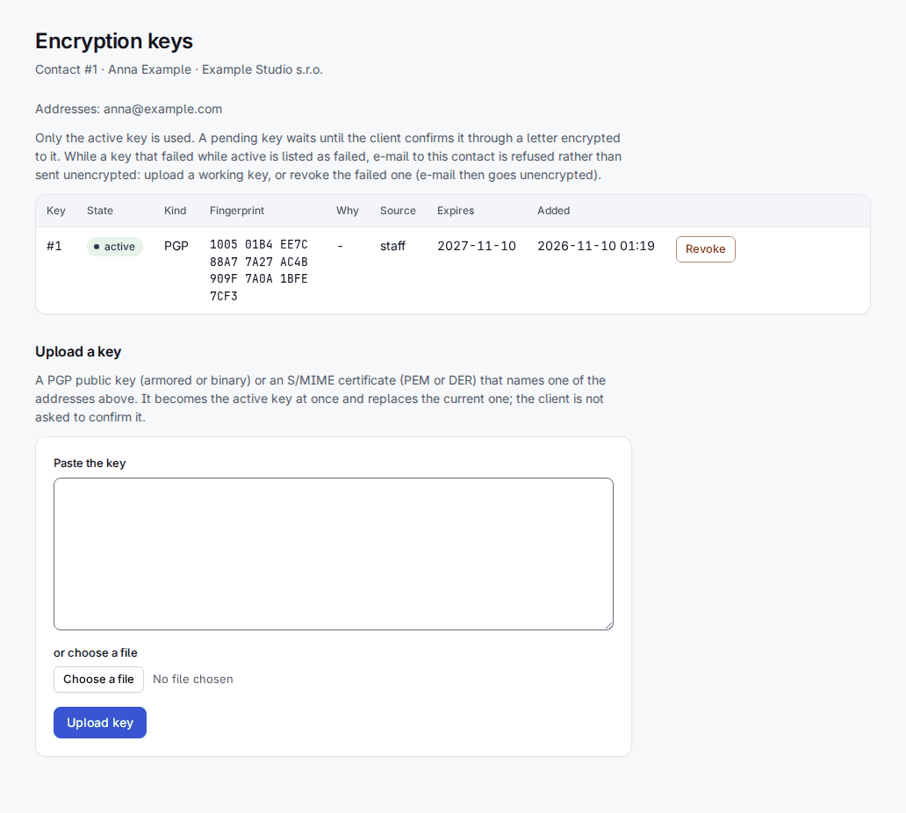

# 3. Contacts

Un **contact** est un client d'une organisation : noms, une ou plusieurs adresses e-mail, une adresse postale, des identifiants fiscaux, un téléphone, une langue préférée, une note et la réponse à « US tax resident ? ». Chaque contact appartient à une organisation. Ouvrez **Contacts** dans la barre.

- Recherchez par **adresse e-mail exacte** ; filtrez par organisation.
- La liste affiche **Clients and link buyers**, **Clients of record** ou **Link buyers**. Un *link buyer* est un contact créé par le passage en caisse (checkout) d'un lien de paiement à partir de ce qu'un visiteur a saisi ; n'importe qui peut saisir n'importe quoi dans un formulaire public, ce n'est donc pas un client enregistré (client of record) tant qu'une personne ne l'a pas promu (chapitre 5).
- Un contact que vous voyez deux fois sous le même nom, une fois sous chaque organisation, est la **copie du client chez l'émetteur américain** (chapitre 2) : l'émetteur tient sa propre copie pour que les données de la première organisation ne soient jamais réécrites.

## Créer et modifier un contact

On en crée rarement un isolément. Saisir une adresse e-mail dans **New invoice** retrouve le contact qui a cette adresse ou en crée un nouveau à partir de ce que vous avez saisi ; ce que vous laissez vide n'écrase jamais ce qui est enregistré. L'API et l'outil d'import créent aussi des contacts.

**Contact > Edit** modifie le nom, le téléphone, la langue préférée, la réponse sur les États-Unis, les identifiants fiscaux, les notes et l'adresse. L'organisation ne peut pas changer. Abaisser une réponse américaine enregistrée (depuis « yes ») est consigné dans le journal d'audit.

Sur la page du contact, la liste **E-mail addresses** ajoute une adresse, en désigne une comme **Primary** et en supprime. Les e-mails, les liens de paiement et les PDF vont à l'adresse principale, ajouter ou promouvoir une adresse est donc un changement soumis à [reconfirmation](01-getting-started.md). L'adresse principale, la dernière adresse et une adresse que nomme une clé de chiffrement active ne peuvent pas être supprimées.

## Clés de chiffrement d'un contact

Tout ce qui est stocké sur un contact est déjà chiffré au repos avec la clé du coffre (chapitre 1). Un contact peut en plus avoir une clé à lui, pour que **les e-mails que vous lui envoyez** soient chiffrés avec elle : une **clé publique PGP** ou un **certificat S/MIME**. Ouvrez **Contact > Encryption keys**.

- **Envoi par le personnel.** Collez la clé ou choisissez un fichier. Elle doit nommer l'une des adresses du contact, ne pas être expirée et être une clé publique ou un certificat (une clé privée ou un fichier `.p12` est refusé). Elle devient aussitôt la clé **active** et remplace l'actuelle ; le client n'a rien à confirmer.
- **Envoi par le client.** Chaque page client a **Recevoir des e-mails chiffrés**. La clé que le client y envoie est **pending** (en attente) : elle attend que le client réponde à un e-mail chiffré avec elle, ce qui prouve qu'il détient la moitié privée. Si le contact avait déjà une clé active, le titulaire de cette clé reçoit un avis avec un lien d'**annulation**, afin que quelqu'un qui lit la boîte aux lettres ne puisse pas glisser discrètement sa propre clé.

  

- Seule la clé **active** est utilisée, une par contact. Son état est `pending`, `active`, `replaced`, `revoked` ou `failed`. **Revoke** la retire ; les e-mails partent alors non chiffrés.
- Une clé qui **cesse de fonctionner alors qu'elle est active** (expirée ou révoquée à la source) passe à `failed`, et les e-mails à ce contact sont **refusés plutôt qu'envoyés non chiffrés**. Elle figure dans Needs a person sous *Encryption keys that stopped working* ; envoyez une clé qui fonctionne ou révoquez celle qui a échoué, puis relancez les messages. Une clé qui échoue encore à l'état pending n'arrête rien. Needs a person liste aussi les *clés qui expirent dans les 30 jours*.
- La copie d'un contact chez l'émetteur suit automatiquement la clé de l'original.

La même chose est possible par l'API : `POST /api/v1/contacts/{id}/keys` avec `{"key": "<armored key>"}` (scope `invoices:write`) et `POST /api/v1/keys/{id}/revoke`.
