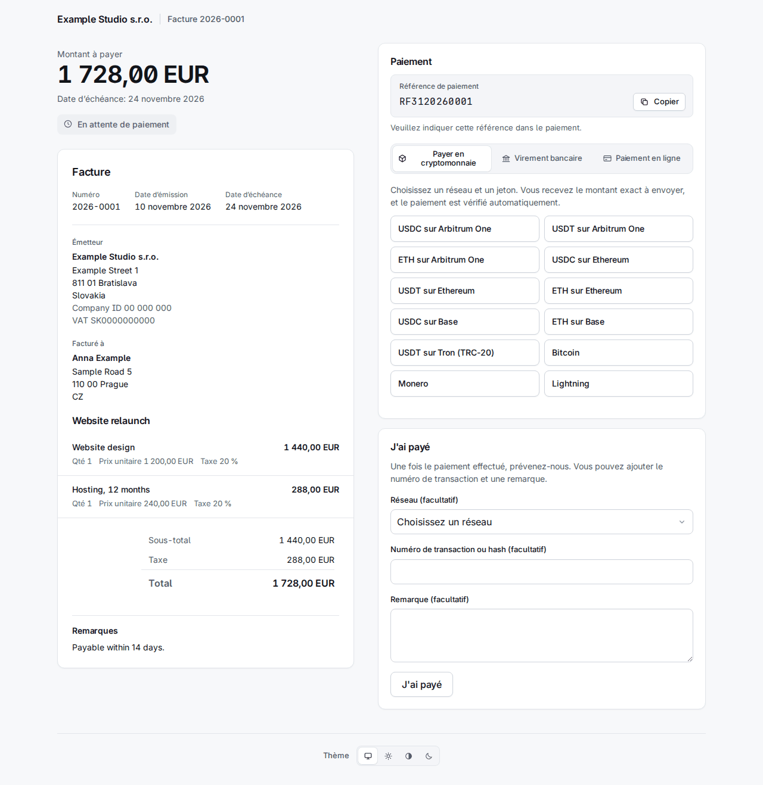

# 4. Factures

**Invoices** dans la barre les liste, les plus récentes d'abord, avec un filtre par statut et par organisation et une recherche par numéro ou référence externe.

Une facture a l'un de ces statuts :

| Statut | Signification |
|---|---|
| `draft` | Non envoyée. Elle n'a pas de numéro et peut encore être modifiée ou supprimée. |
| `sent` | Numérotée et dotée de ses liens ; en attente d'argent. |
| `overdue` | Envoyée, et l'échéance est passée (le worker la fait passer à ce statut). |
| `declared` | Le client a appuyé sur « J'ai payé ». C'est une affirmation, pas de l'argent. |
| `partially_paid` | Les paiements confirmés couvrent une partie du total. |
| `paid` | Les paiements confirmés couvrent le total. |
| `overpaid` | Les paiements confirmés dépassent le total. |
| `void` | Annulée ; elle ne peut plus être payée. |

Seuls les paiements **confirmés** comptent. Une facture envoyée ne peut plus être modifiée : ce qu'elle dit est figé au moment de l'envoi, y compris l'émetteur, l'acheteur et les coordonnées de paiement, si bien qu'un changement ultérieur d'un contact ou d'un compte ne modifie jamais une facture que le client détient déjà.

## Créer une facture

**New invoice** demande qui, quoi et comment payer. Rien n'est envoyé tant que vous n'avez pas appuyé sur Send sur le brouillon.

- **Requesting organization** et **Type** : une *Invoice* reçoit un numéro de la numérotation de l'organisation ; une *Payment request* (demande de paiement) n'a pas de numéro et n'est pas un document de facture légal.
- **Contact e-mail** : un contact existant est retrouvé par lui, sinon un nouveau est créé à partir des champs ci-dessous. Répondez à **US tax resident** (yes, no ou unknown) en connaissance de cause ; « Choose… » n'est pas accepté. Un yes envoie la facture à l'émetteur américain (chapitre 2) : la page indique alors « Issued by … ».
- **Currency**, **Issue date**, **Due in (days)** (vide : due à réception), **Title** et **Notes** (imprimés sur la facture).
- **Lines** : nom, description facultative, quantité, prix unitaire en unités principales (`12.50`), taxe % et remise %. Les lignes vides sont ignorées.
- **Payment methods** : chaque méthode active de l'émetteur qui convient à la devise est cochée : ses comptes bancaires dans cette devise, ses liens fiat qui l'acceptent et tous ses comptes rail (un devis de change convertit, toute devise fonctionne donc). Décochez ce que vous ne voulez pas proposer.

**Create draft** l'enregistre. La page du brouillon montre les lignes et les totaux, a **Edit this draft** et **Delete draft**, et la case qui l'envoie.

## Envoyer

**Send** numérote la facture, la fige et crée deux **liens de capacité** (capability links) : un pour la consulter (`/i/…`) et un pour la payer (`/p/…`). Ce sont des secrets : ils ne sont stockés que sous forme de hachages et ne sont affichés qu'une fois.

- Avec **E-mail the client when sent** coché, la lettre de facture est mise dans la boîte d'envoi (le worker l'envoie, dans la langue du contact, avec le PDF en pièce jointe) et porte les deux liens. Si le contact a une clé de chiffrement active, la lettre est chiffrée avec elle.
- **Sans** la case, rien n'est envoyé et vous transmettez les liens vous-même. Pour les voir, ouvrez la facture, **More actions > Reissue the client links** (ci-dessous) : la page montre les deux liens une fois.

## Ce que voit le client

La **page de facture** `/i/…` montre le document, un PDF à télécharger et **Recevoir des e-mails chiffrés** (chapitre 3). La **page de paiement** `/p/…` montre le montant dû et les moyens de payer. Elle est dans la langue du contact ou du navigateur.

Le cadre de paiement a jusqu'à trois onglets, **crypto en premier** :

- **Payer en cryptomonnaie** : le client choisit un réseau et un jeton, par exemple « USDC on Arbitrum One ».
- **Virement bancaire** : le compte bancaire de la devise de la facture (bénéficiaire, numéro de compte, banque, montant, chacun avec un bouton de copie), la **référence de paiement** (une référence ISO 11649 comme `RF3120260001`) et vos instructions dans la langue du client. En EUR vers l'IBAN d'un pays SEPA s'ajoutent trois codes QR (PAY by square, QR Platba et EPC QR), en CZK vers un IBAN tchèque le code QR Platba : le client en scanne un dans son application bancaire, et le compte, le montant restant dû et la référence se remplissent seuls. La facture PDF imprime les mêmes codes.
- **Paiement en ligne** : les liens fiat (Revolut, PayPal, etc.).

Les neuf langues sont couvertes : la même page en slovaque, tchèque, allemand, espagnol, français, polonais, coréen et russe se trouve à la fin de ce chapitre.

### Devis de change et taux de change

Un client ne paie pas « le montant de la facture » en crypto : il paie un **devis de change** (quote).

- Choisir un réseau et un jeton fixe le taux de change et affiche le **montant exact** à envoyer, l'adresse, un code QR et un lien « Open in wallet ». Le montant est arrondi **à l'excès**, jamais en dessous.
- Le devis est valable environ **30 minutes** ; la page décompte et **Obtenir un nouveau montant** en émet un autre.
- Sur une adresse partagée, le montant porte quelques unités de « poussière » **uniques par devis**. C'est ainsi que le paiement est rapproché de la facture ; le client doit donc envoyer exactement ce montant dans ce jeton sur ce réseau.
- Les taux proviennent de deux sources recoupées (Kraken et Coinbase) ; si elles diffèrent de plus de 1 %, aucun devis n'est émis. L'étape de l'EUR vers les autres devises fiat utilise les taux de la BCE via Frankfurter ; un taux périmé ou qui saute brusquement fait refuser les devis dans cette devise et apparaît dans Needs a person sous *Exchange rates refused*, où une personne peut accepter un saut qui est réel.
- La page se met à jour toute seule quand le virement est vu. Le worker surveille la chaîne ; les paiements Lightning et BTCPay sont lus auprès de leur passerelle.

La zone **J'ai payé** permet au client de signaler un paiement (réseau, hachage de transaction et une note, le tout facultatif). La facture passe à `declared` et apparaît dans Needs a person ; un hachage fourni est recherché sur la chaîne. Une déclaration est une affirmation, jamais de l'argent : elle ne règle rien par elle-même. Le personnel reçoit un e-mail seulement quand il doit agir : tout de suite quand seule une personne peut vérifier la déclaration (sans hachage, ou sur un réseau que le système ne lit pas) ou quand l'argent de la transaction indiquée est allé à une autre facture, et au bout d'une demi-heure quand le hachage n'a pas été trouvé. Un hachage dont l'argent revient à cette facture n'envoie pas d'e-mail : le paiement se règle seul, ou passe en examen, qui a son propre e-mail.

## Enregistrer un paiement à la main

Un virement bancaire ou un paiement en ligne arrive là où Sealbill ne voit pas. Quand **vous** voyez l'argent, ouvrez la facture et appuyez sur **Record payment** : le montant, le moyen (*Bank transfer*, *Payment link* ou *Recorded by hand*) et une note. Il est confirmé aussitôt et compté. Seule une personne peut le faire ; aucun jeton d'API ne le peut.

Un paiement mal enregistré ou rendu s'annule avec **Reverse** sur sa ligne, qui demande un motif.

## Paiements partiels et trop-perçus

**Partiel.** Quand les paiements confirmés ne couvrent qu'une partie du total, la facture passe à `partially_paid`. Le client reçoit une lettre qui dit ce qui est arrivé et ce qui reste dû, et la page de paiement propose des devis de change pour le **solde**. Une facture partiellement payée ne peut pas être annulée.

**Trop-perçu.** Une facture peut être payée en trop de deux façons, et les deux aboutissent devant une personne (chapitre 6) :

- *Plus d'argent que le total a été enregistré* (un virement bancaire ou un paiement que vous avez enregistré à la main) : la facture est `overpaid` et figure dans la file **Overpaid invoices**. Remboursez la différence hors du système, ou appuyez sur **Keep the overpayment** et indiquez pourquoi. La facture reste `overpaid`, ce que dit l'argent ; la décision, la somme qu'elle couvre et votre note vont au journal d'audit, et l'élément quitte la file jusqu'à l'arrivée de nouveaux fonds.

  

- *Un paiement crypto supérieur à son devis de change* : la facture est payée et le paiement reçoit un **refund due**, listé sous **Refunds due** avec le montant et l'adresse d'où il vient. Une fois que vous l'avez renvoyé, ou décidé de ne pas le faire, appuyez sur **Refunded** avec une note. Un paiement très supérieur au devis (au-delà du *Overpayment ceiling* de l'organisation) n'est pas réglé du tout : il attend sous **Payments to review**.

  

## Annuler

**More actions** (les trois points) propose **Void invoice** avec un motif obligatoire. Une facture annulée ne peut plus être payée : ses devis de change et déclarations ouverts sont clos, et la page du client dit qu'elle est annulée. L'action est refusée tant qu'un paiement est en cours de confirmation et dès que de l'argent a été confirmé (annulez d'abord ce paiement) ; une facture `paid`, `partially_paid` ou `overpaid` ne peut pas être annulée. L'argent qui arrive malgré tout plus tard pour une facture annulée n'est pas perdu : il atterrit dans **Payments to review** avec le motif « The invoice was already closed when the payment arrived. »

## Réémettre les liens

Un client a perdu l'e-mail, ou vous avez envoyé sans e-mail et il vous faut les liens : **More actions > Reissue the client links**.

Réémettre **remplace les deux liens** : les anciens cessent de fonctionner, y compris ceux déjà dans la boîte du client, et les lettres pas encore envoyées avec les anciens liens sont annulées. Cochez **E-mail the new links to the client** pour mettre une lettre en file ; sinon la page montre les deux nouveaux liens **une fois** et dit « Nothing was e-mailed: pass these on yourself. » Un brouillon ou une facture annulée ne peut pas voir ses liens réémis. L'événement de webhook `invoice.links_reissued` signale à une intégration qui avait stocké les anciens liens qu'ils sont morts.

## Le rappel au bout de 30 jours

Si le système a envoyé la lettre de facture par e-mail et que la facture est toujours impayée (`sent`, `overdue` ou `partially_paid`) **30 jours** après l'envoi, le worker envoie **un** rappel, une seule fois. Le rappel **remplace les deux liens**, comme ci-dessus.

- `INVOICE_REMINDER_DAYS` fixe le nombre de jours ; `0` désactive le rappel.
- Il est ignoré pour une facture envoyée sans e-mail, une facture envoyée par l'API avec `client_letters: false`, toute commande issue d'un lien de paiement, une facture `declared`, une facture avec un devis de change ouvert ou un paiement détecté ou en examen, un résident fiscal américain chez un émetteur non américain (cette facture est dans la file « wrong issuer ») et un contact dont la clé de chiffrement a échoué. Une facture ignorée est réexaminée à l'exécution suivante.
- La tâche s'exécute au démarrage du worker puis toutes les 24 heures ; un worker qui était arrêté rattrape donc tout ce qui remplit les conditions, quel que soit l'âge de la facture. Si le coffre est scellé au démarrage, elle ne fait rien et réessaie 24 heures plus tard.

## La même page dans les neuf langues

Chaque langue montre la page de facture et la page de paiement de la facture de démonstration. Le texte propre de la facture (lignes, notes) est dans la langue où vous l'avez saisi ; le cadre autour est traduit.

| | Page de facture | Page de paiement |
|---|---|---|
| English | [image](../img/portal-invoice-en.png) | [image](../img/portal-pay-en.png) |
| Slovenčina | [image](../img/portal-invoice-sk.png) | [image](../img/portal-pay-sk.png) |
| Čeština | [image](../img/portal-invoice-cs.png) | [image](../img/portal-pay-cs.png) |
| Deutsch | [image](../img/portal-invoice-de.png) | [image](../img/portal-pay-de.png) |
| Español | [image](../img/portal-invoice-es.png) | [image](../img/portal-pay-es.png) |
| Français | [image](../img/portal-invoice-fr.png) | [image](../img/portal-pay-fr.png) |
| Polski | [image](../img/portal-invoice-pl.png) | [image](../img/portal-pay-pl.png) |
| 한국어 | [image](../img/portal-invoice-ko.png) | [image](../img/portal-pay-ko.png) |
| Русский | [image](../img/portal-invoice-ru.png) | [image](../img/portal-pay-ru.png) |

Les factures dans d'autres états ressemblent à ceci pour le client :

