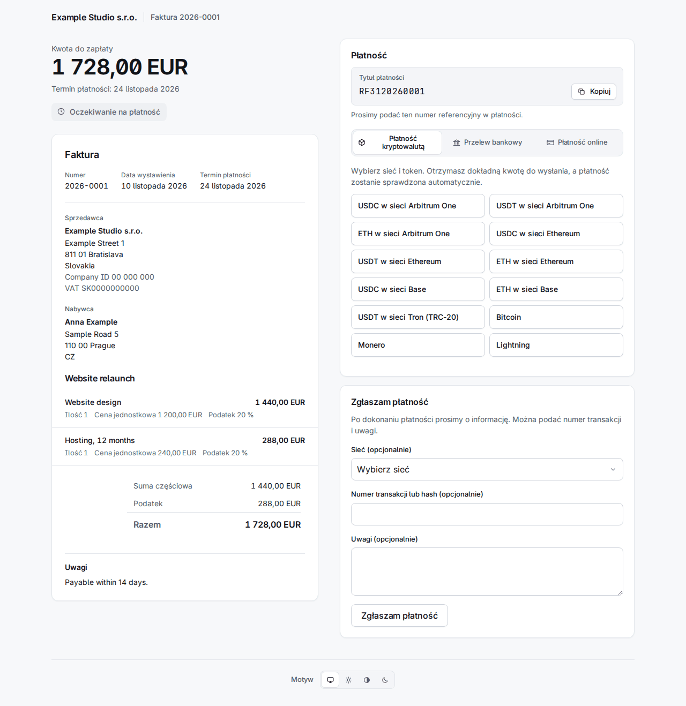

# 4. Faktury

**Invoices** na pasku wymienia je od najnowszych, z filtrem według statusu i organizacji oraz wyszukiwaniem po numerze lub zewnętrznym odnośniku.

Faktura ma jeden z tych statusów:

| Status | Znaczenie |
|---|---|
| `draft` | Niewysłana. Nie ma numeru i można ją jeszcze edytować lub usunąć. |
| `sent` | Ponumerowana i z linkami; czeka na pieniądze. |
| `overdue` | Wysłana, a termin płatności minął (status zmienia worker). |
| `declared` | Klient nacisnął „Zgłaszam płatność". To twierdzenie, nie pieniądze. |
| `partially_paid` | Potwierdzone płatności pokrywają część sumy. |
| `paid` | Potwierdzone płatności pokrywają całą sumę. |
| `overpaid` | Potwierdzone płatności przekraczają sumę. |
| `void` | Anulowana; nie można jej już zapłacić. |

Liczą się tylko płatności **potwierdzone**. Wysłanej faktury nie można już edytować: to, co mówi, jest zamrażane w chwili wysłania, łącznie ze sprzedawcą, nabywcą i danymi płatności, więc późniejsza zmiana kontaktu lub konta nigdy nie zmienia faktury, którą klient już ma.

## Tworzenie faktury

**New invoice** pyta, kto, co i jak ma zapłacić. Nic nie jest wysyłane, dopóki nie naciśniesz Send na wersji roboczej.

- **Requesting organization** i **Type**: *Invoice* dostaje numer z numeracji organizacji; *Payment request* (prośba o płatność) nie ma numeru i nie jest dokumentem faktury w sensie prawnym.
- **Contact e-mail**: istniejący kontakt jest znajdowany po nim, w przeciwnym razie z pól poniżej powstaje nowy. Odpowiedz na **US tax resident** (yes, no lub unknown) świadomie; „Choose…" nie jest akceptowane. Odpowiedź yes kieruje fakturę do wystawcy dla USA (rozdział 2): strona pokazuje wtedy „Issued by …".
- **Currency**, **Issue date**, **Due in (days)** (puste: płatne przy otrzymaniu), **Title** i **Notes** (drukowane na fakturze).
- **Lines**: nazwa, opcjonalny opis, ilość, cena jednostkowa w jednostkach głównych (`12.50`), podatek % i rabat %. Puste wiersze są pomijane.
- **Payment methods**: zaznaczona jest każda aktywna metoda wystawcy pasująca do waluty: jego konta bankowe w tej walucie, jego fiat linki, które ją przyjmują, i wszystkie jego konta rail (oferta kursowa przelicza, więc działa każda waluta). Odznacz to, czego nie chcesz oferować.

**Create draft** zapisuje ją. Strona wersji roboczej pokazuje pozycje i sumy, ma **Edit this draft** i **Delete draft** oraz pole, które ją wysyła.

## Wysyłanie

**Send** numeruje fakturę, zamraża ją i tworzy dwa **linki uprawniające** (capability links): jeden do podglądu (`/i/…`) i jeden do zapłaty (`/p/…`). To sekrety: są przechowywane tylko jako skróty i pokazywane tylko raz.

- Przy zaznaczonym **E-mail the client when sent** list z fakturą trafia do skrzynki nadawczej (wysyła go worker, w języku kontaktu, z PDF w załączniku) i niesie oba linki. Jeśli kontakt ma aktywny klucz szyfrujący, list jest na niego szyfrowany.
- **Bez** zaznaczenia nic nie jest wysyłane, a linki przekazujesz sam. Aby je zobaczyć, otwórz fakturę, **More actions > Reissue the client links** (poniżej): strona pokazuje dwa linki raz.

## Co widzi klient

**Strona faktury** `/i/…` pokazuje dokument, PDF do pobrania i **Otrzymywanie zaszyfrowanych e-maili** (rozdział 3). **Strona płatności** `/p/…` pokazuje kwotę do zapłaty i sposoby płatności. Jest w języku kontaktu lub przeglądarki.

Pole płatności ma do trzech zakładek, **krypto na pierwszym miejscu**:

- **Płatność kryptowalutą**: klient wybiera sieć i token, np. „USDC on Arbitrum One".
- **Przelew bankowy**: konto bankowe w walucie faktury (beneficjent, numer konta, bank, kwota, każde z przyciskiem kopiowania), **tytuł płatności** (odnośnik ISO 11649, np. `RF3120260001`) i Twoje instrukcje w języku klienta. Przy EUR na IBAN kraju SEPA dochodzą trzy kody QR (PAY by square, QR Platba i EPC QR), przy CZK na czeski IBAN kod QR Platba: klient skanuje jeden z nich w aplikacji bankowej, a konto, pozostała kwota i tytuł płatności wypełniają się same. Faktura PDF zawiera te same kody.
- **Płatność online**: fiat linki (Revolut, PayPal i tak dalej).

Obsługiwanych jest wszystkie dziewięć języków: ta sama strona po słowacku, czesku, niemiecku, hiszpańsku, francusku, polsku, koreańsku i rosyjsku jest na końcu tego rozdziału.

### Oferty kursowe i kursy wymiany

Klient nie płaci w krypto „kwoty faktury": płaci **ofertę kursową** (quote).

- Wybór sieci i tokenu ustala kurs wymiany i pokazuje **dokładną kwotę** do wysłania, adres, kod QR i link „Open in wallet". Kwota jest zaokrąglana **w górę**, nigdy w dół.
- Oferta obowiązuje około **30 minut**; strona odlicza czas, a **Pobierz nową kwotę** wystawia kolejną.
- Na wspólnym adresie kwota niesie kilka jednostek „pyłu", **unikalnych dla każdej oferty**. W ten sposób płatność jest dopasowywana do faktury, więc klient musi wysłać dokładnie tę kwotę w tym tokenie w tej sieci.
- Kursy pochodzą z dwóch źródeł, które są ze sobą porównywane (Kraken i Coinbase); jeśli różnią się o więcej niż 1 %, oferta nie jest tworzona. Krok z EUR na inne waluty fiat używa kursów EBC przez Frankfurter; nieaktualny lub nagle skaczący kurs powoduje odrzucanie ofert w tej walucie i pojawia się w Needs a person w sekcji *Exchange rates refused*, gdzie człowiek może zaakceptować skok, który jest prawdziwy.
- Strona odświeża się sama, gdy przelew zostanie zauważony. Worker obserwuje łańcuch; płatności Lightning i BTCPay są odczytywane z ich bramki.

Pole **Zgłaszam płatność** pozwala klientowi zgłosić płatność (sieć, skrót transakcji i notatka, wszystko opcjonalne). Faktura zmienia status na `declared` i trafia do Needs a person; podany skrót jest sprawdzany w łańcuchu. Zgłoszenie to twierdzenie, nigdy pieniądze: samo niczego nie rozlicza.

## Ręczna rejestracja płatności

Przelew bankowy lub płatność online trafia tam, gdzie Sealbill nie widzi. Gdy **Ty** zobaczysz pieniądze, otwórz fakturę i naciśnij **Record payment**: kwota, sposób (*Bank transfer*, *Payment link* lub *Recorded by hand*) i notatka. Jest natychmiast potwierdzona i liczona. Może to zrobić tylko człowiek; żaden token API nie może.

Błędnie zarejestrowaną lub zwróconą płatność cofa się przyciskiem **Reverse** w jej wierszu, który wymaga powodu.

## Płatności częściowe i nadpłaty

**Częściowa.** Gdy potwierdzone płatności pokrywają tylko część sumy, faktura przechodzi w `partially_paid`. Klient dostaje list z informacją, co wpłynęło i ile jeszcze zostało, a strona płatności oferuje oferty na **resztę**. Częściowo opłaconej faktury nie można anulować.

**Nadpłata.** Fakturę można nadpłacić na dwa sposoby i oba kończą się przed człowiekiem (rozdział 6):

- *Zarejestrowano więcej pieniędzy niż suma* (przelew bankowy lub płatność, którą zarejestrowałeś ręcznie): faktura jest `overpaid` i trafia do kolejki **Overpaid invoices**. Zwróć różnicę poza systemem albo naciśnij **Keep the overpayment** i wpisz dlaczego. Faktura pozostaje `overpaid`, co odpowiada stanowi pieniędzy; decyzja, suma, którą obejmuje, i Twoja notatka trafiają do dziennika audytu, a pozycja opuszcza kolejkę, dopóki nie wpłyną kolejne pieniądze.

  

- *Płatność krypto powyżej oferty kursowej*: faktura jest opłacona, a płatność dostaje **refund due**, wymieniony w **Refunds due** z kwotą i adresem, z którego przyszła. Gdy odeślesz ją lub zdecydujesz, że nie, naciśnij **Refunded** z notatką. Płatność znacznie powyżej oferty (powyżej *Overpayment ceiling* organizacji) nie jest w ogóle rozliczana: czeka w **Payments to review**.

  

## Anulowanie

**More actions** (trzy kropki) ma **Void invoice** z obowiązkowym powodem. Anulowanej faktury nie można już zapłacić: jej otwarte oferty i otwarte zgłoszenia są zamykane, a strona klienta mówi, że jest anulowana. Jest odrzucane, dopóki płatność jest potwierdzana, oraz gdy potwierdzono już pieniądze (najpierw cofnij tę płatność); faktury `paid`, `partially_paid` lub `overpaid` nie można anulować. Pieniądze, które mimo to wpłyną później na anulowaną fakturę, nie przepadają: trafiają do **Payments to review** z powodem „The invoice was already closed when the payment arrived."

## Ponowne wydanie linków

Klient zgubił e-mail albo wysłałeś bez e-maila i potrzebujesz linków: **More actions > Reissue the client links**.

Ponowne wydanie **zastępuje oba linki**: stare przestają działać, także te, które już są w skrzynce klienta, a jeszcze niewysłane listy ze starymi linkami są anulowane. Zaznacz **E-mail the new links to the client**, aby zakolejkować list; w przeciwnym razie strona pokazuje dwa nowe linki **raz** i mówi „Nothing was e-mailed: pass these on yourself." Wersja robocza ani anulowana faktura nie mogą dostać nowych linków. Zdarzenie webhooka `invoice.links_reissued` informuje integrację, która zapisała stare linki, że są martwe.

## Przypomnienie po 30 dniach

Jeśli system wysłał list z fakturą e-mailem, a faktura jest wciąż nieopłacona (`sent`, `overdue` lub `partially_paid`) **30 dni** po wysłaniu, worker wysyła **jedno** przypomnienie, raz. Przypomnienie **zastępuje oba linki**, jak wyżej.

- `INVOICE_REMINDER_DAYS` ustawia liczbę dni; `0` wyłącza przypomnienie.
- Jest pomijane dla faktury wysłanej bez e-maila, wysłanej przez API z `client_letters: false`, każdego zamówienia z linku do płatności, faktury `declared`, faktury z otwartą ofertą lub płatnością wykrytą albo w weryfikacji, amerykańskiego rezydenta podatkowego u wystawcy spoza USA (ta faktura jest w kolejce „wrong issuer") i kontaktu, którego klucz szyfrujący zawiódł. Pominięta faktura jest oceniana ponownie przy następnym uruchomieniu.
- Zadanie działa przy starcie workera i potem co 24 godziny, więc worker, który był wyłączony, nadrabia wszystko, co spełnia warunki, bez względu na wiek faktury. Jeśli przy starcie sejf jest zapieczętowany, nie robi nic i próbuje ponownie po 24 godzinach.

## Ta sama strona w dziewięciu językach

Każdy język pokazuje stronę faktury i stronę płatności faktury demonstracyjnej. Własny tekst faktury (pozycje, notatki) jest w języku, w którym go wpisałeś; otoczka jest przetłumaczona.

| | Strona faktury | Strona płatności |
|---|---|---|
| English | [obraz](../img/portal-invoice-en.png) | [obraz](../img/portal-pay-en.png) |
| Slovenčina | [obraz](../img/portal-invoice-sk.png) | [obraz](../img/portal-pay-sk.png) |
| Čeština | [obraz](../img/portal-invoice-cs.png) | [obraz](../img/portal-pay-cs.png) |
| Deutsch | [obraz](../img/portal-invoice-de.png) | [obraz](../img/portal-pay-de.png) |
| Español | [obraz](../img/portal-invoice-es.png) | [obraz](../img/portal-pay-es.png) |
| Français | [obraz](../img/portal-invoice-fr.png) | [obraz](../img/portal-pay-fr.png) |
| Polski | [obraz](../img/portal-invoice-pl.png) | [obraz](../img/portal-pay-pl.png) |
| 한국어 | [obraz](../img/portal-invoice-ko.png) | [obraz](../img/portal-pay-ko.png) |
| Русский | [obraz](../img/portal-invoice-ru.png) | [obraz](../img/portal-pay-ru.png) |

Faktury w innych stanach wyglądają dla klienta tak:

