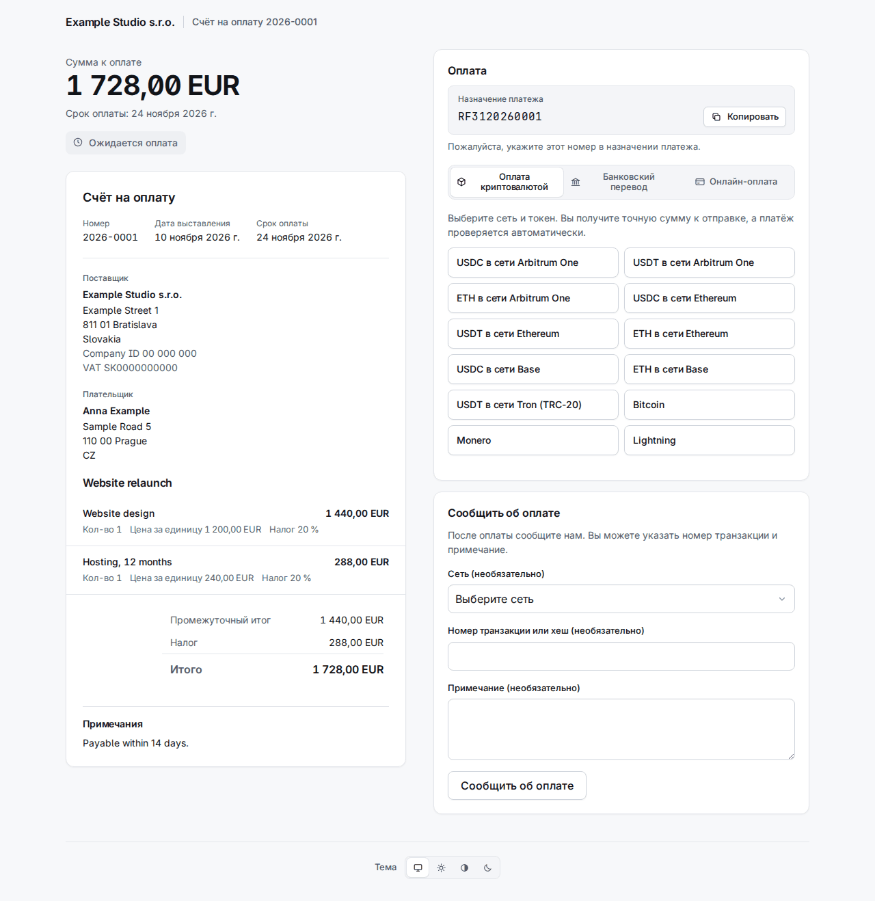

# 4. Счета

**Invoices** на панели перечисляет счета, самые новые первыми, с фильтром по статусу и по организации и поиском по номеру или внешней ссылке.

У счёта один из следующих статусов:

| Статус | Значение |
|---|---|
| `draft` | Не отправлен. Номера нет, его ещё можно править или удалить. |
| `sent` | Пронумерован и снабжён ссылками; ждёт денег. |
| `overdue` | Отправлен, и срок оплаты прошёл (статус меняет воркер). |
| `declared` | Клиент нажал «Сообщить об оплате». Это утверждение, а не деньги. |
| `partially_paid` | Подтверждённые платежи покрывают часть суммы. |
| `paid` | Подтверждённые платежи покрывают сумму. |
| `overpaid` | Подтверждённые платежи превышают сумму. |
| `void` | Аннулирован; оплатить его больше нельзя. |

Учитываются только **подтверждённые** платежи. Отправленный счёт больше нельзя править: то, что в нём написано, фиксируется в момент отправки, включая поставщика, покупателя и платёжные реквизиты, поэтому последующее изменение контакта или счёта никогда не меняет счёт, который уже у клиента.

## Создание счёта

**New invoice** спрашивает, кому, за что и как платить. Ничего не отправляется, пока вы не нажмёте Send на черновике.

- **Requesting organization** и **Type**: *Invoice* получает номер из нумерации организации; *Payment request* (запрос на оплату) номера не имеет и не является юридическим счётом.
- **Contact e-mail**: существующий контакт находится по нему, иначе из полей ниже создаётся новый. Отвечайте на **US tax resident** (yes, no или unknown) осознанно; «Choose…» не принимается. Ответ yes отправляет счёт эмитенту для США (глава 2): страница тогда сообщает «Issued by …».
- **Currency**, **Issue date**, **Due in (days)** (пусто: к оплате при получении), **Title** и **Notes** (печатаются на счёте).
- **Lines**: название, необязательное описание, количество, цена за единицу в основных единицах (`12.50`), налог % и скидка %. Пустые строки игнорируются.
- **Payment methods**: отмечен каждый активный способ эмитента, подходящий к валюте: его банковские счета в этой валюте, его фиатные ссылки, принимающие её, и все его аккаунты rail (котировка пересчитывает, поэтому подойдёт любая валюта). Снимите отметку с того, что не хотите предлагать.

**Create draft** сохраняет его. На странице черновика показаны позиции и итоги, есть **Edit this draft** и **Delete draft** и блок, который его отправляет.

## Отправка

**Send** нумерует счёт, фиксирует его и создаёт две **ссылки-полномочия** (capability links): одну для просмотра (`/i/…`) и одну для оплаты (`/p/…`). Это секреты: они хранятся только в виде хэшей и показываются только один раз.

- При отмеченном **E-mail the client when sent** письмо со счётом ставится в исходящую очередь (воркер отправляет его на языке контакта, с PDF во вложении) и содержит обе ссылки. Если у контакта есть активный ключ шифрования, письмо шифруется на него.
- **Без** отметки ничего не отправляется, и ссылки вы передаёте сами. Чтобы их увидеть, откройте счёт, **More actions > Reissue the client links** (ниже): страница покажет две ссылки один раз.

## Что видит клиент

**Страница счёта** `/i/…` показывает документ, PDF для скачивания и **Получать зашифрованные письма** (глава 3). **Страница оплаты** `/p/…` показывает сумму к оплате и способы оплаты. Она на языке контакта или браузера.

В блоке оплаты до трёх вкладок, **сначала криптовалюта**:

- **Оплата криптовалютой**: клиент выбирает сеть и токен, например «USDC on Arbitrum One».
- **Банковский перевод**: банковский счёт в валюте счёта (получатель, номер счёта, банк, сумма, у каждого кнопка копирования), **назначение платежа** (ссылка ISO 11649, например `RF3120260001`) и ваши инструкции на языке клиента. Для EUR на IBAN страны SEPA добавляются три QR-кода (PAY by square, QR Platba и EPC QR), для CZK на чешский IBAN добавляется код QR Platba: клиент сканирует один из них в банковском приложении, и счёт, оставшаяся сумма и назначение платежа заполняются сами. В PDF-счёте напечатаны те же коды.
- **Онлайн-оплата**: фиатные ссылки (Revolut, PayPal и так далее).

Охвачены все девять языков: та же страница на словацком, чешском, немецком, испанском, французском, польском, корейском и русском языках — в конце этой главы.

### Котировки и курсы обмена

Клиент в криптовалюте платит не «сумму счёта», а **котировку** (quote).

- Выбор сети и токена фиксирует курс обмена и показывает **точную сумму** к отправке, адрес, QR-код и ссылку «Open in wallet». Сумма округляется **вверх**, никогда не в меньшую сторону.
- Котировка действует около **30 минут**; страница ведёт обратный отсчёт, а **Получить новую сумму** выдаёт следующую.
- На общем адресе сумма содержит несколько единиц «пыли», **уникальных для каждой котировки**. Именно так платёж сопоставляется со счётом, поэтому клиент должен отправить ровно эту сумму в этом токене по этой сети.
- Курсы берутся из двух источников, которые сверяются друг с другом (Kraken и Coinbase); если они расходятся больше чем на 1 %, котировка не создаётся. Шаг от EUR к другим фиатным валютам использует курсы ЕЦБ через Frankfurter; устаревший или внезапно скакнувший курс приводит к отклонению котировок в этой валюте и появляется в Needs a person в разделе *Exchange rates refused*, где человек может принять скачок, если он реальный.
- Страница обновляется сама, когда перевод замечен. Воркер следит за блокчейном; платежи Lightning и BTCPay читаются из их шлюза.

Блок **Сообщить об оплате** позволяет клиенту сообщить о платеже (сеть, хэш транзакции и заметка, всё необязательно). Счёт получает статус `declared` и появляется в Needs a person; указанный хэш ищется в блокчейне. Заявление — это утверждение, а не деньги: само по себе оно ничего не закрывает.

## Запись платежа вручную

Банковский перевод или онлайн-оплата приходят туда, куда Sealbill не заглядывает. Когда деньги увидите **вы**, откройте счёт и нажмите **Record payment**: сумма, способ (*Bank transfer*, *Payment link* или *Recorded by hand*) и заметка. Платёж сразу подтверждается и учитывается. Сделать это может только человек; ни один API-токен не может.

Ошибочно записанный или возвращённый платёж отменяется кнопкой **Reverse** в его строке, для этого нужна причина.

## Частичные оплаты и переплаты

**Частичная.** Когда подтверждённые платежи покрывают лишь часть суммы, счёт становится `partially_paid`. Клиент получает письмо, где сказано, что поступило и сколько ещё осталось, а страница оплаты предлагает котировки на **остаток**. Частично оплаченный счёт аннулировать нельзя.

**Переплата.** Счёт можно переплатить двумя способами, и оба заканчиваются перед человеком (глава 6):

- *Записано больше денег, чем сумма* (банковский перевод или платёж, который вы записали вручную): счёт получает статус `overpaid` и попадает в очередь **Overpaid invoices**. Верните разницу вне системы либо нажмите **Keep the overpayment** и напишите причину. Счёт остаётся `overpaid`, как и говорят деньги; решение, покрываемая им сумма и ваша заметка попадают в журнал аудита, а запись уходит из очереди, пока не поступят ещё деньги.

  

- *Крипто-платёж сверх котировки*: счёт считается оплаченным, а у платежа появляется **refund due**, который перечислен в **Refunds due** с суммой и адресом, откуда он пришёл. После того как вы вернули её или решили не возвращать, нажмите **Refunded** с заметкой. Платёж, намного превышающий котировку (сверх *Overpayment ceiling* организации), вообще не засчитывается: он ждёт в **Payments to review**.

  

## Аннулирование

В **More actions** (три точки) есть **Void invoice** с обязательной причиной. Аннулированный счёт больше нельзя оплатить: его открытые котировки и открытые заявления закрываются, а страница клиента сообщает, что он аннулирован. В действии откажут, пока платёж подтверждается, и после того, как деньги подтверждены (сначала отмените этот платёж); счёт в статусе `paid`, `partially_paid` или `overpaid` аннулировать нельзя. Деньги, которые всё же придут позже по аннулированному счёту, не пропадают: они попадают в **Payments to review** с причиной «The invoice was already closed when the payment arrived.»

## Перевыпуск ссылок

Клиент потерял письмо или вы отправили без письма и вам нужны ссылки: **More actions > Reissue the client links**.

Перевыпуск **заменяет обе ссылки**: старые перестают работать, в том числе те, что уже лежат в почтовом ящике клиента, а ещё не отправленные письма со старыми ссылками отменяются. Отметьте **E-mail the new links to the client**, чтобы поставить письмо в очередь; иначе страница покажет две новые ссылки **один раз** и сообщит «Nothing was e-mailed: pass these on yourself.» У черновика или аннулированного счёта ссылки перевыпустить нельзя. Событие вебхука `invoice.links_reissued` сообщает интеграции, сохранившей старые ссылки, что они больше не работают.

## Напоминание через 30 дней

Если система отправила письмо со счётом, а счёт всё ещё не оплачен (`sent`, `overdue` или `partially_paid`) через **30 дней** после отправки, воркер отправляет **одно** напоминание, один раз. Напоминание **заменяет обе ссылки**, как описано выше.

- Число дней задаёт `INVOICE_REMINDER_DAYS`; `0` отключает напоминание.
- Оно пропускается для счёта, отправленного без письма, отправленного через API с `client_letters: false`, любого заказа по платёжной ссылке, счёта `declared`, счёта с открытой котировкой или с обнаруженным либо проверяемым платежом, налогового резидента США у эмитента не из США (такой счёт находится в очереди «wrong issuer») и контакта, у которого сбойнул ключ шифрования. Пропущенный счёт рассматривается снова при следующем запуске.
- Задача выполняется при запуске воркера и затем каждые 24 часа, так что воркер, который был остановлен, догоняет всё, что удовлетворяет условиям, каким бы старым ни был счёт. Если при запуске хранилище запечатано, она ничего не делает и пробует снова через 24 часа.

## Та же страница на девяти языках

Каждый язык показывает страницу счёта и страницу оплаты демонстрационного счёта. Собственный текст счёта (позиции, заметки) — на том языке, на котором вы его ввели; рамка вокруг него переведена.

| | Страница счёта | Страница оплаты |
|---|---|---|
| English | [изображение](../img/portal-invoice-en.png) | [изображение](../img/portal-pay-en.png) |
| Slovenčina | [изображение](../img/portal-invoice-sk.png) | [изображение](../img/portal-pay-sk.png) |
| Čeština | [изображение](../img/portal-invoice-cs.png) | [изображение](../img/portal-pay-cs.png) |
| Deutsch | [изображение](../img/portal-invoice-de.png) | [изображение](../img/portal-pay-de.png) |
| Español | [изображение](../img/portal-invoice-es.png) | [изображение](../img/portal-pay-es.png) |
| Français | [изображение](../img/portal-invoice-fr.png) | [изображение](../img/portal-pay-fr.png) |
| Polski | [изображение](../img/portal-invoice-pl.png) | [изображение](../img/portal-pay-pl.png) |
| 한국어 | [изображение](../img/portal-invoice-ko.png) | [изображение](../img/portal-pay-ko.png) |
| Русский | [изображение](../img/portal-invoice-ru.png) | [изображение](../img/portal-pay-ru.png) |

Счета в других состояниях выглядят для клиента так:

