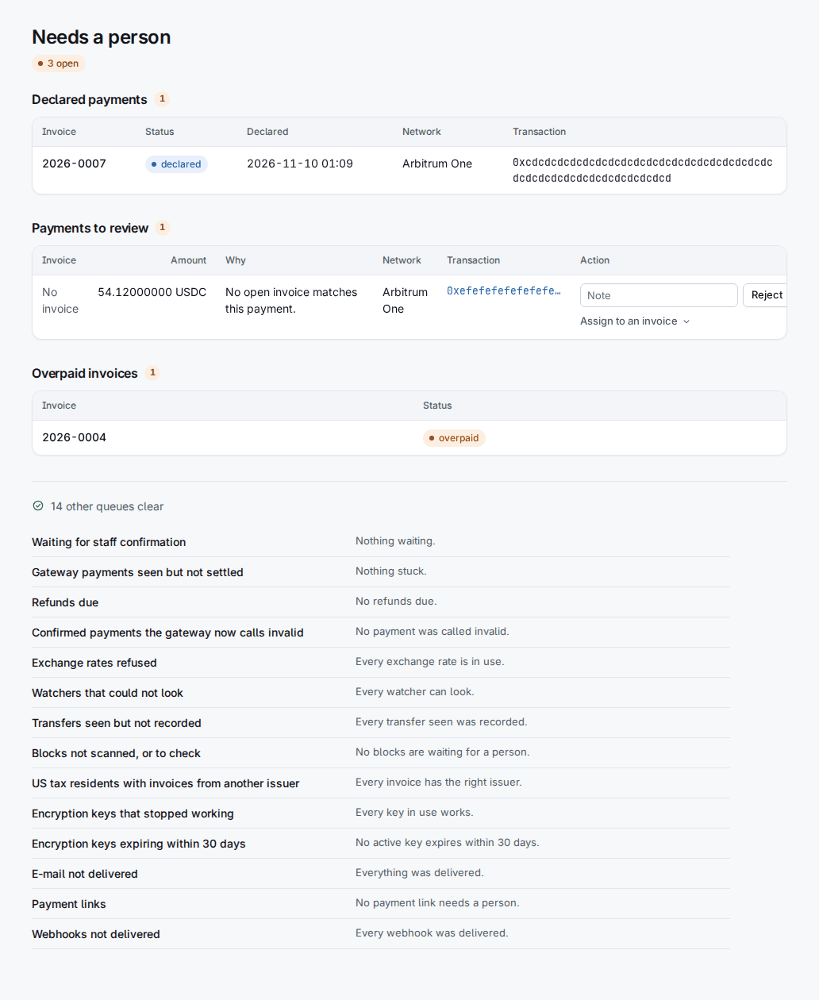
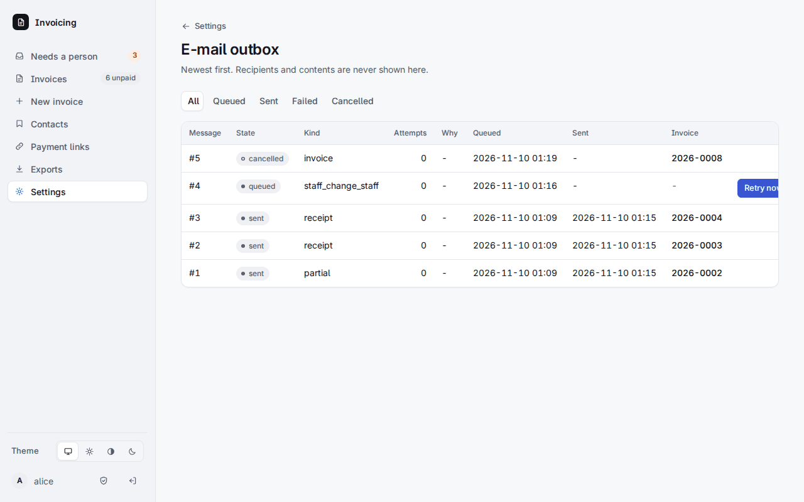
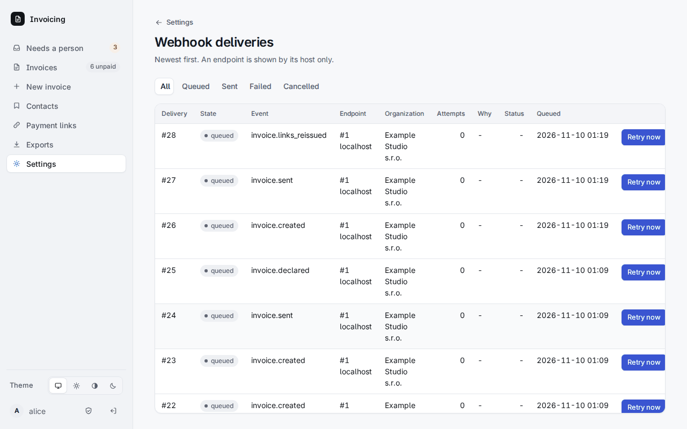

# 6. Needs a person

**Needs a person** — первая страница, и именно за ней стоит следить. Она перечисляет то, что ни одна программа не должна решать сама. Панель показывает, сколько записей открыто; если делать нечего, страница так и пишет.

Очереди показываются, только когда в них есть записи; **Show N queues** перечисляет и пустые, чтобы вы видели, за чем следит страница.

| Очередь | Что это и что делать |
|---|---|
| **Declared payments** | Клиент нажал «Сообщить об оплате» по счёту. Проверьте банк или блокчейн. Запись платежа в счёте закрывает заявление; **Dismiss declaration** в счёте закрывает ложное. |
| **Payments to review** | Деньги, которые не совпали ни с одним счётом или совпали плохо, с причиной: токен не принимается, ни один открытый счёт не подходит, может подойти более одного, пришли после истечения котировки, дубликат, намного больше долга, счёт уже был закрыт, очень маленький перевод-«пыль» (вероятно, спам address poisoning, свёрнут), отброшенная транзакция или сообщение BTCPay о частичном, запоздалом, недействительном или отмеченном вручную счёте. **Confirm** относит платёж к его счёту, **Reject** — с заметкой, **Assign to an invoice** — номер счёта, сумма и заметка. С переводом в блокчейне можно работать, когда он финализирован. |
| **Waiting for staff confirmation** | Платежи Monero и Zcash (через BTCPay) и деньги, записанные вручную: за ними никто не следит, поэтому проверьте кошелёк или банк, затем **Confirm** или **Reject**. Подтвердить может только человек; ни один API-токен не может. |
| **Gateway payments seen but not settled** | Платежи BTCPay или Lightning, которые шлюз увидел более шести часов назад и не закрыл. |
| **Refunds due** | Крипто-платёж сверх котировки. Верните разницу на указанный адрес, затем **Refunded** с заметкой. |
| **Confirmed payments the gateway now calls invalid** | BTCPay закрыл его, а потом назвал недействительным (двойная трата, реорганизация). Код ничего не отменяет: отмените платёж в его счёте или оставьте его. |
| **Exchange rates refused** | Фиатная часть курсов устарела или скакнула. Проверьте курс ЕЦБ; **accept** скачок, если он реальный. Крипто-котировки в этой валюте тем временем отклоняются. |
| **Watchers that could not look** | Читатель блокчейна или шлюза даёт сбой десять минут или дольше (сотрудникам также ушло письмо). |
| **Transfers seen but not recorded** | Перевод, который увидел вотчер, пока не удалось записать; запись повторяется при каждом проходе. |
| **Blocks not scanned, or to check** | Диапазон блоков был пропущен. Проверьте его вручную, затем **Acknowledge** с тем, что вы проверили. |
| **Overpaid invoices** | Верните вне системы или **Keep the overpayment** (глава 4). |
| **US tax residents with invoices from another issuer** | Аннулируйте счёт и создайте заново; тогда его выставит организация для США. |
| **Encryption keys that stopped working** / **expiring within 30 days** | Глава 3. |
| **E-mail not delivered** | Сообщение, которое не удавалось доставить около шестнадцати часов. **Retry** либо **Dismiss** с причиной (тогда оно отменено навсегда). |
| **Payment links** | Оплаченный заказ превысил лимит ссылки, эмитент не предлагает ни одного из способов ссылки, введённый ответ о США противоречит сохранённому или ни одна организация не является эмитентом для США. Нажмите **Resolved** с тем, что вы проверили. |
| **Webhooks not delivered** | Доставка, которая не удалась после всех повторов. **Retry** либо **Dismiss** с причиной. |

Через всю страницу проходят два правила:

- Платёж, который **ждёт человека**, подтверждает или назначает только вошедший сотрудник. Токен, даже `admin`, получает `409 needs_person`, и ничего не меняется. Запись ручного платежа — тоже дело человека.
- Каждое действие запрашивает заметку там, где это важно, и каждое действие попадает в журнал аудита.

Те же очереди можно разбирать через API с `payments:confirm`, кроме тех, что только для человека (глава 9). Два списка, которые вы используете, чтобы выяснить, *почему* что-то застряло, — это **Settings > E-mail outbox** (каждое письмо со статусом, числом попыток и причиной сбоя; получатели и содержимое никогда не показываются) и **Settings > Webhook deliveries**.

