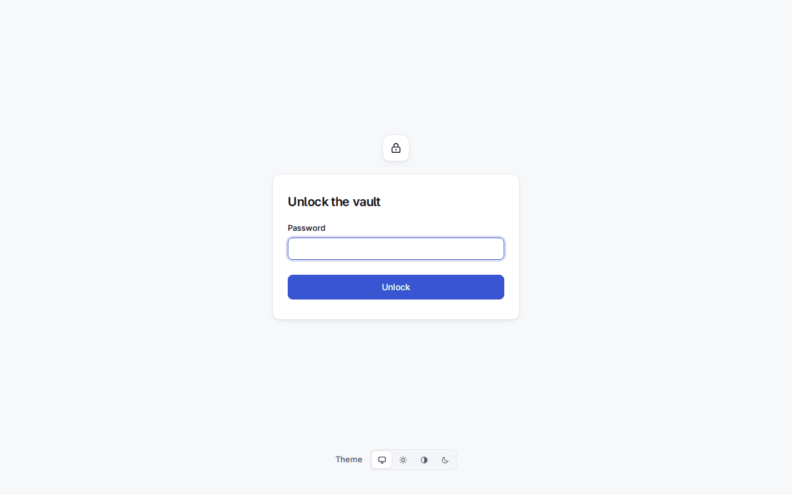
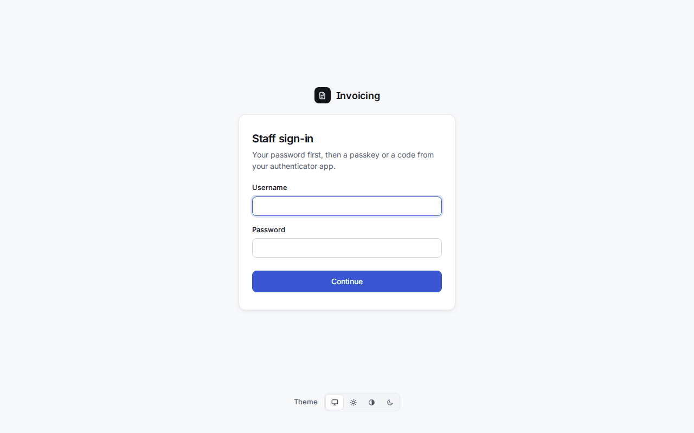
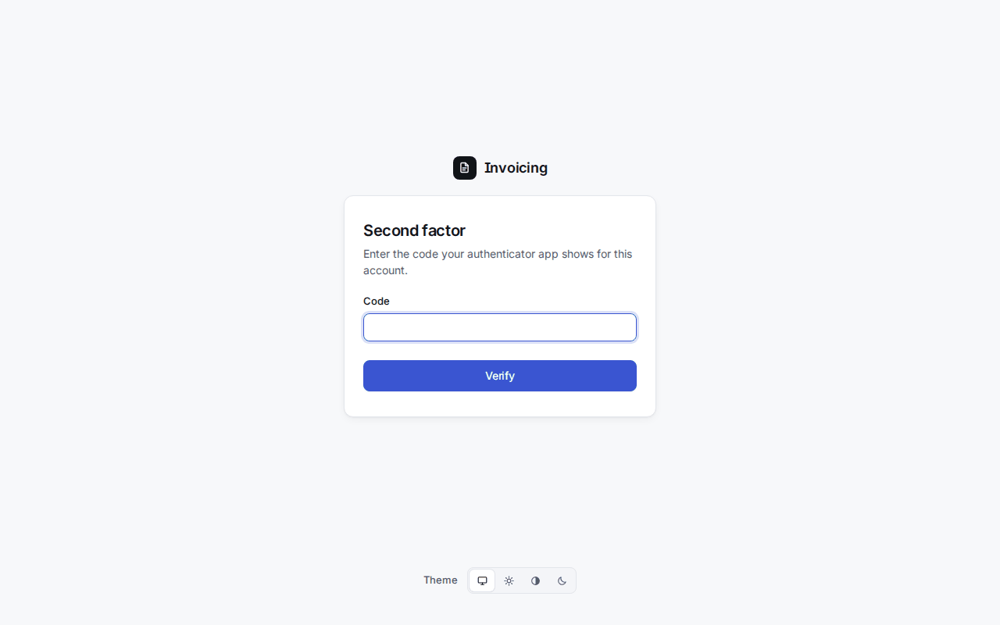
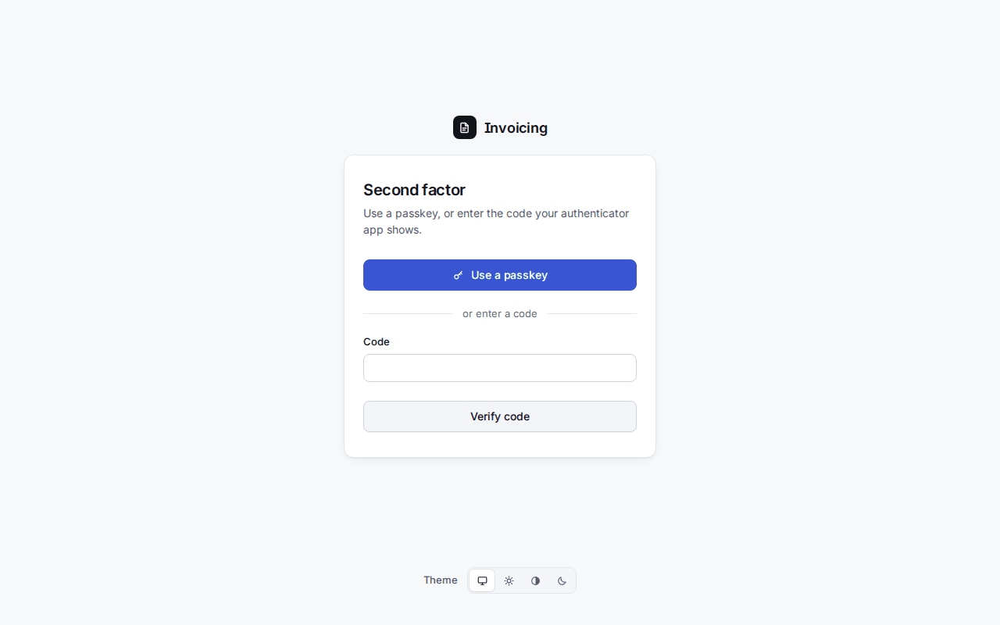
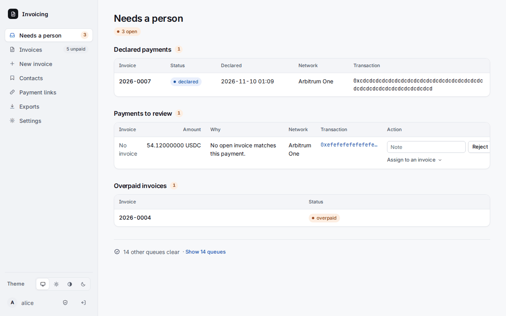
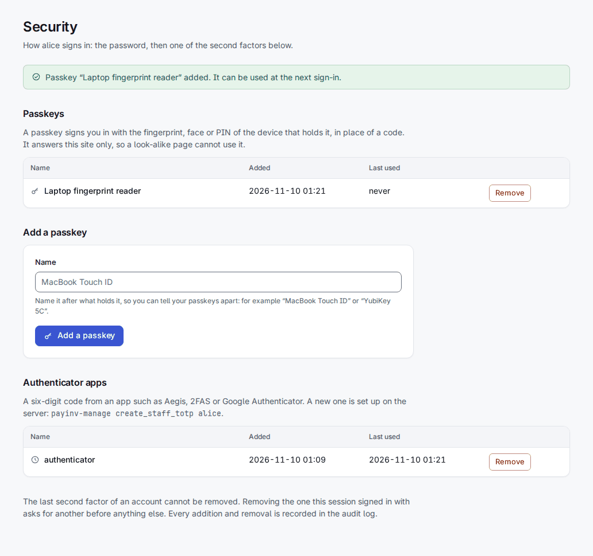
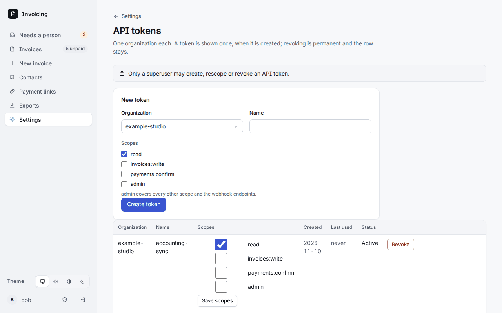
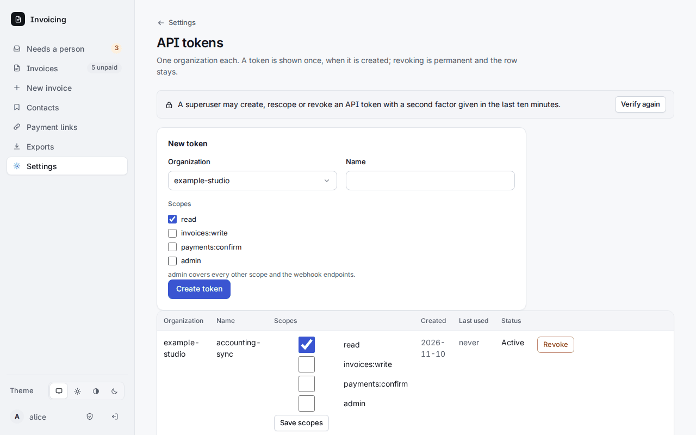
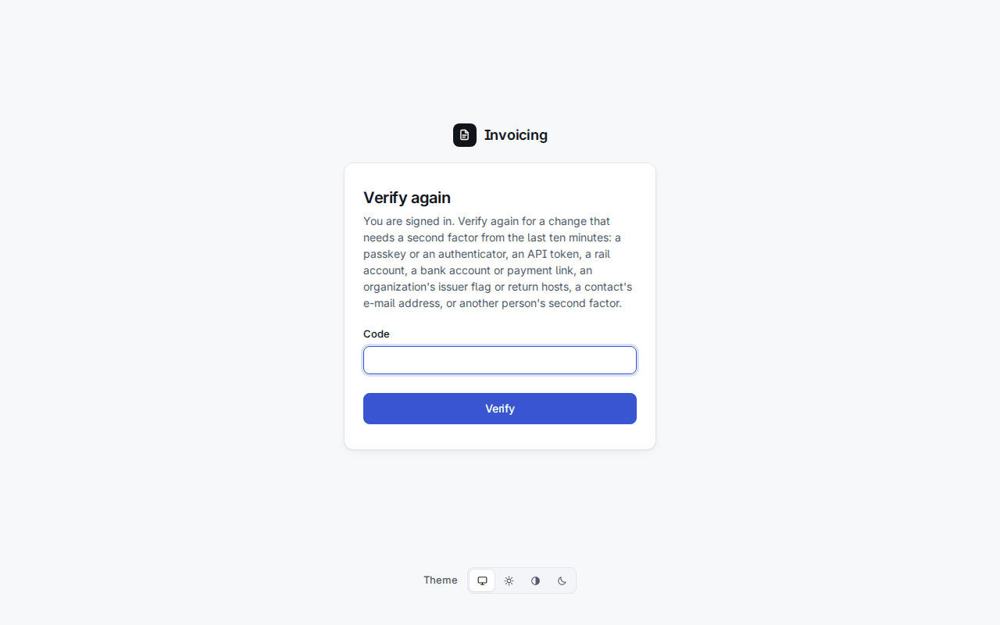

# 1. Začíname

## Čo prevádzkujete

Sealbill je jedna webová aplikácia a jeden worker na pozadí.

- **Webová aplikácia** obsluhuje stránky pre zamestnancov (v koreni webu, napr. `https://pay.example.org/`), stránky pre klienta (`/i/…` zobrazí faktúru, `/p/…` je miesto, kde sa platí, `/l/…` je platobný odkaz), API (`/api/v1/…`) a stránku odomknutia (`/unlock/`).
- **Worker** (`manage.py run_worker`) robí všetko, čo sa musí diať bez kliknutia: odosiela e-maily z fronty, označuje faktúry po splatnosti, sleduje blockchainy a brány kvôli platbám, ukončuje kurzové ponuky, posiela jednu pripomienku platby a doručuje webhooky. **Bez workera sa nič neodosiela a nezaznamená sa žiadna krypto platba.** Spúšťajte ho ako druhý proces vedľa webovej aplikácie; `manage.py run_worker --once` vykoná každú úlohu raz a skončí, čo sa hodí na test.

## Inštalácia a prvé spustenie

README repozitára obsahuje príkazy pre každý spôsob prevádzky, preto ich tu neopakujeme:

- na vlastnom počítači, na vyskúšanie: [README, Development](../../../README.md#development)
- s Docker Compose: [README, Docker Compose](../../../README.md#docker-compose)
- na serveri so systemd, Apache a PostgreSQL: [README, Deploying with systemd and Apache](../../../README.md#deploying-with-systemd-and-apache)

Nech zvolíte čokoľvek, poradie prvého spustenia je rovnaké:

1. Vytvorte databázové tabuľky (`migrate` a `createcachetable` pre tabuľky s limitmi požiadaviek).
2. Vytvorte trezor a odomknite ho (ďalšia časť).
3. Vytvorte prvého používateľa príkazom `manage.py createsuperuser`.
4. Dajte mu druhý faktor: `manage.py create_staff_totp <username>` vypíše adresu `otpauth://` pre aplikáciu autentifikátora. Trezor musí byť odomknutý. Passkey môžete pridať neskôr na stránke Security.
5. Spustite webovú aplikáciu a workera, otvorte stránku a prihláste sa.
6. V **Settings** vytvorte organizáciu a bankový účet alebo platobný kanál (kapitola 2) a pošlite si prvú faktúru (kapitola 4).

## Trezor

Všetko, čo človek napísal (mená, adresy, daňové identifikátory, položky faktúr, poznámky, prístupové údaje vašich platobných brán), je uložené zašifrované. Kľúč sa odvodzuje z **hesla trezoru** a je uložený iba v súbore v pamäti určenom cestou `VAULT_KEY_PATH`; nikdy nie v prostredí ani na disku.

```bash
printf '%s\n' 'a long vault password' | manage.py init_vault      # raz; aspoň 16 znakov
printf '%s\n' 'a long vault password' | manage.py unseal_vault    # po každom reštarte stroja
```

Heslo zadávajte na štandardný vstup, ako vyššie, aby sa nikdy neobjavilo v príkazovom riadku ani v histórii shellu. `init_vault` iba vytvorí `vault.json` (soľ a kontrolnú hodnotu, nie kľúč); `unseal_vault` ho otvorí.

Po reštarte stroja alebo po vymazaní súboru v pamäti je trezor **zapečatený**. Postupné opätovné načítanie webovej služby ho nechá otvorený; tvrdý reštart nie. Kým je zapečatený:

- každá stránka pre zamestnancov presmeruje na **/unlock/**: zadajte tam heslo trezoru alebo spustite `unseal_vault`;
- platobné stránky, platobné odkazy a API odpovedajú „dočasne nedostupné" (503), takže žiaden klient nezíska kurzovú ponuku;
- worker stále vidí a páruje platby na blockchaine (číta iba nešifrované stĺpce), no e-maily a webhooky čakajú a sledovanie brán (BTCPay, Lightning) sa pozastaví; operátor dostane jeden upozorňujúci e-mail za každú zapečatenú epizódu.



`GET /healthz` hlási `"vault": "sealed"` alebo `"unsealed"` bez akýchkoľvek dát, takže ho môže sledovať monitoring. Uchovajte kópiu `vault.json`, zálohovaciu frázu a heslo trezoru niekde mimo servera: databázu bez všetkých troch nemožno prečítať. Úplný zoznam toho, čo beží pri zapečatenom trezore, je v [README](../../../README.md#what-runs-while-the-vault-is-sealed).

## Prihlásenie

Zamestnanci sa prihlasujú na `/login/` v dvoch krokoch: **heslo** a potom **druhý faktor**, ktorým je passkey alebo šesťmiestny kód z aplikácie autentifikátora. Relácia trvá osem hodín a končí zatvorením prehliadača. Prihlásenie má obmedzený počet pokusov na adresu, na účet a na zariadenie.





Ak má účet passkey, druhý krok ponúkne najprv **Use a passkey** a pod ním pole na kód („or enter a code"). Passkey patrí iba tejto stránke, takže ho nemôže použiť falošná stránka.



Po prihlásení sa dostanete na **Needs a person** (kapitola 6). Pruh vľavo je celá navigácia: Needs a person, Invoices, New invoice, Contacts, Payment links, Exports, Settings; štít dole je **Security**, šípka vás odhlási.



### Security: vlastné passkeys a autentifikátory

**Security** (ikona štítu) vypisuje vaše druhé faktory. Passkey pridáte tak, že mu dáte meno (napr. „MacBook Touch ID" alebo „YubiKey 5C") a stlačíte **Add a passkey**; prehliadač sa potom spýta na odtlačok, tvár alebo PIN. Aplikácia autentifikátora sa pridáva na serveri príkazom `create_staff_totp`, nikdy v prehliadači. Posledný druhý faktor účtu nemožno odstrániť a odstránenie faktora, ktorým je prihlásená aktuálna relácia, najprv vyžaduje iný. Každé pridanie aj odstránenie je v audit logu.



## Zamestnanci a superužívatelia

Každý s účtom zamestnanca môže vystavovať faktúry, zaznamenávať platby a vybavovať fronty. Niektoré zmeny môžu presunúť peniaze alebo presmerovať klienta, a tie vyžadujú viac.

### Zosilnené overenie (step-up)

Tieto zmeny vyžadujú **superužívateľa**, ktorý dal druhý faktor **v posledných desiatich minútach**:

- vytvorenie, zmena rozsahov (scopes) alebo zrušenie API tokenu;
- účet platobného kanála a jeho prístupové údaje (a webhook BTCPay, ktorý ukladá tajomstvo);
- príznak vystavovateľa pre amerických daňových rezidentov a návratové hosty organizácie;
- bankový účet alebo fiat platobný odkaz organizácie;
- vytvorenie alebo zmazanie webhooku (kam idú udalosti organizácie);
- pridanie e-mailovej adresy ku kontaktu alebo jej nastavenie ako primárnej (idú na ňu e-maily, platobné odkazy a PDF);
- odstránenie druhého faktora iného zamestnanca.

Stránky povedia, ako na tom ste, ešte skôr, než niečo stlačíte:

- zamestnanec, ktorý nie je superužívateľ, uvidí „Only a superuser may …" a nič sa nezmení;

  

- superužívateľ, ktorého posledný druhý faktor je starší ako desať minút, uvidí **Verify again**; tlačidlo vedie na overovaciu stránku a vráti vás na pôvodnú stránku.

  

  

Každá zmena so zosilneným overením pošle aj e-mail každému aktívnemu superužívateľovi: kto, čo a kedy, podľa mien a id, nikdy nie tajomstvo, číslo účtu ani adresa. Ak ukradnutá relácia niečo zmení, vlastník systému sa to dozvie.

Stránka **Team** (Settings > Team) vypisuje všetkých, ktorí sa môžu prihlásiť, ich druhé faktory a posledné prihlásenie, a superužívateľovi umožňuje odstrániť stratený faktor kolegu. Nových zamestnancov vytvoríte príkazom `createsuperuser` alebo v skrytom Django admine (cesta v `DJANGO_ADMIN_PATH`; iba superužívateľ s druhým faktorom, ostatní dostanú 404).
