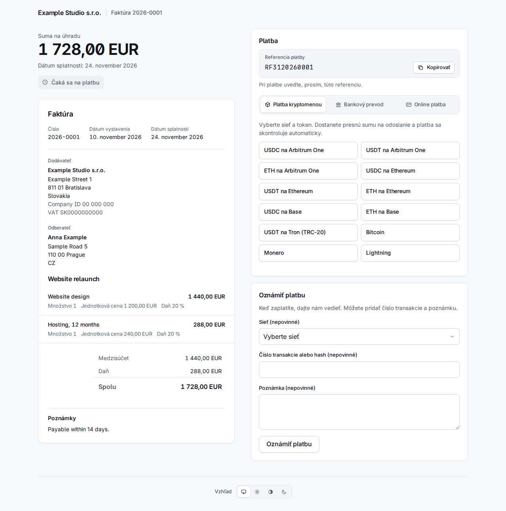

# 4. Faktúry

**Invoices** v pruhu vľavo ich vypisuje od najnovších, s filtrom podľa stavu a organizácie a vyhľadávaním podľa čísla alebo externej referencie.

Faktúra má jeden z týchto stavov:

| Stav | Význam |
|---|---|
| `draft` | Neodoslaná. Nemá číslo a dá sa upraviť alebo zmazať. |
| `sent` | Očíslovaná a s odkazmi; čaká na peniaze. |
| `overdue` | Odoslaná a splatnosť uplynula (stav mení worker). |
| `declared` | Klient stlačil „Oznámiť platbu". To je tvrdenie, nie peniaze. |
| `partially_paid` | Potvrdené platby pokrývajú časť sumy. |
| `paid` | Potvrdené platby pokrývajú celú sumu. |
| `overpaid` | Potvrdené platby presahujú sumu. |
| `void` | Stornovaná; nemožno ju už zaplatiť. |

Počítajú sa iba **potvrdené** platby. Odoslanú faktúru už nemožno upraviť: jej obsah sa zmrazí v okamihu odoslania vrátane dodávateľa, odberateľa a platobných údajov, takže neskoršia zmena kontaktu alebo účtu nikdy nezmení faktúru, ktorú už klient má.

## Vytvorenie faktúry

**New invoice** sa pýta, kto, čo a ako sa má platiť. Nič sa neodošle, kým nestlačíte Send na koncepte.

- **Requesting organization** a **Type**: *Invoice* dostane číslo z číslovania organizácie; *Payment request* (žiadosť o platbu) nemá číslo a nie je právny doklad faktúry.
- **Contact e-mail**: existujúci kontakt sa nájde podľa neho, inak sa z polí nižšie vytvorí nový. Na **US tax resident** (yes, no alebo unknown) odpovedzte vedome; „Choose…" sa neprijme. Odpoveď yes pošle faktúru vystavovateľovi pre USA (kapitola 2): stránka potom hlási „Issued by …".
- **Currency**, **Issue date**, **Due in (days)** (prázdne: splatné pri prijatí), **Title** a **Notes** (tlačia sa na faktúre).
- **Lines**: názov, voliteľný popis, množstvo, jednotková cena v hlavných jednotkách (`12.50`), daň % a zľava %. Prázdne riadky sa ignorujú.
- **Payment methods**: zaškrtnutá je každá aktívna metóda vystavovateľa, ktorá sa hodí k mene: jeho bankové účty v tejto mene, jeho fiat odkazy, ktoré ju prijímajú, a všetky jeho platobné kanály (kurzová ponuka prepočíta, takže funguje akákoľvek mena). Čo nechcete ponúkať, odškrtnite.

**Create draft** ho uloží. Stránka konceptu ukazuje položky a súčty, má **Edit this draft** a **Delete draft** a políčko, ktoré ho odošle.

## Odoslanie

**Send** faktúru očísluje, zmrazí a vytvorí dva **odkazy s oprávnením** (capability links): jeden na zobrazenie (`/i/…`) a jeden na zaplatenie (`/p/…`). Sú to tajomstvá: ukladajú sa iba ako hashe a zobrazia sa len raz.

- So zaškrtnutým **E-mail the client when sent** sa e-mail s faktúrou zaradí do odchádzajúcej pošty (odošle ho worker, v jazyku kontaktu, s PDF v prílohe) a nesie oba odkazy. Ak má kontakt aktívny šifrovací kľúč, e-mail sa naň zašifruje.
- **Bez** zaškrtnutia sa nič neodošle a odkazy odovzdáte sami. Aby ste ich videli, otvorte faktúru, **More actions > Reissue the client links** (nižšie): stránka ukáže dva odkazy raz.

## Čo vidí klient

**Stránka faktúry** `/i/…` ukazuje doklad, PDF na stiahnutie a **Dostávať šifrované e-maily** (kapitola 3). **Platobná stránka** `/p/…` ukazuje splatnú sumu a spôsoby platby. Je v jazyku kontaktu alebo prehliadača.

Platobné okno má až tri záložky, **krypto prvé**:

- **Platba kryptomenou**: klient vyberie sieť a token, napr. „USDC on Arbitrum One".
- **Bankový prevod**: bankový účet v mene faktúry (príjemca, číslo účtu, banka, suma, každé s tlačidlom kopírovania), **referencia platby** (referencia ISO 11649 napr. `RF3120260001`) a vaše pokyny v jazyku klienta. Pri EUR na IBAN krajiny SEPA pribudnú tri QR kódy (PAY by square, QR Platba a EPC QR), pri CZK na český IBAN kód QR Platba: klient jeden naskenuje v bankovej aplikácii a účet, zostávajúca suma aj referencia sa vyplnia samy. Rovnaké kódy sú vytlačené aj na PDF faktúre.
- **Online platba**: fiat odkazy (Revolut, PayPal a pod.).

Pokryté je všetkých deväť jazykov: tá istá stránka po slovensky, česky, nemecky, španielsky, francúzsky, poľsky, kórejsky a rusky je na konci tejto kapitoly.

### Kurzové ponuky a výmenné kurzy

Klient v kryptomene neplatí „sumu faktúry": platí **kurzovú ponuku** (quote).

- Výberom siete a tokenu sa zafixuje výmenný kurz a zobrazí sa **presná suma** na odoslanie, adresa, QR kód a odkaz „Open in wallet". Suma sa zaokrúhľuje **nahor**, nikdy nie na menej.
- Ponuka platí asi **30 minút**; stránka odpočítava a **Získať novú sumu** vydá ďalšiu.
- Na zdieľanej adrese nesie suma pár jednotiek „prachu", **jedinečných pre každú ponuku**. Takto sa platba páruje s faktúrou, preto musí klient poslať presne túto sumu v tomto tokene v tejto sieti.
- Kurzy pochádzajú z dvoch zdrojov, ktoré sa krížovo kontrolujú (Kraken a Coinbase); ak sa líšia o viac než 1 %, ponuka sa nevytvorí. Krok z EUR na iné fiat meny používa kurzy ECB cez Frankfurter; zastaraný alebo náhle skočivší kurz odmietne ponuky v danej mene a zobrazí sa v Needs a person v časti *Exchange rates refused*, kde človek môže prijať skok, ktorý je skutočný.
- Stránka sa aktualizuje sama, keď sa prevod zaznamená. Worker sleduje blockchain; platby cez Lightning a BTCPay sa čítajú z ich brány.

Pole **Oznámiť platbu** umožňuje klientovi nahlásiť platbu (sieť, hash transakcie a poznámku, všetko voliteľné). Faktúra sa stane `declared` a objaví sa v Needs a person; zadaný hash sa vyhľadá na blockchaine. Vyhlásenie je tvrdenie, nie peniaze: samo nič nevyrovná. E-mail príde zamestnancom len vtedy, keď treba konať: hneď, keď tvrdenie môže overiť iba človek (bez hashu alebo na sieti, ktorú systém nečíta), alebo keď peniaze z uvedenej transakcie patria inej faktúre, a po pol hodine, keď sa hash nenašiel. Hash, ktorého peniaze patria tejto faktúre, e-mail nepošle: platba sa vyrovná sama, alebo ide na kontrolu, o ktorej príde vlastný e-mail.

## Ručné zaznamenanie platby

Bankový prevod alebo online platba dorazí tam, kam Sealbill nevidí. Keď peniaze uvidíte **vy**, otvorte faktúru a stlačte **Record payment**: suma, spôsob (*Bank transfer*, *Payment link* alebo *Recorded by hand*) a poznámka. Platba je ihneď potvrdená a započítaná. Môže to urobiť iba človek; žiaden API token nie.

Nesprávne zaznamenaná alebo vrátená platba sa zruší tlačidlom **Reverse** na jej riadku, ktoré vyžaduje dôvod.

## Čiastočné platby a preplatky

**Čiastočná.** Keď potvrdené platby pokrývajú len časť sumy, faktúra sa stane `partially_paid`. Klient dostane e-mail, ktorý hovorí, čo dorazilo a čo ešte treba zaplatiť, a platobná stránka ponúka ponuky na **zvyšok**. Čiastočne zaplatenú faktúru nemožno stornovať.

**Preplatok.** Faktúra môže byť preplatená dvoma spôsobmi a obidva skončia pred človekom (kapitola 6):

- *Zaznamenalo sa viac peňazí, než je suma* (bankový prevod alebo platba, ktorú ste zaznamenali ručne): faktúra je `overpaid` a je vo fronte **Overpaid invoices**. Rozdiel vráťte mimo systému, alebo stlačte **Keep the overpayment** a napíšte prečo. Faktúra zostane `overpaid`, čo vyjadruje stav peňazí; rozhodnutie, suma, ktorú pokrýva, a vaša poznámka idú do audit logu a položka opustí frontu, kým nepríde ďalšia platba.

  

- *Krypto platba nad kurzovú ponuku*: faktúra je zaplatená a platba dostane **refund due**, zobrazenú vo fronte **Refunds due** so sumou a adresou, z ktorej prišla. Keď ste ju poslali späť alebo rozhodli, že nie, stlačte **Refunded** s poznámkou. Platba ďaleko nad ponukou (nad *Overpayment ceiling* organizácie) sa neuhradí vôbec: čaká v **Payments to review**.

  

## Storno

**More actions** (tri bodky) má **Void invoice** s povinným dôvodom. Stornovanú faktúru už nemožno zaplatiť: jej otvorené ponuky a otvorené vyhlásenia sa zatvoria a stránka klienta hlási, že je stornovaná. Odmietne sa, kým sa platba potvrdzuje a keď už boli potvrdené peniaze (najprv platbu zrušte); faktúru `paid`, `partially_paid` alebo `overpaid` stornovať nemožno. Peniaze, ktoré neskôr predsa len prídu na stornovanú faktúru, sa nestratia: skončia v **Payments to review** s dôvodom „The invoice was already closed when the payment arrived."

## Nové odkazy

Klient stratil e-mail alebo ste odoslali bez e-mailu a odkazy potrebujete: **More actions > Reissue the client links**.

Opätovné vydanie **nahradí oba odkazy**: staré prestanú fungovať, aj tie, ktoré už sú v klientovej schránke, a e-maily ešte neodoslané so starými odkazmi sa zrušia. Zaškrtnutím **E-mail the new links to the client** zaradíte e-mail; inak stránka ukáže dva nové odkazy **raz** a napíše „Nothing was e-mailed: pass these on yourself." Koncept ani stornovaná faktúra nové odkazy mať nemôžu. Udalosť webhooku `invoice.links_reissued` oznámi integrácii, ktorá uložila staré odkazy, že sú mŕtve.

## Pripomienka po 30 dňoch

Ak systém odoslal e-mail s faktúrou a faktúra je 30 dní po odoslaní stále nezaplatená (`sent`, `overdue` alebo `partially_paid`), worker pošle **jednu** pripomienku, raz. Pripomienka **nahradí oba odkazy**, ako vyššie.

- Počet dní nastavuje `INVOICE_REMINDER_DAYS`; `0` pripomienku vypne.
- Preskočí sa pri faktúre odoslanej bez e-mailu, pri faktúre odoslanej cez API s `client_letters: false`, pri každej objednávke z platobného odkazu, pri faktúre `declared`, pri faktúre s otvorenou ponukou alebo zaznamenanou či posudzovanou platbou, pri americkom daňovom rezidentovi u vystavovateľa mimo USA (táto faktúra je vo fronte „wrong issuer") a pri kontakte, ktorého šifrovací kľúč zlyhal. Preskočená faktúra sa posúdi znova pri ďalšom behu.
- Úloha beží pri štarte workera a potom každých 24 hodín, takže worker, ktorý bol vypnutý, dobehne všetko, čo spĺňa podmienky, nech je faktúra akokoľvek stará. Ak je pri štarte trezor zapečatený, nespraví nič a skúsi to o 24 hodín.

## Tá istá stránka v deviatich jazykoch

Každý jazyk ukazuje stránku faktúry a platobnú stránku ukážkovej faktúry. Vlastný text faktúry (položky, poznámky) je v jazyku, v akom ste ho napísali; rámec okolo je preložený.

| | Stránka faktúry | Platobná stránka |
|---|---|---|
| English | [obrázok](../img/portal-invoice-en.png) | [obrázok](../img/portal-pay-en.png) |
| Slovenčina | [obrázok](../img/portal-invoice-sk.png) | [obrázok](../img/portal-pay-sk.png) |
| Čeština | [obrázok](../img/portal-invoice-cs.png) | [obrázok](../img/portal-pay-cs.png) |
| Deutsch | [obrázok](../img/portal-invoice-de.png) | [obrázok](../img/portal-pay-de.png) |
| Español | [obrázok](../img/portal-invoice-es.png) | [obrázok](../img/portal-pay-es.png) |
| Français | [obrázok](../img/portal-invoice-fr.png) | [obrázok](../img/portal-pay-fr.png) |
| Polski | [obrázok](../img/portal-invoice-pl.png) | [obrázok](../img/portal-pay-pl.png) |
| 한국어 | [obrázok](../img/portal-invoice-ko.png) | [obrázok](../img/portal-pay-ko.png) |
| Русский | [obrázok](../img/portal-invoice-ru.png) | [obrázok](../img/portal-pay-ru.png) |

Faktúry v iných stavoch vyzerajú pre klienta takto:

